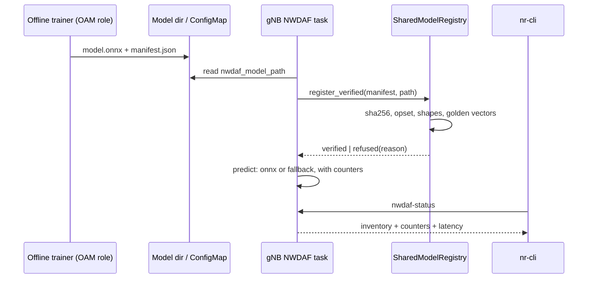

# D440B: verified OAM-style model loading with serving counters

Demo key `d440b-model-verify`, ticket
[nextgsim#463](https://github.com/NextgCoreLab/nextgsim/issues/463), program
anchor [nextgsim#458](https://github.com/NextgCoreLab/nextgsim/issues/458).

## Purpose

To give every model-based demo (#462, #467, #474, #486) one shared, verifiable
proof that a specific model artefact was checked, activated and actually served
live inferences, so that no demo can pass on a silent fallback.

- **Success signal:** the gNB logs
  `NWDAF: model verified id=.. version=.. sha256=<pinned> ... golden=ok`, and
  `nwdaf-status` shows `onnx_inferences > 0` and `fallback_inferences = 0`. A
  copy with one byte flipped logs `model refused (sha256 mismatch)`.
- **Not the point:** this is not a model-accuracy result, not a TS 28.105 MnS
  implementation, and not a viewer-facing demo. It is a feature and groundwork
  ticket.

## How it works



### Components

| Piece | Where | What it does |
|---|---|---|
| Reference model and manifest | `tools/d440b-model/` | `make_reference_model.py` plays the OAM role (TS 38.300 §16.20.2: training in the OAM, inference in the NG-RAN node). It writes `nwdaf-trajectory-cv.onnx` and `nwdaf-trajectory-cv.manifest.json` using only the standard library, and `--check` proves the committed files are byte-identical to what it writes. |
| Manifest checks | `nextgsim-ai/src/manifest.rs` | Checks the sha256 over the file, then the default-domain opset and the graph input and output signature (read from the ONNX protobuf without ONNX Runtime), then every golden vector within `tolerance` on ONNX Runtime. Each failed check has its own reason: `sha256 mismatch`, `opset mismatch`, `input shape mismatch`, `output shape mismatch`, `golden mismatch`, as well as `manifest invalid`, `model unreadable`, `not an onnx model`, `runtime unavailable` and `load failed`. |
| Verified registration | `SharedModelRegistry::register_verified` | Reads the file once and runs every check on those bytes. Only a model that passes is registered, and the engine that serves predictions is the one the golden vectors ran on. |
| Serving counters | `nextgsim-nwdaf/src/serving.rs` | Counts every trajectory prediction by the method that produced it (`onnx_inferences`, `fallback_inferences`) with p50/p99 latency, plus `measurements_recorded`. |
| `nwdaf-status` | gNB App task to NWDAF task | One line of JSON (`schema: nextgsim.nwdaf-status/1`) carrying `verified`, the model state, the counters, the latency and an inventory entry shaped like TS 28.105 `MLModel-Single` (`mLModelId`, `mLModelVersion`, `aIMLInferenceName`, `mLTrainingType`). |

The manifest sits beside the model as `<stem>.manifest.json`. The pinned
reference model is
`sha256=90a74d28c8e919ad8fdaa0f487976c8a4e803af3e318c5a30e02afcc3ec1f826`, opset
13, input `positions:float32[1,-1,3]`, output `next_position:float32[1,1,3]`,
with three golden vectors.

### Toggles

The demo follows the #458 convention. Both gates are off by default.

- **Cargo:** the gNB feature `model-registry` (it implies `nextgsim-nwdaf` and
  forwards to `nextgsim-nwdaf/model-registry` and `nextgsim-ai/model-registry`).
  Build it together with `6g`. A build without it, `6g` included, is unchanged.
  A default gNB build pulls in no `ort` crate at all.
- **Config** (the gNB only; `nwdaf_enabled: true` and `nwdaf_model_path` name
  the artefact):

  ```yaml
  nwdaf_enabled: true
  nwdaf_model_path: /etc/nextgsim/models/nwdaf-trajectory-cv.onnx
  demo:
    enabled: true
    d440b-model-verify:
      enabled: true
      mode: verify      # or fallback
  ```

| Mode | Behaviour |
|---|---|
| `verify` | The checks run, and the model is activated only on a pass. |
| `fallback` | The model is neither verified nor activated, and every prediction uses linear extrapolation. This reproduces the silent-fallback state, so a consumer's check can be shown to catch it. |

- While the demo is active, the NWDAF task serves one trajectory prediction per
  recorded UE measurement, which is what moves the counters in a live run.
  With the demo off, nothing is served.
- With `model-registry` built, the verification itself runs whenever
  `nwdaf_model_path` is set, demo or not.
- When the demo is active, the gNB logs `WARN DEMO MODE ACTIVE: d440b-model-verify=<mode>`,
  and `nr-cli <gnb> demo metrics` shows
  `nextg_demo_enabled{demo="d440b-model-verify",mode="<mode>"} 1`. Every demo
  line is prefixed `[demo:d440b-model-verify]`.
- **Switching** happens at runtime, with
  `nr-cli <gnb> demo d440b-model-verify set mode=<mode>` (audited by
  `nextgsim-demo`). The switch applies from the next prediction. A model that a
  `fallback` start deferred is verified at the first `verify` prediction, and is
  never activated unchecked.
- **Startup failures:**
  - `mode: bogus` fails startup with `DemoConfigError::UnknownMode`, and
    `set mode=bogus` is rejected with the mode left unchanged;
  - a `d440b-model-verify` block in a gNB built without `model-registry` fails
    with `DemoConfigError::UnknownKey`.

## How to run it

### Unit and runtime tests

```bash
# No ONNX Runtime needed: every refusal reason, fallback, demo-off, the runtime switch
cargo test -p nextgsim-ai --features model-registry
cargo test -p nextgsim-nwdaf --features model-registry
cargo test -p nextgsim-gnb --features 6g,model-registry

# The golden-vector and "served by onnx" arms need ONNX Runtime >= 1.23
# (CI pins 1.23.2 by version and tarball sha256, job "Model verify")
ORT_DYLIB_PATH=/path/to/libonnxruntime.so.1.23.2 \
  cargo test -p nextgsim-gnb --features 6g,model-registry --lib d440b -- --include-ignored
```

### Compose (local)

1. Build the gNB with
   `cargo build --release -p nextgsim-gnb --features 6g,model-registry --bin nr-gnb`
   and image it with `Dockerfile.gnb-local`. Do not publish this image.
2. Copy `tools/d440b-model/nwdaf-trajectory-cv.{onnx,manifest.json}` into
   `config/models/` in your local checkout, which nextgcore's compose mounts
   at `/etc/nextgsim`. Add the config block above to that checkout's
   `gnb.yaml`.
3. Mount the pinned `libonnxruntime.so` into the gNB container and set
   `ORT_DYLIB_PATH` to it (for example with a compose override file of your
   own). Without it the model is refused as `runtime unavailable`; the gNB does
   not crash.
4. Register a UE, then run:

   ```bash
   nr-cli <gnb> nwdaf-status
   nr-cli <gnb> demo d440b-model-verify show
   nr-cli <gnb> demo metrics
   ```

### EKS

The overlay is `deploy/eks/overlays/demo-d440b-model-verify/` in nextgcore
(nextgcore#1427). It adds the pinned model and manifest as the `d440b-model`
ConfigMap, mounted read-only at `/opt/nextgsim/models` in the gNB, and turns on
the gNB NWDAF task with `nwdaf_model_path` pointing at it. It adds the demo
block to `gnb.yaml` only. Nothing in it adds a Service, a port or a listener.
The gNB image is the demo build (`6g,model-registry`, plus `nr-cli` and the
pinned ONNX Runtime 1.23.2), made by the overlay's `build-gnb-image.sh` and
pushed under a new `demo-d440b-model-verify-<sha>` tag to the devtest1 ECR only.

```bash
# from a nextgcore checkout with nextgsim beside it
YES=true KUBE_CONTEXT=devtest1 CORE_IMAGE_TAG=cab375953734-6g \
  SIM_IMAGE_TAG=demo-d440b-model-verify-7179cc1c7237 \
  k8s/demo-check.sh d440b-model-verify verify      # then: ... fallback
k8s/demo-check.sh off off                          # the demo-off control
```

`demo-check.sh` deploys into its own temporary namespace (`nextg-demo`) and
runs the base e2e. It then runs the overlay's `scenario.sh`, which reads the
gNB with `nr-cli` through `kubectl exec`, because the CLI socket binds
127.0.0.1 in the pod. It captures the artefacts into
`/tmp/eks-val/demos/d440b-model-verify/<mode>/<UTC>/` and deletes the
namespace afterwards. The scenario's assertions are proved non-vacuous by
`test-scenario.sh`, which makes each one fail on input missing its line.

## Results

All of the output below is copied from the devtest1 runs of 2026-11-11, with
the core images at `cab375953734-6g` and the gNB/UE at
`demo-d440b-model-verify-7179cc1c7237`. That is nextgsim 7179cc1, the #504
head; its d440b code is identical to the merge commit 817bdcf. The overlay was
at nextgcore `ee4942d9`. Run directories:

| Arm | Run directory | Verdict |
|---|---|---|
| demo-off control | `/tmp/eks-val/demos/off/off/20261111T093238Z/` | PASS: e2e PASS, 0 `DEMO MODE ACTIVE` lines, 0 `[demo:` lines, 0 `nextg_demo_enabled` series |
| `verify` | `/tmp/eks-val/demos/d440b-model-verify/verify/20261111T095339Z/` | PASS: e2e PASS, scenario 10/10 checks |
| `fallback` | `/tmp/eks-val/demos/d440b-model-verify/fallback/20261111T100110Z/` | PASS: e2e PASS, scenario 9/9 checks |

### verify vs fallback

From `d440b/nwdaf-status-before-switch.json` (the status once at least 5
predictions had been served) and `d440b/nwdaf-status.json` (the end of the run):

| | `verify` | `fallback` |
|---|---|---|
| `model verified ... golden=ok` logged | yes, pinned sha256 | no |
| `verified` | `true` | `false` |
| `model.state` | `verified` | `deferred` |
| `onnx_inferences` (before switch) | 171 | 0 |
| `fallback_inferences` (before switch) | 0 | 79 |
| `models[]` (MLModel NRM-shaped inventory) | 1 entry | empty |
| onnx latency p50 / p99 (end of run) | 0.082 ms / 0.566 ms | n/a |
| the #462-style consumer check (`verified && onnx>0 && fallback==0`) | holds | fails, as it must |
| `nextg_demo_enabled` via `nr-cli demo metrics` | `mode="verify"} 1` | `mode="fallback"} 1` |

**Revert arm (verify run).** The scenario switched to `fallback` at runtime and
back, and recorded the status each time:

| Snapshot | `force_fallback` | `onnx_inferences` | `fallback_inferences` |
|---|---|---|---|
| `nwdaf-status-before-switch.json` | false | 171 | 0 |
| `nwdaf-status-after-switch.json` (after `set mode=fallback`) | true | 173 | 1 |
| `nwdaf-status-after-switch-back.json` (after `set mode=verify`) | false | 175 | 2 |

The counters are cumulative, so the run's final `nwdaf-status.json` reads
`onnx_inferences=178 fallback_inferences=2`. The two fallbacks are the ones
served while the run was in `fallback` mode; one of them landed after the
"after-switch" snapshot and before the switch back.

### gNB log chain, verify (`d440b/chain.txt`)

```text
2026-11-11T09:55:08.982550Z  WARN nextgsim_demo: DEMO MODE ACTIVE: d440b-model-verify=verify
2026-11-11T09:55:09.006368Z  INFO nextgsim_nwdaf: NWDAF: model verified id=nwdaf-trajectory-cv version=1.0.0 sha256=90a74d28c8e919ad8fdaa0f487976c8a4e803af3e318c5a30e02afcc3ec1f826 opset=13 inputs=[positions:float32[1, -1, 3]] outputs=[next_position:float32[1, 1, 3]] golden=ok (3 vectors, tolerance 0.00001) path=/opt/nextgsim/models/nwdaf-trajectory-cv.onnx; trajectory predictions use the model
2026-11-11T09:58:24.860225Z  WARN nextgsim_demo: [demo:d440b-model-verify] audit: mode verify -> fallback from nr-cli; applies to the next decision
2026-11-11T09:58:24.860234Z  WARN nextgsim_demo: DEMO MODE ACTIVE: d440b-model-verify=fallback
2026-11-11T09:58:26.882232Z  WARN nextgsim_demo: [demo:d440b-model-verify] audit: mode fallback -> verify from nr-cli; applies to the next decision
2026-11-11T09:58:26.882239Z  WARN nextgsim_demo: DEMO MODE ACTIVE: d440b-model-verify=verify
2026-11-11T09:58:29.005359Z  WARN nextgsim_demo: [demo:d440b-model-verify] audit: rejected set mode="bogus" from nr-cli: demo config: unknown mode "bogus" for demo "d440b-model-verify" (known modes ["verify", "fallback"]); mode unchanged (verify)
```

### gNB log, fallback (`d440b/chain.txt` and `d440b/gnb.log`)

```text
2026-11-11T10:02:32.449813Z  WARN nextgsim_demo: DEMO MODE ACTIVE: d440b-model-verify=fallback
2026-11-11T10:02:32.450005Z  WARN nextgsim_gnb::nwdaf::task: [demo:d440b-model-verify] mode=fallback: the model at /opt/nextgsim/models/nwdaf-trajectory-cv.onnx is neither verified nor activated; every trajectory prediction uses linear extrapolation
2026-11-11T10:04:11.101899Z  WARN nextgsim_demo: [demo:d440b-model-verify] audit: rejected set mode="bogus" from nr-cli: demo config: unknown mode "bogus" for demo "d440b-model-verify" (known modes ["verify", "fallback"]); mode unchanged (fallback)
```

### `nwdaf-status`, verify (`d440b/nwdaf-status.json`, end of run)

```json
{"schema":"nextgsim.nwdaf-status/1","verified":true,"force_fallback":false,"model":{"state":"verified","id":"nwdaf-trajectory-cv","version":"1.0.0","sha256":"90a74d28c8e919ad8fdaa0f487976c8a4e803af3e318c5a30e02afcc3ec1f826","opset":13,"path":"/opt/nextgsim/models/nwdaf-trajectory-cv.onnx"},"measurements_recorded":181,"onnx_inferences":178,"fallback_inferences":2,"latency":{"onnx":{"count":178,"p50_ms":0.082253,"p99_ms":0.5657289999999999},"fallback":{"count":2,"p50_ms":0.0019690000000000003,"p99_ms":0.0019690000000000003}},"models":[{"id":"nwdaf-trajectory-cv:1.0.0","attributes":{"mLModelId":"nwdaf-trajectory-cv","mLModelVersion":"1.0.0","aIMLInferenceName":"NG_RAN_MOBILITY_OPTIMIZATION","mLTrainingType":"INITIAL_TRAINING"}}]}
```

### `nwdaf-status`, fallback (`d440b/nwdaf-status.json`, end of run)

```json
{"schema":"nextgsim.nwdaf-status/1","verified":false,"force_fallback":true,"model":{"state":"deferred","path":"/opt/nextgsim/models/nwdaf-trajectory-cv.onnx"},"measurements_recorded":85,"onnx_inferences":0,"fallback_inferences":84,"latency":{"onnx":{"count":0,"p50_ms":null,"p99_ms":null},"fallback":{"count":84,"p50_ms":0.0019360000000000002,"p99_ms":0.003453}},"models":[]}
```

### `nr-cli demo metrics` (`metrics/<gnb-pod>-nr-cli.prom`)

```text
# verify run
nextg_demo_enabled{demo="d440b-model-verify",mode="verify"} 1
# fallback run
nextg_demo_enabled{demo="d440b-model-verify",mode="fallback"} 1
```

### Runtime switching and an invalid mode (`d440b/*.txt`)

```text
$ nr-cli <gnb> -e "demo d440b-model-verify set mode=fallback"     # switch-to-fallback.txt
demo=d440b-model-verify mode=fallback (was verify; applies to the next decision)
$ nr-cli <gnb> -e "demo d440b-model-verify set mode=verify"       # switch-back.txt
demo=d440b-model-verify mode=verify (was fallback; applies to the next decision)
$ nr-cli <gnb> -e "demo d440b-model-verify set mode=bogus"        # set-bogus.txt, exit 1
ERROR: demo config: unknown mode "bogus" for demo "d440b-model-verify" (known modes ["verify", "fallback"])
$ nr-cli <gnb> -e "demo d440b-model-verify show"                  # demo-show.txt
demo=d440b-model-verify active=true mode=verify modes=verify,fallback requires=-
```

Not exercised on EKS: the refusal arms, such as a flipped byte logging
`model refused (sha256 mismatch)`. They are covered by the unit and runtime
tests above, not by this run.

One earlier `verify` run (`verify/20261111T094407Z/`) is recorded as a FAIL.
Its scenario passed, but the base e2e did not register the UE: the UDR
container started at 09:47:09, after the UE's attempts from 09:45:45 (UDM to
UDR connection refused, AUSF 503, Registration Reject #90). That is a startup
race in the base core, not this demo. The rerun above, on the same images,
passed.

## Honesty labels and limitations

- **Non-normative.** TS 28.105 §6.4.1.1 says "The way for loading the ML model
  is not in scope of the present document". The manifest and its checks are an
  implementation choice.
- **The `nwdaf-status` inventory is MLModel NRM-shaped, not TS 28.105
  conformant.** It emits only `mLModelId`, `mLModelVersion`, `aIMLInferenceName`
  and `mLTrainingType`, and only those local properties are validated, because
  `Top` (TS 28.623) is not vendored.
- **The trainer is a file drop standing in for OAM**, not an MnS producer, and
  no training happens. The reference "model" is a fixed constant-velocity graph
  (`next = 2*last - prev`, one sample step ahead), which the predictor stamps at
  the requested horizon. Its accuracy is not claimed.
- **The golden vectors are valid only on the pinned ONNX Runtime version.**
- **`shadow_*` counters are not implemented.** No shadow inference path exists
  on main; a consumer demo that runs a shadow arm adds its own.
- `ort` 2.0.0-rc.11 marks its library slot initialised even after a failed
  load. The runtime probe therefore runs once per process and caches the
  result, and a process whose runtime failed never touches `ort` again.
