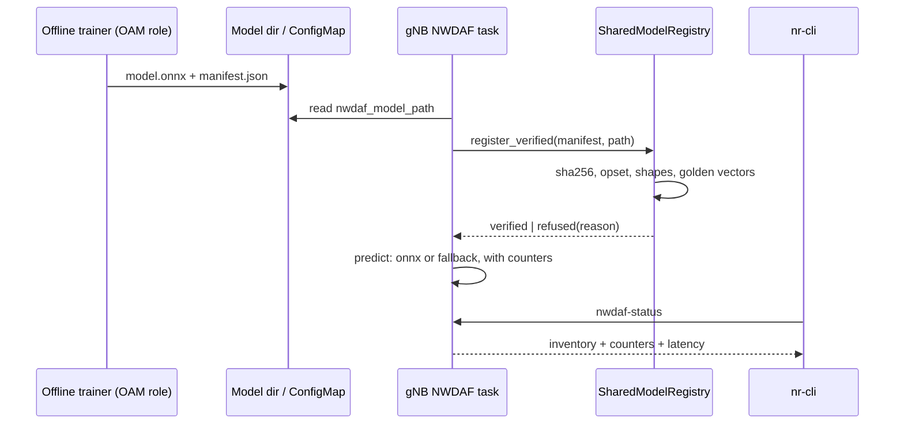

# D440B: verified OAM-style model loading with serving counters

Demo key `d440b-model-verify`, ticket
[nextgsim#463](https://github.com/NextgCoreLab/nextgsim/issues/463), program
anchor [nextgsim#458](https://github.com/NextgCoreLab/nextgsim/issues/458).

## Purpose

To give every model-based demo (#462, #467, #474, #486) one shared, verifiable
proof that a specific model artefact was checked, activated and actually served
live inferences, so that no demo can pass on a silent fallback.

- **Success signal:** the gNB logs
  `NWDAF: model verified id=.. version=.. sha256=<pinned> ... golden=ok`, and
  `nwdaf-status` shows `onnx_inferences > 0` and `fallback_inferences = 0`. A
  copy with one byte flipped logs `model refused (sha256 mismatch)`.
- **Not the point:** this is not a model-accuracy result, not a TS 28.105 MnS
  implementation, and not a viewer-facing demo. It is a feature and groundwork
  ticket.

## How it works



### Components

| Piece | Where | What it does |
|---|---|---|
| Reference model and manifest | `tools/d440b-model/` | `make_reference_model.py` plays the OAM role (TS 38.300 §16.20.2: training in the OAM, inference in the NG-RAN node). It writes `nwdaf-trajectory-cv.onnx` and `nwdaf-trajectory-cv.manifest.json` using only the standard library, and `--check` proves the committed files are byte-identical to what it writes. |
| Manifest checks | `nextgsim-ai/src/manifest.rs` | Checks the sha256 over the file, then the default-domain opset and the graph input and output signature (read from the ONNX protobuf without ONNX Runtime), then every golden vector within `tolerance` on ONNX Runtime. Each failed check has its own reason: `sha256 mismatch`, `opset mismatch`, `input shape mismatch`, `output shape mismatch`, `golden mismatch`, as well as `manifest invalid`, `model unreadable`, `not an onnx model`, `runtime unavailable` and `load failed`. |
| Verified registration | `SharedModelRegistry::register_verified` | Reads the file once and runs every check on those bytes. Only a model that passes is registered, and the engine that serves predictions is the one the golden vectors ran on. |
| Serving counters | `nextgsim-nwdaf/src/serving.rs` | Counts every trajectory prediction by the method that produced it (`onnx_inferences`, `fallback_inferences`) with p50/p99 latency, plus `measurements_recorded`. |
| `nwdaf-status` | gNB App task to NWDAF task | One line of JSON (`schema: nextgsim.nwdaf-status/1`) carrying `verified`, the model state, the counters, the latency and an inventory entry shaped like TS 28.105 `MLModel-Single` (`mLModelId`, `mLModelVersion`, `aIMLInferenceName`, `mLTrainingType`). |

The manifest sits beside the model as `<stem>.manifest.json`. The pinned
reference model is
`sha256=90a74d28c8e919ad8fdaa0f487976c8a4e803af3e318c5a30e02afcc3ec1f826`, opset
13, input `positions:float32[1,-1,3]`, output `next_position:float32[1,1,3]`,
with three golden vectors.

### Toggles

The demo follows the #458 convention. Both gates are off by default.

- **Cargo:** the gNB feature `model-registry` (it implies `nextgsim-nwdaf` and
  forwards to `nextgsim-nwdaf/model-registry` and `nextgsim-ai/model-registry`).
  Build it together with `6g`. A build without it, `6g` included, is unchanged.
  A default gNB build pulls in no `ort` crate at all.
- **Config** (the gNB only; `nwdaf_enabled: true` and `nwdaf_model_path` name
  the artefact):

  ```yaml
  nwdaf_enabled: true
  nwdaf_model_path: /etc/nextgsim/models/nwdaf-trajectory-cv.onnx
  demo:
    enabled: true
    d440b-model-verify:
      enabled: true
      mode: verify      # or fallback
  ```

| Mode | Behaviour |
|---|---|
| `verify` | The checks run, and the model is activated only on a pass. |
| `fallback` | The model is neither verified nor activated, and every prediction uses linear extrapolation. This reproduces the silent-fallback state, so a consumer's check can be shown to catch it. |

- While the demo is active, the NWDAF task serves one trajectory prediction per
  recorded UE measurement, which is what moves the counters in a live run.
  With the demo off, nothing is served.
- With `model-registry` built, the verification itself runs whenever
  `nwdaf_model_path` is set, demo or not.
- When the demo is active, the gNB logs `WARN DEMO MODE ACTIVE: d440b-model-verify=<mode>`,
  and `nr-cli <gnb> demo metrics` shows
  `nextg_demo_enabled{demo="d440b-model-verify",mode="<mode>"} 1`. Every demo
  line is prefixed `[demo:d440b-model-verify]`.
- **Switching** happens at runtime, with
  `nr-cli <gnb> demo d440b-model-verify set mode=<mode>` (audited by
  `nextgsim-demo`). The switch applies from the next prediction. A model that a
  `fallback` start deferred is verified at the first `verify` prediction, and is
  never activated unchecked.
- **Startup failures:**
  - `mode: bogus` fails startup with `DemoConfigError::UnknownMode`, and
    `set mode=bogus` is rejected with the mode left unchanged;
  - a `d440b-model-verify` block in a gNB built without `model-registry` fails
    with `DemoConfigError::UnknownKey`.

## How to run it

### Unit and runtime tests

```bash
# No ONNX Runtime needed: every refusal reason, fallback, demo-off, the runtime switch
cargo test -p nextgsim-ai --features model-registry
cargo test -p nextgsim-nwdaf --features model-registry
cargo test -p nextgsim-gnb --features 6g,model-registry

# The golden-vector and "served by onnx" arms need ONNX Runtime >= 1.23
# (CI pins 1.23.2 by version and tarball sha256, job "Model verify")
ORT_DYLIB_PATH=/path/to/libonnxruntime.so.1.23.2 \
  cargo test -p nextgsim-gnb --features 6g,model-registry --lib d440b -- --include-ignored
```

### Compose (local)

1. Build the gNB with
   `cargo build --release -p nextgsim-gnb --features 6g,model-registry --bin nr-gnb`
   and image it with `Dockerfile.gnb-local`. Do not publish this image.
2. Copy `tools/d440b-model/nwdaf-trajectory-cv.{onnx,manifest.json}` into
   `config/models/` in your local checkout, which nextgcore's compose mounts
   at `/etc/nextgsim`. Add the config block above to that checkout's
   `gnb.yaml`.
3. Mount the pinned `libonnxruntime.so` into the gNB container and set
   `ORT_DYLIB_PATH` to it (for example with a compose override file of your
   own). Without it the model is refused as `runtime unavailable`; the gNB does
   not crash.
4. Register a UE, then run:

   ```bash
   nr-cli <gnb> nwdaf-status
   nr-cli <gnb> demo d440b-model-verify show
   nr-cli <gnb> demo metrics
   ```

### EKS

TODO: the EKS overlay (`deploy/eks/overlays/demo-d440b-model-verify/` in
nextgcore, with a `model-registry` gNB build, the pinned ONNX Runtime and the
model artefacts) is a follow-up to this ticket. It will be run with
`k8s/demo-check.sh d440b-model-verify verify` and `... fallback`.

## Results

> **TODO: not yet run.** This section is filled only from the real EKS run
> artefacts (`/tmp/eks-val/demos/d440b-model-verify/<mode>/`): the log chain,
> `nwdaf-status` and `demo metrics` for `verify` and `fallback`, and the
> demo-off control. Nothing here is invented ahead of that run.

## Honesty labels and limitations

- **Non-normative.** TS 28.105 §6.4.1.1 says "The way for loading the ML model
  is not in scope of the present document". The manifest and its checks are an
  implementation choice.
- **The `nwdaf-status` inventory is MLModel NRM-shaped, not TS 28.105
  conformant.** It emits only `mLModelId`, `mLModelVersion`, `aIMLInferenceName`
  and `mLTrainingType`, and only those local properties are validated, because
  `Top` (TS 28.623) is not vendored.
- **The trainer is a file drop standing in for OAM**, not an MnS producer, and
  no training happens. The reference "model" is a fixed constant-velocity graph
  (`next = 2*last - prev`, one sample step ahead), which the predictor stamps at
  the requested horizon. Its accuracy is not claimed.
- **The golden vectors are valid only on the pinned ONNX Runtime version.**
- **`shadow_*` counters are not implemented.** No shadow inference path exists
  on main; a consumer demo that runs a shadow arm adds its own.
- `ort` 2.0.0-rc.11 marks its library slot initialised even after a failed
  load. The runtime probe therefore runs once per process and caches the
  result, and a process whose runtime failed never touches `ort` again.
