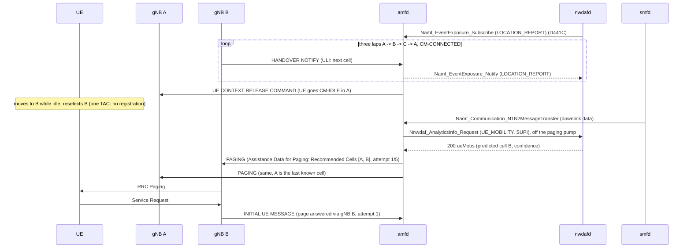

# D440C: NWDAF UE-mobility analytics steer AMF paging

Demo key `d440c-nwdaf-paging`, ticket
[nextgsim#464](https://github.com/NextgCoreLab/nextgsim/issues/464), program
anchor [nextgsim#458](https://github.com/NextgCoreLab/nextgsim/issues/458).
The code ships in five PRs:

| PR | Repo | What |
|---|---|---|
| 1, [nextgcore#1456](https://github.com/NextgCoreLab/nextgcore/pull/1456) | nextgcore | amfd `paging.strategy: nwdaf-mobility`, the base UE Mobility consumer |
| 2, [nextgcore#1466](https://github.com/NextgCoreLab/nextgcore/pull/1466) | nextgcore | Paging Attempt Information under the staged strategies |
| 3, [nextgcore#1469](https://github.com/NextgCoreLab/nextgcore/pull/1469) | nextgcore | the amfd demo: modes, demo lines, Recommended Cells from the prediction |
| 4, [#536](https://github.com/NextgCoreLab/nextgsim/pull/536) | nextgsim | the gNB's Assistance Data for Paging decode and demo log, the seeded lap route, its configs, this page |
| 5 | both | the EKS overlay, scenario and arms (nextgcore), the three-gNB compose and its check, the per-seed route table, and the Results below |

## Purpose

*(From the ticket.)* The core predicts an idle UE's location (nwdafd
UE_MOBILITY), and amfd, as a standard analytics consumer, uses the prediction
to page the predicted gNB first and to send the predicted cells to it in NGAP
PAGING.

- **Success signal:** amfd `Paging sent ... scope=nwdaf-mobility targets=[gNB 0x..] attempt 1`,
  then `page answered ... via gNB 0x.. attempt 1`, preceded by an nwdafd 200
  for UE_MOBILITY naming that cell.
- **Not the point:** ML accuracy (nwdafd's predictor is first-order transition
  statistics), or the gNB-originated hint
  ([#462](https://github.com/NextgCoreLab/nextgsim/issues/462)).

## How it works



1. **History.** The UE rides seeded laps across three gNBs in one TAC while
   CM-CONNECTED. Every N2 handover gives amfd a HANDOVER NOTIFY, and amfd sends
   nwdafd a LOCATION_REPORT ([D441C](d441c-amf-mobility.md)). Each transition
   out of A in the history is A -> B.
2. **Idle.** The UE is released to CM-IDLE in A, then moves to B and reselects
   it. One TAC, so it does not register, and amfd's last known cell stays A.
3. **Prediction.** Downlink data makes smfd send an N1N2MessageTransfer. amfd
   (`paging.strategy: nwdaf-mobility`, PR 1) asks nwdafd for UE Mobility with a
   future window, so the answer is a prediction: the most frequent next cell out
   of A, B. The query runs off the paging pump; a missing, slow or 204 answer
   pages the whole registration area on time.
4. **Targeted page.** Attempt 1 goes to the predicted gNB and the gNB of the
   last known cell, within the registration area: `targets=[gNB 0x2,gNB 0x1]`
   (nextgcore#1456 adds the last known gNB, so a UE that stayed put is still
   found on attempt 1). Each carries the Paging Attempt Information (PR 2) and,
   in this demo, the Recommended Cells (PR 3, a labelled departure, see below).
   Retransmissions widen to the whole area.
5. **The gNB.** gNB B decodes the Assistance Data for Paging and logs it (PR 4),
   then pages exactly as before. The UE answers on B, and amfd logs the page
   answered via gNB 0x2 on attempt 1.

### Components

| Piece | Where | What it does |
|---|---|---|
| NWDAF UE Mobility consumer | amfd `nwdaf_mobility.rs` (base, nextgcore#1456) | TS 23.501 §5.4.3.1: the AMF "may also use analytics ... on the UE's mobility as provided by NWDAF". `paging.strategy: nwdaf-mobility`; the default `registration-area` makes no NWDAF call. Maps the predicted NCGI to a gNB by the gNB-ID bits of the NCI (TS 38.413 §9.3.1.7). |
| Paging Attempt Information | amfd (base, nextgcore#1466) | TS 38.413 §9.3.1.72 under the staged strategies: count, intended number (`max_retransmit + 1`, 5 by default), next scope `changed` after a targeted attempt 1. |
| Demo layer | amfd `demo_d440c.rs` (nextgcore#1469) | The modes, the `[demo:d440c-nwdaf-paging]` lines, and the Recommended Cells from the prediction. |
| Assistance Data for Paging decode | nextgsim-ngap `procedures::paging` (base, PR 4) | TS 38.413 §9.3.1.69-72: `PagingData::assistance_data` carries the Recommended Cells in received order (NR or E-UTRA CGI, Time Stayed in Cell) and the Paging Attempt Information. The IE's criticality is `ignore` and §8.5.1.2 says it "may be used", so an IE that decodes never fails the PAGING: an unknown extension value (for example a Next Paging Area Scope past {same, changed}) reads as absent. IE bytes that do not decode are a transfer syntax error (TS 38.413 §10.2): the PAGING is not decoded, as before, and the gNB answers with an Error Indication (cause transfer-syntax-error). Pinned against amfd's own bytes, all four re-encoded byte-identically. |
| PAGING assistance log | nextgsim gNB `handle_paging` (demo, PR 4) | With the demo active, a PAGING for a served TAI that carries the IE logs `[demo:d440c-nwdaf-paging] PAGING assistance: cells=[0x10,0x20] attempt 1/5 next-scope=changed`. Logged only: the RRC paging is unchanged. |
| Lap route | `config/demo-nwdaf-paging/` (PR 4) | Three gNB configs and the UE's seeded `sim_route`, below. |

### The lap

`config/demo-nwdaf-paging/`: gNB A at (0, 0), B at (100, 0) and C at (50, 87)
(`gnb-a.yaml`, `gnb-b.yaml`, `gnb-c.yaml`; NCI 0x10, 0x20, 0x30, so gNB IDs 1,
2, 3; addresses 172.23.0.100, .102, .103), all TAC 1, each listing the other two
as handover neighbours. The UE (`ue-lap.yaml`) registers on A and, 60 s after
start-up, follows a `sim_route` (#462) at 2.5 m/s:

| Phase | Waypoints | Time | What the network sees |
|---|---|---|---|
| Laps | 3 x (B, C, A) corners, about 35 m from each gNB toward the centre | about 150 s | 9 N2 handovers A->B->C->A, each a LOCATION_REPORT |
| Dwell | out behind A to (-21, -10) and back | 47 s | nothing: no neighbour comes within the A3 margin of A. The harness releases the UE here |
| Idle | to (81, 11), 22 m from B | about 20 s | nothing until the page: idle reselection A -> B |

The route is generated from a seed: each waypoint is moved up to 3 m off its
nominal corner. The committed route is seed 464's.
`tests/src/d440c_lap_route.rs` checks that the committed file is exactly that
seed's route, and checks the geometry on seed 464 and on 32 other seeds, with
the simulator's channel model (`DistanceModel`, levels reported no higher than
-31 dBm):

- the connected laps hand over exactly A->B->C->A three times, under the A3
  rule (offset 3 dB + hysteresis 1 dB) with a 640 ms and with a 3 s trigger;
- the dwell lasts at least 40 s, and no neighbour comes within the A3 margin of
  A during it;
- released at any point of the dwell, the idle UE reselects A -> B and nothing
  else (R-criterion, q-Hyst 4 dB, Treselection 1 s and 3 s).

To print another seed's route:

```sh
D440C_SEED=7 cargo test -p nextgsim-integration-tests --test d440c_lap_route \
    -- --ignored --nocapture print_the_lap_route
```

### Toggles

Follows the #458 convention. Both gates are off by default, on every node.

- **amfd:** cargo feature `demo-d440c-nwdaf-paging` and the `demo:` block. Config
  plus restart. The mode is the effective paging strategy and supersedes
  `amf.paging.strategy`; amfd logs which at startup. See
  [amf.md](https://github.com/NextgCoreLab/nextgcore/blob/main/docs-book/src/configuration/amf.md)
  in nextgcore.
- **gNB:** cargo feature `demo-d440c-nwdaf-paging` (it implies `6g`, the gate the
  ticket names) and the same block. Any active mode turns the PAGING assistance
  log on; what amfd sends is amfd's decision. Runtime switching:
  `nr-cli <node> demo d440c-nwdaf-paging show | set mode=<mode>`.
- **nwdafd:** live UE Mobility needs nwdafd built with `amf-mobility`
  ([D441C](d441c-amf-mobility.md)). The stacks switch it on with its base knob
  `nwdaf.amf_mobility.enabled: true`, not with the `d441c-amf-mobility` demo
  block, so a run has one demo active and nwdafd logs no `DEMO MODE ACTIVE`
  line. The revert arm turns the knob off.

```yaml
demo:
  enabled: true
  d440c-nwdaf-paging:
    enabled: true
    mode: nwdaf-mobility   # or registration-area
```

| Mode | amfd | gNB |
|---|---|---|
| `nwdaf-mobility` (default) | strategy `nwdaf-mobility`; the NWDAF-steered attempt 1 carries the Recommended Cells | logs the PAGING assistance |
| `registration-area` | the page-all baseline: the whole area on attempt 1, no Assistance Data | logs the PAGING assistance (none arrives) |
| `ran-recommendation` | **not registered yet**: it needs #462's amfd `d440a-ai-paging` demo. Until then it fails startup with `UnknownMode` on both | same |

When the demo is active a node logs `WARN DEMO MODE ACTIVE: d440c-nwdaf-paging=<mode>`,
prefixes its demo lines with `[demo:d440c-nwdaf-paging]`, and reports
`nextg_demo_enabled{demo="d440c-nwdaf-paging",mode="<mode>"} 1` (amfd on
`/metrics`, the gNB through `nr-cli <node> demo d440c-nwdaf-paging show`).

**Startup failures**, with no fallback:

- `mode: bogus` gives `UnknownMode { demo: "d440c-nwdaf-paging", mode: "bogus" }`;
- the block in a build without the feature gives `UnknownKey`.

**Demo off** (no block, `demo.enabled: false`, or the kill switch off with the
key on): PAGING is byte-identical, amfd makes no NWDAF call, the gNB prints no
assistance line, and there is no `nextg_demo_enabled` series. The gNB still
decodes the IE (base NGAP), and logs nothing about it.

## How to run it

Both stacks run the same scenario, and nextgcore's
`deploy/eks/overlays/demo-d440c-nwdaf-paging/analyze.py` gives the verdict for
both, from kubelet- or docker-timestamped logs:

1. the UE starts (EKS: the scenario restarts it) once nwdafd has subscribed to
   amfd's LOCATION_REPORT, so its registration on A is in the history;
2. it rides the laps (nine N2 handovers) and, at the dwell's far point (172.8 s
   after its `Simulated motion started` line, computed from the deployed
   route), gNB A's `nr-cli ue-release` sends it to CM-IDLE;
3. it reselects B while idle; after the route's end the check asks nwdafd for
   its UE_MOBILITY prediction (`ue-mobility.http`). This is corroboration
   only: a separate request a few seconds before amfd's, with its own window.
   The evidence for amfd's own exchange is its `predicted=` line and its
   `predicted` hint counter (nextgcore#1494);
4. 20 downlink pings from the UPF make smfd send the N1N2MessageTransfer, and
   amfd pages;
5. `analyze.py` checks the arm (its header lists every check).

### The arms

| Arm | Command | What must hold |
|---|---|---|
| `nwdaf-mobility` | `k8s/demo-check.sh d440c-nwdaf-paging nwdaf-mobility` | the ordered chain below; gNB C gets no PAGING |
| `registration-area` | `k8s/demo-check.sh d440c-nwdaf-paging registration-area` | `Paging sent to 3/3 ... scope=registration-area`, no NWDAF query, no Assistance Data |
| demo off | `k8s/demo-check.sh d440c-nwdaf-paging off` | the base core on the same topology: `Paging sent to 3/3 gNB(s) serving the registration area`, no demo line, no NWDAF query, no `nextg_demo_enabled` |
| invalid | `k8s/demo-check.sh d440c-nwdaf-paging bogus` | amfd (and every gNB) fails startup with `UnknownMode`; the run FAILS to deploy |
| `nwdaf-down` | `DEMO_VARIANT=nwdaf-down k8s/demo-check.sh d440c-nwdaf-paging nwdaf-mobility` | nwdafd scaled to 0 before the downlink: a fail-open line, the whole area paged within the budget |
| revert | `DEMO_VARIANT=revert k8s/demo-check.sh d440c-nwdaf-paging nwdaf-mobility` | nwdafd's knob off, which stands in for the #466 ingest patched out (no AMF subscription, UE_MOBILITY not served): its answer is 204, amfd pages the whole area, and the success chain does not hold |

Every arm also checks the common chain: nine handovers before the release,
the idle reselection, the page answered on attempt 1 through gNB B
(`Initial UE Message ... nci=0x20`, `page answered, T3513 stopped`), at least
19 of the 20 downlink pings answered, and the PAGING within 2 s of smfd's
`PFCP Session Report Request`. `k8s/demo-check.sh <key> off` and
`DEMO_VARIANT` are part of nextgcore PR 5 (see
`deploy/eks/overlays/README.md`).

The ordered chain of the `nwdaf-mobility` arm (strings are the ones the code
emits):

1. smfd: `PFCP Session Report Request` (the downlink data);
2. amfd: `NWDAF UE mobility: ue=<supi> predicted=(999-70, 0x000000020) confidence=<percent>`,
   logged only when nwdafd answered 200 naming cell B;
3. amfd: `[demo:d440c-nwdaf-paging] Paging sent to 2/2 ue=<supi> scope=nwdaf-mobility targets=[gNB 0x2,gNB 0x1] attempt 1`;
4. gNB B: `[demo:d440c-nwdaf-paging] PAGING assistance: cells=[0x10,0x20] attempt 1/5 next-scope=changed`;
5. amfd: `[demo:d440c-nwdaf-paging] page answered ue=<supi> via gNB 0x2 attempt 1`.

The ticket's chain says `Paging sent to 1/1 ... targets=[gNB 0x2]`. As built,
attempt 1 also pages the last known cell's gNB (A), so it is 2/2, and the
Recommended Cells list A (visited, first) then B (predicted). The ticket's
first step, an nwdafd log line for the 200, does not exist: nwdafd logs
`Analytics Info Query: /nnwdaf-analyticsinfo/v1/analytics` without the query
string, and pcfd polls the same path every 10 s, so nwdafd's log cannot tell
amfd's query apart (nextgcore#1494). amfd's `predicted=` line, its
`amf_paging_nwdaf_hints_total{outcome="predicted"}` and the check's own GET
are the evidence instead.

### EKS

```bash
# Images: amfd demo-d440c-nwdaf-paging, nwdafd amf-mobility, nr-gnb
# demo-d440c-nwdaf-paging, the profile's other NFs, the default nr-ue; one new
# tag, never an existing one; nr-cli goes to nextgsim's binaries/.
deploy/eks/overlays/demo-d440c-nwdaf-paging/build-images.sh
export CORE_IMAGE_TAG=<tag> SIM_IMAGE_TAG=<tag> SIM_SHA=<nextgsim sha>
flock /tmp/eks-nextg-demo.lock k8s/demo-check.sh d440c-nwdaf-paging nwdaf-mobility
# ... one arm per lock hold, as in the table above
```

The overlay `deploy/eks/overlays/demo-d440c-nwdaf-paging/` (ClusterIP only)
adds gnb-b and gnb-c (the base gNB is A), nwdafd, and gNB A's and the UE's
configs. Its configs are `config/demo-nwdaf-paging/` with the compose
addresses replaced by Service names and the demo block removed: the run's mode
goes in at render time. The overlay's `test-scenario.sh` checks nothing else
differs, so the cluster rides the committed seed-464 route. The one exception
is `start_after_secs`: the overlay deploys the route parked (86400), so the
deploy's UE stays in A through the base e2e, and the scenario writes the
committed 60 back just before it restarts the UE. If nwdafd ingests the
deploy UE's registration in A, its history has one A -> A beside the three
A -> B and the prediction is B at 75%; if it does not, every transition out of
A is A -> B and the prediction is B at 100%. The Results quote the confidence
the run's amfd `predicted=` line shows.

### Compose

**Not yet run.** The builder host has no docker compose, so no compose arm has
passed yet; the EKS run is the acceptance. The stack and its check are wired as
below and checked statically only.

```bash
# nextgcore-rust/{amf,nwdaf}:d440c and nextgsim-gnb:d440c built with the demo
# features (D440C_TAG overrides the tag); the other services use the n2ho
# stack's images.
NEXTGCORE_DIR=../nextgcore scripts/demo/d440c-check.sh nwdaf-mobility
NEXTGCORE_DIR=../nextgcore scripts/demo/d440c-check.sh nwdaf-mobility revert
```

`scripts/demo/d440c.compose.yml` overrides nextgcore's
`docker/rust/docker-compose.demo-n2ho.yml`: gnb-west and gnb-east run gnb-a
and gnb-b, gnb-c joins at 172.23.0.103, nwdafd at 172.23.0.30, and the UE runs
`ue-lap.yaml`. `D440C_MODE` goes into amfd's and every gNB's config at
start-up. The stack publishes no port (the check asserts it before `up`).

## Results

**Not yet run.** The runs, the committed table (PAGINGs per page and attempt-1
hits, per mode, on the committed seed and the sweep seeds) and the captured log
excerpts and metrics come from the EKS arms, which have not run yet (devtest1
credentials). Nothing here is a measured result yet.

## Honesty labels and limitations

- **Recommended Cells from NWDAF are a departure.** TS 38.413 §9.3.1.71 says the
  Recommended Cells for Paging IE "is transparent to the 5GC", and TS 23.502
  §4.2.3.3 has the AMF convey the RAN's own recommendation. Here amfd fills it
  from the NWDAF prediction, and only in the demo build with the demo on.
- **The prediction is statistics, not a model.** nwdafd counts first-order cell
  transitions over the AMF-reported cells. The laps make the transition out of A
  always A -> B, so the prediction is B by construction: the demo shows the
  loop from analytics into paging, not prediction quality.
- **The route is seeded and committed before the check.** The geometry claims
  above hold on all 33 checked seeds. The PR 5 table reports the committed
  seed's run, with the other seeds beside it.
- **The gNB only logs the assistance.** Each simulated gNB serves one cell, so
  the Recommended Cells cannot narrow its paging; it pages every served cell of
  the TAI list as before (§8.5.1.2).
- **The radio is the simulator's.** Levels are the negated distance in metres
  (`DistanceModel`), not a path-loss model.
