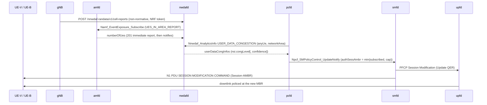

# D441A: RAN-fed User Data Congestion loop to Session-AMBR

Demo key `d441a-congestion-loop` (nextgsim#465, program #458). Modes:
`statistics` (default), `prediction` and `no-loop` (the baseline).

## Purpose

The demo takes the cell occupancy measured at the RAN and has nwdafd serve it
as TS 23.288 §6.8 *User Data Congestion*. That analytics output drives a real
PCF policy change. The change reaches the UPF QER and protects a priority UE.
The comparison is the same network with no loop.

- **Success signal:** with the loop on, during UE-B's ramp:
  - smfd logs `Applying PCF-updated policy … AMBR UL/DL=1000000/1000000 bps` for
    the best-effort UE (UE-B), followed by upfd `Installed 1 QERs for SEID=…`;
  - the protected UE's (UE-V's) ping p95 stays flat.

  With the loop off, there is no policy update and the p95 rises.
- **Not the point:**
  - It is not a prediction-accuracy demo. The prediction is a least-squares fit
    on a ramp, and it is a secondary arm.
  - It is not a RAN scheduler demo.

## How it works



| component | what it does |
|---|---|
| gNB (this repo, `nextgsim-gnb/src/congestion/`) | Serves every UE's downlink through one FIFO, drained by a token bucket at the configured capacity C, with drop-tail at `queue_limit_bytes`. A flood from UE-B therefore delays UE-V's packets. Each `window_ms` window, occupancy is computed as served bits / (C × window). The exporter registers at the NRF as an AF, takes an OAuth2 token (CCA, scope `nnwdaf-randata`) and POSTs a cell report: the measured occupancy, plus an 8-sample OLS prediction with R² confidence in mode `prediction`. In `no-loop` it sends nothing. |
| nwdafd (nextgcore, `ran_congestion.rs`) | The ingest route checks its own token. Without one it answers 401; with the wrong scope, 403; and it ingests nothing in either case. For each reported TAI it subscribes to the AMF's `UES_IN_AREA_REPORT` as a cross-check on the gNB's connected-UE count. `USER_DATA_CONGESTION` answers per reported cell in the requested area, with `congLevel` = occupancy %. A past or absent `ana-req` gives statistics; a future `ana-req` gives the gNB's prediction with `confidence`. A stale report gives 204. |
| pcfd (nextgcore, `congestion_loop.rs`, `ambr_override.rs`) | Polls USER_DATA_CONGESTION for the configured cells: mode `prediction` asks for a future period, the other modes for statistics. It throttles UE-B's Session-AMBR through a per-session override layer, which every subscription-derived re-notify also consults, so the cap survives a re-authorisation. When congestion clears it restores the subscribed value. |
| smfd / upfd (existing) | smfd applies the notify as a full replacement (nextgcore#1387), updates the UPF QER and sends N1 Session-AMBR to the UE (nextgcore#1385). |

**Guardrails (pcfd `pcf.congestion_loop`).** The controller only acts within
these limits:
- **Scope:** only sessions on the configured slice and DNN.
- **Who:** never a `protected_supis` UE, and only `best_effort_supis` UEs when
  that list is set.
- **How many:** at most `max_sessions` sessions throttled.
- **How far:** the cap is `throttle_kbps`, never below `floor_kbps` (default 500)
  and never above the subscribed AMBR.
- **When to throttle:** at `congLevel >= throttle_at`.
- **When to restore:** after `restore_after_polls` polls below `restore_below`,
  and only once the throttle is at least `min_hold_secs` old.
- **Fail open:** restore after `fail_open_secs` with no data.
- **Dry run:** `dry_run` logs every action without taking it.

An active demo with no `pcf.congestion_loop` block fails pcfd startup. So do
two active demos that both write the override layer.

## Configuration and toggles

Two gates on every NF, both needed:
- the cargo feature `demo-d441a-congestion-loop`, on `nextgsim-gnb` (which
  implies `6g` and `sbi-client`), `nextgcore-nwdafd` and `nextgcore-pcfd`;
- `demo: {enabled: true, d441a-congestion-loop: {enabled: true, mode: …}}` in
  gnb.yaml, nwdaf.yaml and pcf.yaml.

An unknown mode fails startup with `DemoConfigError::UnknownMode`. Each NF logs
`WARN DEMO MODE ACTIVE: d441a-congestion-loop=<mode>` and a `[demo:d441a-congestion-loop]`
prefix on its lines. The nextgcore NFs export
`nextg_demo_enabled{demo="d441a-congestion-loop",mode="<mode>"} 1` on
`/metrics`.

The gNB block, read only while the demo is active:

```yaml
congestion_export:
  cell_capacity_mbps: 5.0        # C, required (a simulator construct)
  queue_limit_bytes: 200000
  window_ms: 1000
  prediction_horizon_ms: 5000
  nrf_uri: http://nrf:7777       # required
  # nwdaf_uri: http://nwdaf:7777 # optional, skips discovery
  nf_instance_id: 6b1d7e3c-0000-4000-8000-00000000465a
  cca_key_file: /tmp/d441a-cca/exporter.key   # created 0600 if absent; an existing file
                                              # must be a regular file, mode 0600, owned
                                              # by the gNB's uid, or startup fails
  cca_public_jwk_dir: /tmp/d441a-cca          # writes <nf_instance_id>.jwk
```

The NRF must trust the exporter's public JWK, through
`nrf.sbi.oauth2.cca_trusted_keys_dir`. If the key file or the JWK directory is
unusable, gNB startup fails.

Runtime switching applies to the gNB only:
- `nr-cli <gnb> demo d441a-congestion-loop set mode=<mode>` takes effect from
  the next window;
- `nr-cli <gnb> congestion-status` shows the mode, the last occupancy and
  prediction, the queue state and the export counters.

nwdafd and pcfd switch only by changing their config and restarting.

## How to run it

**EKS (devtest1)** uses the nextgcore overlay
`deploy/eks/overlays/demo-d441a-congestion-loop/`. Run the arms in this order,
each one under `flock /tmp/eks-nextg-demo.lock`:

```bash
k8s/demo-check.sh off off                           # demo-off control
k8s/demo-check.sh d441a-congestion-loop no-loop     # baseline first: its p95 is the reference
k8s/demo-check.sh d441a-congestion-loop statistics
k8s/demo-check.sh d441a-congestion-loop prediction
```

What the overlay provides:
- nwdafd;
- pcf.yaml's loop block: UE-V `imsi-999700000000001` protected, UE-B
  `imsi-999700000000002` best effort, a 1000 kbps cap, throttle at 80, restore
  below 10;
- the gNB block with C = 5 Mbps;
- the NRF's trusted-key directory;
- UE-B.

The overlay's `scenario.sh` then:
1. hands the gNB's JWK to the NRF;
2. seeds UE-B's subscriber and starts UE-B;
3. pings the UPF gateway from UE-V at 10 Hz;
4. ramps UE-B's downlink from 1 to 10 Mbps (2C);
5. checks per mode:
   - the ordered log chain;
   - one throttle and one restore of UE-B, none of UE-V;
   - the AMF/gNB UE-count cross-check;
   - that a tokenless POST is answered 401;
   - UE-V's p95 against the no-loop arm.

The artefacts go to `/tmp/eks-val/demos/d441a-congestion-loop/<mode>/`. The
images:
- nwdafd and pcfd with the feature (`deploy/eks/profiles/demo/profile.env`);
- the gNB with `--features demo-d441a-congestion-loop` (`SIM_IMAGE_TAG`).

**Compose.** No compose overlay ships for this demo yet. To run it by hand:
1. Build nwdafd and pcfd with `--features demo-d441a-congestion-loop`, and the
   gNB with the same feature.
2. Add the three configuration blocks above.
3. Add a second UE (IMSI `999700000000002`) and its subscriber.
4. Trust the gNB's JWK at the NRF.
5. Reproduce `scenario.sh`'s load.

## Results

Not yet run. This section is filled in from the captured EKS artefacts after
validation; nothing here is invented.

## Honesty labels and limitations

- **Simulator constructs.** C and the queue are simulator constructs: the gNB
  has no PHY or scheduler. The queue serves RLC UM data PDUs; RLC AM status and
  retransmission PDUs bypass it.
- **Stand-in for OAM.** The gNB push stands in for the OAM PM path (TS 23.288
  §6.2.3, Table 6.8.2-1 "Radio Resource Utilization"). The ingest route is not
  a 3GPP API.
- **Implementation choices.** How the NSI is derived (occupancy as
  `congLevel`) is left open by TS 23.288. The thresholds and the cap are this
  demo's choices.
- **UE selection.** UE-B is chosen from a configured list, which is PCF local
  policy. TS 23.503 targets "UEs reported as heavy users" through Data Dispersion
  analytics, which this demo does not implement.
- **Ingest token.** The ingest route checks its own token instead of nwdafd
  enabling listener-wide OAuth2. Listener-wide OAuth2 would reject amfd's
  token-less notifies (TS 33.501 §13.4.1; nextgcore#1421).
- **Lead time.** The prediction's lead time over statistics is reported, not
  asserted.
- **UE-B's load is ICMP echo.** `scenario.sh` makes UE-B's downlink with large
  echo requests whose replies are the downlink, not an application flow. A
  throttle also polices the requests on the uplink.
- **One prediction horizon.** nwdafd answers a prediction request with the
  gNB's single prediction at its own `prediction_horizon_ms`, whatever future
  window `ana-req` names; `timeIntev` echoes the requested window.
- **pcfd restart.** A cap is recorded with the session. A restarted pcfd
  re-notifies the subscribed Session-AMBR for every capped session, so a
  throttle does not outlive the process (or the demo).
