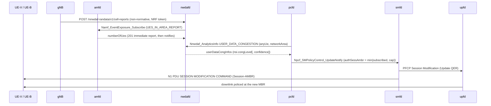

# D441A: RAN-fed User Data Congestion loop to Session-AMBR

Demo key `d441a-congestion-loop` (nextgsim#465, program #458). Modes:
`statistics` (default), `prediction` and `no-loop` (the baseline).

## Purpose

The demo takes the cell occupancy measured at the RAN and has nwdafd serve it
as TS 23.288 §6.8 *User Data Congestion*. That analytics output drives a real
PCF policy change. The change reaches the UPF QER and protects a priority UE.
The comparison is the same network with no loop.

- **Success signal:** with the loop on, during UE-B's ramp:
  - smfd logs `Applying PCF-updated policy … AMBR UL/DL=1000000/1000000 bps` for
    the best-effort UE (UE-B), followed by upfd `Installed 1 QERs for SEID=…`;
  - the protected UE's (UE-V's) ping p95 stays flat.

  With the loop off, there is no policy update and the p95 rises.
- **Not the point:**
  - It is not a prediction-accuracy demo. The prediction is a least-squares fit
    on a ramp, and it is a secondary arm.
  - It is not a RAN scheduler demo.

## How it works



| component | what it does |
|---|---|
| gNB (this repo, `nextgsim-gnb/src/congestion/`) | Serves every UE's downlink through one FIFO, drained by a token bucket at the configured capacity C, with drop-tail at `queue_limit_bytes`. A flood from UE-B therefore delays UE-V's packets. Each `window_ms` window, occupancy is computed as served bits / (C × window). The exporter registers at the NRF as an AF, takes an OAuth2 token (CCA, scope `nnwdaf-randata`) and POSTs a cell report: the measured occupancy, plus an 8-sample OLS prediction with R² confidence in mode `prediction`. In `no-loop` it sends nothing. |
| nwdafd (nextgcore, `ran_congestion.rs`) | The ingest route checks its own token. Without one it answers 401; with the wrong scope, 403; and it ingests nothing in either case. For each reported TAI it subscribes to the AMF's `UES_IN_AREA_REPORT` as a cross-check on the gNB's connected-UE count. `USER_DATA_CONGESTION` answers per reported cell in the requested area, with `congLevel` = occupancy %. A past or absent `ana-req` gives statistics; a future `ana-req` gives the gNB's prediction with `confidence`. A stale report gives 204. |
| pcfd (nextgcore, `congestion_loop.rs`, `ambr_override.rs`) | Polls USER_DATA_CONGESTION for the configured cells: mode `prediction` asks for a future period, the other modes for statistics. It throttles UE-B's Session-AMBR through a per-session override layer, which every subscription-derived re-notify also consults, so the cap survives a re-authorisation. When congestion clears it restores the subscribed value. |
| smfd / upfd (existing) | smfd applies the notify as a full replacement (nextgcore#1387), updates the UPF QER and sends N1 Session-AMBR to the UE (nextgcore#1385). |

**Guardrails (pcfd `pcf.congestion_loop`).** The controller only acts within
these limits:
- **Scope:** only sessions on the configured slice and DNN.
- **Who:** never a `protected_supis` UE, and only `best_effort_supis` UEs when
  that list is set.
- **How many:** at most `max_sessions` sessions throttled.
- **How far:** the cap is `throttle_kbps`, never below `floor_kbps` (default 500)
  and never above the subscribed AMBR.
- **When to throttle:** at `congLevel >= throttle_at`.
- **When to restore:** after `restore_after_polls` polls below `restore_below`,
  and only once the throttle is at least `min_hold_secs` old.
- **Fail open:** restore after `fail_open_secs` with no data.
- **Dry run:** `dry_run` logs every action without taking it.

An active demo with no `pcf.congestion_loop` block fails pcfd startup. So do
two active demos that both write the override layer.

## Configuration and toggles

Two gates on every NF, both needed:
- the cargo feature `demo-d441a-congestion-loop`, on `nextgsim-gnb` (which
  implies `6g` and `sbi-client`), `nextgcore-nwdafd` and `nextgcore-pcfd`;
- `demo: {enabled: true, d441a-congestion-loop: {enabled: true, mode: …}}` in
  gnb.yaml, nwdaf.yaml and pcf.yaml.

An unknown mode fails startup with `DemoConfigError::UnknownMode`. Each NF logs
`WARN DEMO MODE ACTIVE: d441a-congestion-loop=<mode>` and a `[demo:d441a-congestion-loop]`
prefix on its lines. The nextgcore NFs export
`nextg_demo_enabled{demo="d441a-congestion-loop",mode="<mode>"} 1` on
`/metrics`.

The gNB block, read only while the demo is active:

```yaml
congestion_export:
  cell_capacity_mbps: 5.0        # C, required (a simulator construct)
  queue_limit_bytes: 200000
  window_ms: 1000
  prediction_horizon_ms: 5000
  nrf_uri: http://nrf:7777       # required
  # nwdaf_uri: http://nwdaf:7777 # optional, skips discovery
  nf_instance_id: 6b1d7e3c-0000-4000-8000-00000000465a
  cca_key_file: /tmp/d441a-cca/exporter.key   # created 0600 if absent; an existing file
                                              # must be a regular file, mode 0600, owned
                                              # by the gNB's uid, or startup fails
  cca_public_jwk_dir: /tmp/d441a-cca          # writes <nf_instance_id>.jwk
```

The NRF must trust the exporter's public JWK, through
`nrf.sbi.oauth2.cca_trusted_keys_dir`. If the key file or the JWK directory is
unusable, gNB startup fails.

Runtime switching applies to the gNB only:
- `nr-cli <gnb> demo d441a-congestion-loop set mode=<mode>` takes effect from
  the next window;
- `nr-cli <gnb> congestion-status` shows the mode, the last occupancy and
  prediction, the queue state and the export counters.

nwdafd and pcfd switch only by changing their config and restarting.

## How to run it

**EKS (devtest1)** uses the nextgcore overlay
`deploy/eks/overlays/demo-d441a-congestion-loop/`. Run the arms in this order,
each one under `flock /tmp/eks-nextg-demo.lock`:

```bash
k8s/demo-check.sh off off                           # demo-off control
k8s/demo-check.sh d441a-congestion-loop no-loop     # baseline first: its p95 is the reference
k8s/demo-check.sh d441a-congestion-loop statistics
k8s/demo-check.sh d441a-congestion-loop prediction
```

What the overlay provides:
- nwdafd;
- pcf.yaml's loop block: UE-V `imsi-999700000000001` protected, UE-B
  `imsi-999700000000002` best effort, a 1000 kbps cap, throttle at 80, restore
  below 10;
- the gNB block with C = 5 Mbps;
- the NRF's trusted-key directory;
- UE-B.

The overlay's `scenario.sh` then:
1. hands the gNB's JWK to the NRF;
2. seeds UE-B's subscriber and starts UE-B;
3. pings the UPF gateway from UE-V at 10 Hz;
4. ramps UE-B's downlink from 1 to 10 Mbps (2C);
5. checks per mode:
   - the ordered log chain;
   - one throttle and one restore of UE-B, none of UE-V;
   - the AMF/gNB UE-count cross-check;
   - that a tokenless POST is answered 401;
   - UE-V's p95 against the no-loop arm.

The artefacts go to `/tmp/eks-val/demos/d441a-congestion-loop/<mode>/`. The
images:
- nwdafd and pcfd with the feature (`deploy/eks/profiles/demo/profile.env`);
- the gNB with `--features demo-d441a-congestion-loop` (`SIM_IMAGE_TAG`).

**Compose.** No compose overlay ships for this demo yet. To run it by hand:
1. Build nwdafd and pcfd with `--features demo-d441a-congestion-loop`, and the
   gNB with the same feature.
2. Add the three configuration blocks above.
3. Add a second UE (IMSI `999700000000002`) and its subscriber.
4. Trust the gNB's JWK at the NRF.
5. Reproduce `scenario.sh`'s load.

## Results

**The demo does not pass on EKS yet.** On devtest1, all three demo arms FAIL and the
demo-off control PASSES. The loop runs from end to end on the control plane: gNB
report, nwdafd, pcfd, smfd, upfd, UE-B, then the restore. But the success signal
(UE-V's p95 flat while UE-B is throttled, against a no-loop baseline that queues) was
not observed. Three defects, diagnosed below from the artefacts and **not patched
here**, stand in the way. One is the open upfd defect nextgcore#1475; the fixes
for the other two belong in nextgcore PRs, through review.

Everything below is copied from the run artefacts under `/tmp/eks-val/demos/` on the
operator host. Nothing is reconstructed. The code blocks are selected lines, with
the kubelet timestamp prefix and the ANSI colour codes trimmed; `…` marks a line cut
short.

### How it was run

```bash
# images: nextgcore and nextgsim built at their main commits, pushed under NEW tags only
#   core NFs (incl. nwdaf): the demo profile's 6G features plus
#     nextgcore-nwdafd/demo-d441a-congestion-loop nextgcore-pcfd/demo-d441a-congestion-loop
#   gnb: --features nextgsim-gnb/demo-d441a-congestion-loop; ue: nr-ue + nr-cli
# each arm under the program lock, one arm per hold, in this order:
for arm in "off off" "d441a-congestion-loop no-loop" \
           "d441a-congestion-loop statistics" "d441a-congestion-loop prediction"; do
  flock /tmp/eks-nextg-demo.lock env YES=true KEEP=true KUBE_CONTEXT=devtest1 \
    CORE_IMAGE_TAG=demo-d441a-ff97da6b0185 SIM_IMAGE_TAG=demo-d441a-ec4c32d4e524 \
    SIM_SHA=ec4c32d4e524 k8s/demo-check.sh $arm
  # KEEP=true: the wrapper reads UE-B's post-run Session-AMBR state (post/), then
  # deletes the nextg-demo namespace the run created
done
```

### What ran

| arm | artefacts (`/tmp/eks-val/demos/…`) | VERDICT | UE-V p95 |
|---|---|---|---|
| `off off` (demo-off control) | `off/off/20261112T125433Z` | PASS | n/a |
| `d441a-congestion-loop no-loop` | `d441a-congestion-loop/no-loop/20261112T130714Z` | FAIL | 4.3 ms |
| `d441a-congestion-loop statistics` | `d441a-congestion-loop/statistics/20261112T132223Z` | FAIL | 3.8 ms |
| `d441a-congestion-loop prediction` | `d441a-congestion-loop/prediction/20261112T133557Z` | FAIL | 3.7 ms |

- **Harness:** nextgcore `ff97da6b0185` (#1467 merge, so #1447, #1461 and #1467 are all in).
- **Images** (devtest1 ECR, new tags only):
  - `nextg/{nrf,amf,smf,upf,ausf,udm,udr,pcf,nssf,bsf,nwdaf}:demo-d441a-ff97da6b0185`;
  - `nextg/{gnb,ue}:demo-d441a-ec4c32d4e524` (nextgsim `ec4c32d`, which includes #516).
- **e2e.** Every arm's base e2e (`e2e-internet.sh`, PROFILE=demo) passed: `e2e_rc=0`.
- **Demo-off control:** `demo_banner_lines=0 demo_prefix_lines=0 nextg_demo_enabled_series=0`.
- **Demo arms:** each scrape has its mode's series, for example
  `nextg_demo_enabled{demo="d441a-congestion-loop",mode="prediction"} 1`, and
  `demo_banner_lines=2` (nwdafd and pcfd). The gNB's banner is not in any capture;
  see defect 3.
- **Not run:** the runtime `nr-cli … set mode=` switch, and a compose arm (none ships).

### Baseline vs mode

| | no-loop | statistics | prediction |
|---|---|---|---|
| exporter token / ingest | no ingest (every UDC GET 204; the gNB `export: off` line was lost, defect 3) | ingested (`nwdaf_ran_cell_reports_total{result="ingested"} 182`) | ingested |
| peak measured occupancy | n/a (204s) | 74.3 % | 73.9 % |
| peak UDC `congLevel` served | 204 | 74 (statistics) | 91 (prediction, `confidence=34`) |
| pcfd | `hold(no-ran-data)` | holds only, no throttle | one throttle, one restore of UE-B |
| smfd PCF-updated policy | none | none | 1 Mbps, then back to 1 Gbps |
| UE-B actually policed at 1 Mbps | n/a | n/a | **no** (`qer_gate` drops 0; nextgcore#1475) |
| UE-V p95 | 4.3 ms | 3.8 ms | 3.7 ms |
| tokenless POST | 401 | 401 | 401 |

### What failed, and why

**1. The load never reaches C, so no arm builds a queue.** UE-B's ramp asks for 1 to
10 Mbps of 1400-byte echoes. From the 3 to 4 Mbps steps on, ping sends about 1090 to 1260
echoes per 4 s whatever `-i` asks for, about one per RTT. That is roughly 3.0 to
3.5 Mbps of replies, under C = 5 Mbps (no-loop `scenario/ue-b-ramp.txt`, one summary
line per step):

```
283 packets transmitted, 283 received, 0% packet loss, time 3996ms
801 packets transmitted, 800 received, 0.124844% packet loss, time 3998ms
1096 packets transmitted, 1095 received, 0.0912409% packet loss, time 3997ms
1114 packets transmitted, 1113 received, 0.0897666% packet loss, time 3998ms
1091 packets transmitted, 1090 received, 0.091659% packet loss, time 3999ms
3296 packets transmitted, 3295 received, 0.0303398% packet loss, time 11999ms
```

(trimmed: steps 5 to 9 omitted; all are 1091 to 1108.)

- The gNB measured at most 74 % (statistics `scenario/nwdaf-chain.txt`):

  ```
  [2026-11-12T13:26:34.792Z INFO  nextgcore_nwdafd::ran_congestion] [demo:d441a-congestion-loop] ran-ingest cell=99970-000000010 tai=99970-000001 occupancy=74.3% served_kbps=3715/5000 connected_ues=2 amf_ues_in_area=2 from=6b1d7e3c-0000-4000-8000-00000000465a
  [2026-11-12T13:26:35.327Z INFO  nextgcore_nwdafd::ran_congestion] [demo:d441a-congestion-loop] udc GET USER_DATA_CONGESTION kind=statistics cell=000000010 congLevel=74 → 200
  ```

- So the no-loop baseline is 4.3 ms, not ≥ 100 ms. The statistics arm never crosses
  `throttle_at: 80` (statistics `scenario/pcf-chain.txt`, holds logged on change):

  ```
  [2026-11-12T13:26:18.327Z INFO  nextgcore_pcfd::congestion_loop] [demo:d441a-congestion-loop] congestion-loop: observed=congLevel=16(ran-user-data-congestion) action=hold(within-band) throttled=0
  ```

- Every arm's p95 assertion compares against that invalid baseline.
- The cause of the per-RTT pacing has not been isolated. The candidates are iputils
  ping's pacing without `-l` preload, UE-B's 500m CPU limit, and the `kubectl exec`
  path. This is the "UE-B downlink echo throttling" risk the builder listed.

**2. The installed 1 Mbps QER does not police UE-B (nextgcore#1475).** In the prediction arm the
gNB's least-squares prediction crossed 80 % on the ramp, and the full chain ran
(`scenario.log`):

```
[scenario] chain: ingest 2026-11-12 13:39:15.525672 → udc 2026-11-12 13:39:16.164905 → throttle 2026-11-12 13:39:51.207030 → smf 2026-11-12 13:39:51.216243 → upf 2026-11-12 13:39:51.216626 → ue-b 2026-11-12 13:40:44.232618 → restore 2026-11-12 13:40:44.165269
[scenario] connected_ues=2 amf_ues_in_area=2
```

```
[2026-11-12T13:39:50.535Z INFO  nextgcore_nwdafd::ran_congestion] [demo:d441a-congestion-loop] ran-ingest cell=99970-000000010 tai=99970-000001 occupancy=72.1% served_kbps=3603/5000 connected_ues=2 amf_ues_in_area=2 predicted=91.3% conf=34 horizon_ms=5000 from=6b1d7e3c-0000-4000-8000-00000000465a
[2026-11-12T13:39:51.164Z INFO  nextgcore_nwdafd::ran_congestion] [demo:d441a-congestion-loop] udc GET USER_DATA_CONGESTION kind=prediction cell=000000010 congLevel=91 confidence=34 → 200
[2026-11-12T13:39:51.206Z INFO  nextgcore_pcfd::congestion_loop] [demo:d441a-congestion-loop] congestion-loop: observed=congLevel=91 confidence=34(ran-user-data-congestion) action=throttle(supi=imsi-999700000000002) sm_policy_id=a705b07b-b72f-4917-9e17-f38e88431ae0 ambr=1000000/1000000 bps (subscribed 1000000000/1000000000 bps, floor 500 kbps)
[2026-11-12T13:39:51.216Z INFO  nextgcore_smfd] Applying PCF-updated policy to ref=2: AMBR UL/DL=1000000/1000000 bps, 5QI=9
[2026-11-12T13:39:51.216Z INFO  nextgcore_upfd] Installed 1 QERs for SEID=0x2
```

The throttle was a prediction: measured occupancy was 72.1 % at the time, and it
never reached 80 % in this arm. While the cap was in place, though, UE-B's traffic
went on at the same rate:
- the measured occupancy stayed at 72 to 74 %;
- the ramp's echo counts and loss did not change (1243 to 1262 per 4 s step, 0.08 % loss, before and after the throttle alike);
- upfd's DL counter rose by 11,006,748 B in the 30 s after the throttle, about
  2.9 Mbps through a 1 Mbps QER (`logs/upf-*_upf.log`);
- `upf_dataplane_dropped_packets_by_reason_total{reason="qer_gate"} 0`.

```
[2026-11-12T13:39:49.212Z INFO  nextgcore_upfd::data_plane] Data plane stats: UL=2915 pkts/1961661 B, DL=2913 pkts/1966179 B, dropped=6 (spoofed=0, oversize=0, dl_ipv6=6)
[2026-11-12T13:40:19.212Z INFO  nextgcore_upfd::data_plane] Data plane stats: UL=18382 pkts/12968409 B, DL=18380 pkts/12972927 B, dropped=6 (spoofed=0, oversize=0, dl_ipv6=6)
```

This is nextgcore#1475 (open): upfd reads the PFCP MBR 1000× too high.
- `parse_create_qer`, which also parses Update QER, multiplies the kbit/s field by
  1000 (`saturating_mul(1000)`).
- The QER's `ul_mbr`/`dl_mbr` are kbit/s, and `set_mbr` arms the token bucket from
  them as kbit/s.

So smfd's 1000 kbit/s cap is policed at about 1 Gbit/s. The control-plane chain
(pcfd UpdateNotify, then smfd, then the PFCP Update QER) is correct. The missing
policing is #1475's, not a D441A defect, and it is not patched around here.

**3. Scenario and capture defects** (`deploy/eks/overlays/demo-d441a-congestion-loop/scenario.sh`):
- The scenario's own tokenless POST logs `ran-ingest refused (401)`. Two checks match
  that line by mistake:
  - the no-loop check `grep -q 'ran-ingest'` takes it for an ingest, giving the
    false `FAIL: no-loop: nwdafd ingested a cell report`;
  - the prediction lead-time code parses `occupancy=` from every `ran-ingest` line,
    so it raised `AttributeError: 'NoneType' object has no attribute 'group'` and no
    lead time was recorded.

  ```
  [2026-11-12T13:12:36.093Z WARN  nextgcore_nwdafd::ran_congestion] [demo:d441a-congestion-loop] ran-ingest refused (401): Unauthorized("missing or malformed Bearer [REDACTED]"); nothing ingested
  ```

- The gNB and UE pods log every packet at DEBUG, so kubelet rotates their logs within
  the run and `kubectl logs` returns only the newest file. As a result:
  - no gNB banner or `export: off (mode=no-loop)` line survives (no-loop:
    `FAIL: no-loop: no 'export: off' gNB line`; the gNB log starts at 13:12:16,
    after UE-B stopped);
  - in the prediction arm the throttle's N1 Session-AMBR at UE-B was lost. The UE
    line the chain matched is the restore's (13:40:44.232, after the restore at
    13:40:44.165).

### What worked

- **NRF tokens and the trusted-key sync.** The NRF issued the exporter a CCA token,
  and the trusted-key ConfigMap synced in time. Both loop arms ingested within the
  scenario's wait.
- **Ingest auth.** The tokenless POST was `401` in every arm
  (`nwdaf_ran_cell_reports_total{result="unauthorized"} 1`), with no throttle after it.
- **The AMF cross-check** held: `connected_ues=2 amf_ues_in_area=2`.
- **The no-loop arm's controller side** behaved as specified. Every UDC GET was 204,
  pcfd logged `hold(no-ran-data)`, and smfd applied no policy update:

  ```
  [2026-11-12T13:08:02.223Z INFO  nextgcore_nwdafd::ran_congestion] [demo:d441a-congestion-loop] udc GET USER_DATA_CONGESTION kind=statistics → 204 (no fresh cell report in the area)
  [2026-11-12T13:08:02.223Z INFO  nextgcore_pcfd::congestion_loop] [demo:d441a-congestion-loop] congestion-loop: observed=unavailable(ran-user-data-congestion) action=hold(no-ran-data) throttled=0
  ```

- **UE-B's Session-AMBR was restored** (prediction `post/`). There was one throttle
  and one restore, none of UE-V. smfd re-applied the subscribed 1 Gbps, upfd
  installed the QER, the UE took it, and pcfd's durable state holds no cap
  (`demo_ambr_cap occurrences (non-null): 0`):

  ```
  [2026-11-12T13:40:44.165Z INFO  nextgcore_pcfd::congestion_loop] [demo:d441a-congestion-loop] congestion-loop: observed=congLevel=0 confidence=82(ran-user-data-congestion) action=restore(supi=imsi-999700000000002) sm_policy_id=a705b07b-b72f-4917-9e17-f38e88431ae0 reason=below-threshold
  [2026-11-12T13:40:44.175Z INFO  nextgcore_smfd] Applying PCF-updated policy to ref=2: AMBR UL/DL=1000000000/1000000000 bps, 5QI=9
  [2026-11-12T13:40:44.176Z INFO  nextgcore_upfd] Installed 1 QERs for SEID=0x2
  2026-11-12T13:40:44.232099Z  INFO nextgsim_ue::app::task: PDU session 1: network set Session-AMBR DL 1 (unit 11) / UL 1 (unit 11)
  ```

- **Cleanup.** Every arm's namespace was deleted after capture: `namespace gone` in
  each `post/wrapper.txt`.

## Honesty labels and limitations

- **Simulator constructs.** C and the queue are simulator constructs: the gNB
  has no PHY or scheduler. The queue serves RLC UM data PDUs; RLC AM status and
  retransmission PDUs bypass it.
- **Stand-in for OAM.** The gNB push stands in for the OAM PM path (TS 23.288
  §6.2.3, Table 6.8.2-1 "Radio Resource Utilization"). The ingest route is not
  a 3GPP API.
- **Implementation choices.** How the NSI is derived (occupancy as
  `congLevel`) is left open by TS 23.288. The thresholds and the cap are this
  demo's choices.
- **UE selection.** UE-B is chosen from a configured list, which is PCF local
  policy. TS 23.503 targets "UEs reported as heavy users" through Data Dispersion
  analytics, which this demo does not implement.
- **Ingest token.** The ingest route checks its own token instead of nwdafd
  enabling listener-wide OAuth2. Listener-wide OAuth2 would reject amfd's
  token-less notifies (TS 33.501 §13.4.1; nextgcore#1421).
- **Lead time.** The prediction's lead time over statistics is reported, not
  asserted.
- **UE-B's load is ICMP echo.** `scenario.sh` makes UE-B's downlink with large
  echo requests whose replies are the downlink, not an application flow. A
  throttle also polices the requests on the uplink.
- **One prediction horizon.** nwdafd answers a prediction request with the
  gNB's single prediction at its own `prediction_horizon_ms`, whatever future
  window `ana-req` names; `timeIntev` echoes the requested window.
- **pcfd restart.** A cap is recorded with the session in pcfd's durable
  state. A restarted pcfd **with durable state configured** (`--state-file` /
  `NEXTGCORE_PCF_STATE_FILE`) re-notifies the subscribed Session-AMBR for every
  capped session, retrying with backoff, and clears the record only once the
  SMF confirms it (2xx, or 404 for an association it no longer has). Without
  durable state there is no record and nothing is undone. **On EKS** the
  overlay keeps the state file on the pod's emptyDir (devtest1 has no usable
  StorageClass): it survives a container restart, not a pod re-creation. After
  a pcfd pod is re-created mid-throttle, redeploy the arm (smfd included) or
  re-authorise UE-B.
