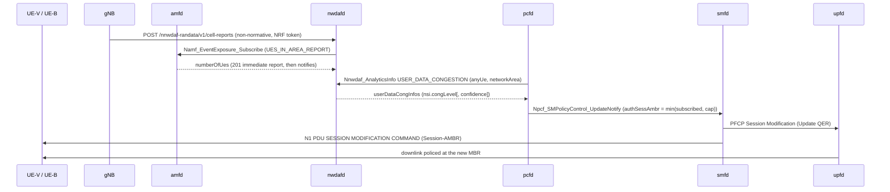

# D441A: RAN-fed User Data Congestion loop to Session-AMBR

Demo key `d441a-congestion-loop` (nextgsim#465, program #458). Modes:
`statistics` (default), `prediction` and `no-loop` (the baseline).

## Purpose

The demo takes the cell occupancy measured at the RAN and has nwdafd serve it
as TS 23.288 §6.8 *User Data Congestion*. That analytics output drives a real
PCF policy change. The change reaches the UPF QER and protects a priority UE.
The comparison is the same network with no loop.

- **Success signal:** with the loop on, during UE-B's ramp:
  - smfd logs `Applying PCF-updated policy … AMBR UL/DL=1000000/1000000 bps` for
    the best-effort UE (UE-B), followed by upfd `Installed 1 QERs for SEID=…`;
  - the protected UE's (UE-V's) ping p95 stays flat.

  With the loop off, there is no policy update and the p95 rises.
- **Not the point:**
  - It is not a prediction-accuracy demo. The prediction is a least-squares fit
    on a ramp, and it is a secondary arm.
  - It is not a RAN scheduler demo.

## How it works



| component | what it does |
|---|---|
| gNB (this repo, `nextgsim-gnb/src/congestion/`) | Serves every UE's downlink through one FIFO, drained by a token bucket at the configured capacity C, with drop-tail at `queue_limit_bytes`. A flood from UE-B therefore delays UE-V's packets. Each `window_ms` window, occupancy is computed as served bits / (C × window). The exporter registers at the NRF as an AF, takes an OAuth2 token (CCA, scope `nnwdaf-randata`) and POSTs a cell report: the measured occupancy, plus an 8-sample OLS prediction with R² confidence in mode `prediction`. In `no-loop` it sends nothing. |
| nwdafd (nextgcore, `ran_congestion.rs`) | The ingest route checks its own token. Without one it answers 401; with the wrong scope, 403; and it ingests nothing in either case. For each reported TAI it subscribes to the AMF's `UES_IN_AREA_REPORT` as a cross-check on the gNB's connected-UE count. `USER_DATA_CONGESTION` answers per reported cell in the requested area, with `congLevel` = occupancy %. A past or absent `ana-req` gives statistics; a future `ana-req` gives the gNB's prediction with `confidence`. A stale report gives 204. |
| pcfd (nextgcore, `congestion_loop.rs`, `ambr_override.rs`) | Polls USER_DATA_CONGESTION for the configured cells: mode `prediction` asks for a future period, the other modes for statistics. It throttles UE-B's Session-AMBR through a per-session override layer, which every subscription-derived re-notify also consults, so the cap survives a re-authorisation. When congestion clears it restores the subscribed value. |
| smfd / upfd (existing) | smfd applies the notify as a full replacement (nextgcore#1387), updates the UPF QER and sends N1 Session-AMBR to the UE (nextgcore#1385). |

**Guardrails (pcfd `pcf.congestion_loop`).** The controller only acts within
these limits:
- **Scope:** only sessions on the configured slice and DNN.
- **Who:** never a `protected_supis` UE, and only `best_effort_supis` UEs when
  that list is set.
- **How many:** at most `max_sessions` sessions throttled.
- **How far:** the cap is `throttle_kbps`, never below `floor_kbps` (default 500)
  and never above the subscribed AMBR.
- **When to throttle:** at `congLevel >= throttle_at`.
- **When to restore:** after `restore_after_polls` polls below `restore_below`,
  and only once the throttle is at least `min_hold_secs` old.
- **Fail open:** restore after `fail_open_secs` with no data.
- **Dry run:** `dry_run` logs every action without taking it.

An active demo with no `pcf.congestion_loop` block fails pcfd startup. So do
two active demos that both write the override layer.

## Configuration and toggles

Two gates on every NF, both needed:
- the cargo feature `demo-d441a-congestion-loop`, on `nextgsim-gnb` (which
  implies `6g` and `sbi-client`), `nextgcore-nwdafd` and `nextgcore-pcfd`;
- `demo: {enabled: true, d441a-congestion-loop: {enabled: true, mode: …}}` in
  gnb.yaml, nwdaf.yaml and pcf.yaml.

An unknown mode fails startup with `DemoConfigError::UnknownMode`. Each NF logs
`WARN DEMO MODE ACTIVE: d441a-congestion-loop=<mode>` and a `[demo:d441a-congestion-loop]`
prefix on its lines. The nextgcore NFs export
`nextg_demo_enabled{demo="d441a-congestion-loop",mode="<mode>"} 1` on
`/metrics`.

The gNB block, read only while the demo is active:

```yaml
congestion_export:
  cell_capacity_mbps: 5.0        # C, required (a simulator construct)
  queue_limit_bytes: 200000
  window_ms: 1000
  prediction_horizon_ms: 5000
  nrf_uri: http://nrf:7777       # required
  # nwdaf_uri: http://nwdaf:7777 # optional, skips discovery
  nf_instance_id: 6b1d7e3c-0000-4000-8000-00000000465a
  cca_key_file: /tmp/d441a-cca/exporter.key   # created 0600 if absent; an existing file
                                              # must be a regular file, mode 0600, owned
                                              # by the gNB's uid, or startup fails
  cca_public_jwk_dir: /tmp/d441a-cca          # writes <nf_instance_id>.jwk
```

The NRF must trust the exporter's public JWK, through
`nrf.sbi.oauth2.cca_trusted_keys_dir`. If the key file or the JWK directory is
unusable, gNB startup fails.

Runtime switching applies to the gNB only:
- `nr-cli <gnb> demo d441a-congestion-loop set mode=<mode>` takes effect from
  the next window;
- `nr-cli <gnb> congestion-status` shows the mode, the last occupancy and
  prediction, the queue state and the export counters.

nwdafd and pcfd switch only by changing their config and restarting.

## How to run it

**EKS (devtest1)** uses the nextgcore overlay
`deploy/eks/overlays/demo-d441a-congestion-loop/` and its harness from
nextgcore #1485 or later (main). The restore knobs and their check need #1481,
and the load checks need #1485. Run the arms in this order, each one under
`flock /tmp/eks-nextg-demo.lock`, one arm per lock hold:

```bash
export YES=true KUBE_CONTEXT=devtest1 CORE_IMAGE_TAG=demo-d441a-congestion-loop-<core sha> \
  SIM_IMAGE_TAG=demo-d441a-congestion-loop-<sim sha> SIM_SHA=<sim sha>
flock /tmp/eks-nextg-demo.lock k8s/demo-check.sh off off                           # demo-off control
flock /tmp/eks-nextg-demo.lock k8s/demo-check.sh d441a-congestion-loop no-loop     # baseline first: its p95 is the reference
flock /tmp/eks-nextg-demo.lock k8s/demo-check.sh d441a-congestion-loop statistics
flock /tmp/eks-nextg-demo.lock k8s/demo-check.sh d441a-congestion-loop prediction
```

The images, each pushed under a new tag (never overwrite one):
- core NFs, nwdafd included, built with the demo profile's 6G features plus
  `nextgcore-nwdafd/demo-d441a-congestion-loop` and
  `nextgcore-pcfd/demo-d441a-congestion-loop` (`deploy/eks/profiles/demo/profile.env`);
- the gNB with `--features demo-d441a-congestion-loop`;
- the UE image with `nr-cli` in it. Build `nextgsim-cli` into `nextgsim/binaries/`
  as well: the gNB pod's `d441a-nr-cli` initContainer copies `nr-cli` from the UE
  image, and the scenario reads the gNB's `congestion-status` through it.
  `Dockerfile.ue-local` copies `nr-cli` only if it is there and stays silent when
  it is not, so check the built image (`command -v nr-cli`) before pushing.
  Without it the gNB pod fails to start.

What the overlay provides:
- nwdafd;
- pcf.yaml's loop block: UE-V `imsi-999700000000001` protected, UE-B
  `imsi-999700000000002` best effort, a 1000 kbps cap, throttle at 80, restore
  after 15 consecutive polls below 3 and a 10 s hold. Before nextgcore #1481
  the restore was below 10 after 3 polls (see Results). The scenario refuses
  knobs that fall inside the occupancy the throttle itself leaves
  (`d441a_restore_hysteresis`);
- the gNB block with C = 5 Mbps, the gNB at `RUST_LOG=info` with a 1000m CPU
  limit, and `nr-cli` at `/opt/d441a/nr-cli`;
- UE-V and UE-B without their per-packet log lines, so kubelet does not rotate
  away the asserted lines;
- the NRF's trusted-key directory;
- UE-B.

The overlay's `scenario.sh` then:
1. hands the gNB's JWK to the NRF;
2. seeds UE-B's subscriber and starts UE-B;
3. pings the UPF gateway (10.45.0.1) from UE-V at 10 Hz for the whole run (900 pings);
4. loads the downlink from UE-B with echo requests, whose replies are the downlink.
   Each step is `ping -i 0.001 -l 8`. The `-l 8` preload keeps the rate from being
   paced by the round trip, so the rate is set by the packet size. The ramp is ten
   4 s steps at IP packet sizes of 125·m bytes (m = 1..10), about 0.2C to 1.6C. Then
   comes a 12 s hold of two such pings at 1250-byte packets (about 3C). Then UE-B
   stops. Every ramp step's and hold ping's `kubectl exec` must exit 0 (#1485);
   a failed one is named (`ramp step N (-s M): kubectl exec exited RC`). Each
   step must also have carried traffic (#1485, `d441a_load_traffic`): it needs
   its ping summary, at least 100 requests a second of its deadline, and at
   least one reply. Otherwise the run fails with
   `load <step> produced no traffic: …`. In the loop modes the run then waits up
   to 60 s for UE-B's restore (#1481), since 15 quiet polls can outlast UE-V's
   ping;
5. samples the gNB's measured occupancy once a second throughout
   (`nr-cli <gnb> congestion-status`, into `scenario/gnb-status.txt`);
6. sends an unauthenticated POST to the ingest route;
7. takes whole container logs after the load. A log whose first line is stamped
   after the load began was rotated, and the run fails. So does a needed capture
   that comes back empty;
8. checks per mode:
   - `no-loop`: nothing ingested, `export: off`, pcfd `hold(no-ran-data)`, no PCF
     policy update. The load must saturate the cell: if the peak measured
     occupancy is under 90 %, the run fails with "load did not saturate". It then
     writes `saturated=yes` and requires UE-V's p95 to be at least 100 ms;
   - `statistics` / `prediction`: the ordered chain (ingest, UDC 200, pcfd
     throttle, smfd 1 Mbps, upfd QER, UE-B's N1 Session-AMBR before the restore,
     restore); exactly one throttle and one restore of UE-B and none of UE-V; the
     restore bound (#1485), `T_STOP <= restore <= max(T_STOP + restore_after_polls·poll_ms,
     throttle + min_hold_secs) + 10 s`, so a mid-load or a late restore fails; the
     AMF/gNB UE-count cross-check; UE-V's p95 at most 0.25× the newest no-loop
     arm's. The comparison is only made when that arm's `saturation.txt` says
     `saturated=yes`; otherwise the run fails with that reason;
   - every mode: the tokenless POST is 401 and is followed by no throttle.

The artefacts go to `/tmp/eks-val/demos/d441a-congestion-loop/<mode>/<UTC>/`.

The Results below were captured with the #1481 harness, and on main two lines
read differently. The knob check prints its terms in another order. This is
`d441a_restore_hysteresis` run on main's overlay files:

```
restore hysteresis ok: 15 polls x 1000 ms >= 12000 ms, restore_below 3 <= 3, ceiling 20 %
```

The chain line also ends with the restore's distance from UE-B's stop. In main's
`scenario.sh` the chain's `print` ends with the f-string
`f"({(t7 - t_stop).total_seconds():.1f} s after UE-B stopped)"`.

**Compose.** No compose overlay ships for this demo yet. To run it by hand:
1. Build nwdafd and pcfd with `--features demo-d441a-congestion-loop`, and the
   gNB with the same feature.
2. Add the three configuration blocks above.
3. Add a second UE (IMSI `999700000000002`) and its subscriber.
4. Trust the gNB's JWK at the NRF.
5. Reproduce `scenario.sh`'s load.

## Results

**All four arms pass on EKS with the restore-hysteresis fix (nextgcore #1481,
merged).** On main (nextgcore `55c6afcb0eda`), three of the four
passed. The demo-off control, the no-loop baseline and the statistics loop
passed there. On a saturated cell, the loop keeps UE-V's ping p95 at 3.6 to
4.2 ms against 320 ms with no loop, and the UPF polices UE-B at the 1 Mbps cap.

The prediction arm failed on main in 2 of 2 runs. It restored UE-B while UE-B's
load was still offered and re-throttled it about 2 s later, because the
overlay's `restore_below: 10` sits inside the occupancy the throttle itself
leaves (nextgcore#1480). With #1481's knobs (`restore_below: 3`,
`restore_after_polls: 15`), prediction passed 2 of 2 and statistics passed. Each
arm throttled once and restored once, after UE-B stopped. Two other attempts on
#1481 failed for reasons outside the demo, both while the cluster API was
unreachable from the operator host (below). Since nextgcore #1485 (merged), the
scenario names such a stalled load step instead of reading it as a restore.

### With the restore-hysteresis fix (nextgcore #1481)

Core images `nextg/{nrf,amf,smf,upf,ausf,udm,udr,pcf,nssf,bsf,nwdaf}:demo-d441a-congestion-loop-d75814c46811`.
#1481 changes only the overlay and the scenario, so these are the same release
binaries as the `55c6afcb0eda` images, repackaged under the fix commit's tag.
The gnb/ue images are the same `demo-d441a-congestion-loop-65fa4c899312`. The
p95 baseline is the no-loop arm below (`no-loop/20261112T162447Z`,
`saturated=yes`). The no-loop arm never restores, so it does not depend on the
restore knobs.

| arm | artefacts (`/tmp/eks-val/demos/d441a-congestion-loop/…`) | VERDICT | UE-V p95 |
|---|---|---|---|
| `statistics` | `statistics/20261112T180956Z` | PASS | 3.6 ms |
| `prediction` | `prediction/20261112T180021Z` | PASS | 4.2 ms |
| `prediction` | `prediction/20261112T181742Z` | PASS | 3.7 ms |
| `statistics` | `statistics/20261112T174900Z` | FAIL: the load stalled, not the loop (below) | 3.8 ms |
| `prediction` | `prediction/20261112T180011Z` | FAIL: `deploy` (cluster API unreachable) | n/a |

Every run that deployed checked the knobs first (`scenario.log`):

```
[scenario] restore hysteresis ok: restore_below 3 <= 3, 15 polls x 1000 ms >= 12000 ms, ceiling 20 %
```

The prediction chain, one throttle during the load and one restore after UE-B
stopped (`prediction/20261112T181742Z`, `scenario.log`):

```
[scenario] UE-B stopped at 2026-11-12T18:22:29Z
[scenario] chain: ingest 2026-11-12 18:21:03.617850 → udc 2026-11-12 18:21:03.637976 → throttle 2026-11-12 18:21:50.638980 → smf 2026-11-12 18:21:50.647012 → upf 2026-11-12 18:21:50.647355 → ue-b 2026-11-12 18:21:50.732418 → restore 2026-11-12 18:22:46.639306
[scenario] UE-V p95 3.7 ms vs no-loop 320.0 ms
```

The statistics chain (`statistics/20261112T180956Z`, `scenario/pcf-chain.txt`, `scenario.log`):

```
[2026-11-12T18:13:53.789Z INFO  nextgcore_pcfd::congestion_loop] [demo:d441a-congestion-loop] congestion-loop: observed=congLevel=89(ran-user-data-congestion) action=throttle(supi=imsi-999700000000002) sm_policy_id=8b780551-dba2-4ff6-adc0-f06eac3606e5 ambr=1000000/1000000 bps (subscribed 1000000000/1000000000 bps, floor 500 kbps)
[2026-11-12T18:14:48.787Z INFO  nextgcore_pcfd::congestion_loop] [demo:d441a-congestion-loop] congestion-loop: observed=congLevel=0(ran-user-data-congestion) action=restore(supi=imsi-999700000000002) sm_policy_id=8b780551-dba2-4ff6-adc0-f06eac3606e5 reason=below-threshold
[scenario] UE-V p95 3.6 ms vs no-loop 320.0 ms
```

Hysteresis margin. Here are the UDC `congLevel` answers pcfd received between
the throttle and UE-B stopping, as the longest runs of consecutive polls below
3 and below 10. These are counted by a script over each run's
`scenario/nwdaf-chain.txt`, so they are not quoted lines:

| run | knobs | in-load polls | min | longest < 3 | longest < 10 |
|---|---|---|---|---|---|
| statistics `164134Z` | 10 / 3 | 40 | 6 | 0 | 2 (passed by one poll) |
| prediction `165042Z` | 10 / 3 | 40 | 0 | 6 | 7 (restored mid-load) |
| prediction `170200Z` | 10 / 3 | 44 | 0 | 6 | 6 (restored mid-load) |
| statistics `180956Z` | 3 / 15 | 40 | 1 | 1 | 1 |
| prediction `180021Z` | 3 / 15 | 43 | 0 | 4 | 6 |
| prediction `181742Z` | 3 / 15 | 39 | 0 | 5 | 6 |

Under the old knobs, both prediction runs on the fix would have restored UE-B
mid-load (a run of 6 below 10 against 3 polls). Under the new ones, the longest
in-load run below 3 was 5 polls on the fix runs (6 across all six runs, the
figure behind `D441A_INLOAD_LOW_RUN_POLLS=6`), against 15 required. The restore
came 15.8 s (`180956Z`), 16.9 s (`180021Z`) and 17.6 s (`181742Z`) after UE-B
stopped, and the scenario's restore wait held it.

**The two failed attempts.** Neither is the loop.
- `statistics/20261112T174900Z`: ramp step 6's `kubectl exec ping` failed
  without reaching the cluster (`scenario/ue-b-ramp.txt`, the whole of step 6):

  ```
  Unable to connect to the server: dial tcp: lookup [REDACTED-HEX128].yl4.us-west-2.eks.amazonaws.com on 169.254.253.253:53: write udp 169.254.253.253:51345->169.254.253.253:53: write: operation not permitted
  ```

  The once-a-second occupancy sampler (also a `kubectl exec`)
  logged nothing between 17:55:55 and 17:56:12. UE-B offered no load for those
  ~17 s, so the gNB served only UE-V's pings, and pcfd restored after 15 quiet
  polls, which is correct. Step 7 then re-loaded the cell and pcfd throttled
  again, hence two throttles. The scenario's own nwdafd capture came back empty
  in the same run (`the nwdaf log does not reach back to the load start`), while
  demo-check's later capture of the same container holds it. The gNB's reports
  in that window (`logs/<nwdaf-pod>_nwdaf.log`):

  ```
  [2026-11-12T17:55:55.400Z INFO  nextgcore_nwdafd::ran_congestion] [demo:d441a-congestion-loop] ran-ingest cell=99970-000000010 tai=99970-000001 occupancy=4.4% served_kbps=222/5000 connected_ues=2 amf_ues_in_area=2 from=6b1d7e3c-0000-4000-8000-00000000465a
  [2026-11-12T17:55:56.400Z INFO  nextgcore_nwdafd::ran_congestion] [demo:d441a-congestion-loop] ran-ingest cell=99970-000000010 tai=99970-000001 occupancy=0.1% served_kbps=7/5000 connected_ues=2 amf_ues_in_area=2 from=6b1d7e3c-0000-4000-8000-00000000465a
  ```

  and pcfd's throttle and restore (`scenario/pcf-chain.txt`):

  ```
  [2026-11-12T17:55:52.972Z INFO  nextgcore_pcfd::congestion_loop] [demo:d441a-congestion-loop] congestion-loop: observed=congLevel=84(ran-user-data-congestion) action=throttle(supi=imsi-999700000000002) sm_policy_id=49b02fca-d20e-40bc-869c-3bec1e521cb3 ambr=1000000/1000000 bps (subscribed 1000000000/1000000000 bps, floor 500 kbps)
  [2026-11-12T17:56:10.971Z INFO  nextgcore_pcfd::congestion_loop] [demo:d441a-congestion-loop] congestion-loop: observed=congLevel=0(ran-user-data-congestion) action=restore(supi=imsi-999700000000002) sm_policy_id=49b02fca-d20e-40bc-869c-3bec1e521cb3 reason=below-threshold
  ```

- `prediction/20261112T180011Z`: deploy-eks.sh stopped with
  `[fail  ] cannot reach the cluster API. Check credentials and endpoint access.`
  It created nothing. The next run 10 s later deployed normally.

Since nextgcore #1485, `d441a_ue_b_load` checks every ramp and hold
`kubectl exec`, and `d441a_load_traffic` fails a step with no ping summary,
fewer than 100 requests a second of its deadline, or no replies. #1485's
replay over the eight arms trips only `174900Z`, at step 6. Run on main over
this run's `scenario/ue-b-ramp.txt`, it names the step:
`load step 6 produced no traffic: no ping summary (Unable to connect to the server: …)`.

Everything below is copied from the run artefacts under `/tmp/eks-val/demos/` on
the operator host. Nothing is reconstructed. The code blocks are selected lines,
with the kubelet timestamp prefix and the ANSI colour codes trimmed.

### How it was run

The arms ran with `KEEP=true`, so that UE-B's post-run state could be read
(`post/`). A wrapper then deleted the `nextg-demo` namespace that the run had
created, in the same lock hold. That is why the verdicts say `teardown=kept`;
every `post/wrapper.txt` contains `namespace gone`.

- **Harness:** nextgcore `55c6afcb0eda`, main with #1472, #1476 (upfd MBR/GBR in
  kbit/s) and #1477 (this scenario's saturating load and its captures).
- **Images** (devtest1 ECR, new tags only):
  - `nextg/{nrf,amf,smf,upf,ausf,udm,udr,pcf,nssf,bsf,nwdaf}:demo-d441a-congestion-loop-55c6afcb0eda`;
  - `nextg/{gnb,ue}:demo-d441a-congestion-loop-65fa4c899312` (nextgsim main
    `65fa4c8`). The UE image carries `nr-cli`, checked with `command -v nr-cli`
    before the push.
- **e2e.** Every arm's base e2e (`e2e-internet.sh`, PROFILE=demo) passed: `e2e_rc=0`.

### What ran

| arm | artefacts (`/tmp/eks-val/demos/…`) | VERDICT | peak occupancy | UE-V p95 |
|---|---|---|---|---|
| `off off` (demo-off control) | `off/off/20261112T161237Z` | PASS | n/a | n/a |
| `d441a-congestion-loop no-loop` | `d441a-congestion-loop/no-loop/20261112T162447Z` | PASS (`saturated=yes`) | 100.0 % | 320.0 ms |
| `d441a-congestion-loop statistics` | `d441a-congestion-loop/statistics/20261112T164134Z` | PASS | 82.1 % | 3.7 ms |
| `d441a-congestion-loop prediction` | `d441a-congestion-loop/prediction/20261112T165042Z` | FAIL: two throttles (nextgcore#1480) | 100.0 % | 3.9 ms |
| `d441a-congestion-loop prediction` (rerun) | `d441a-congestion-loop/prediction/20261112T170200Z` | FAIL: two throttles (nextgcore#1480) | 99.9 % | 4.3 ms |

- **Demo-off control:** `demo_banner_lines=0 demo_prefix_lines=0 nextg_demo_enabled_series=0`.
- **Demo arms:** `demo_banner_lines=3` in every demo arm except prediction
  `170200Z` and statistics `174900Z`, which have `demo_banner_lines=2`. The
  banners of pcfd, nwdafd and the gNB are all in the statistics capture
  (`statistics/20261112T164134Z/log-chain.txt`, prefixes trimmed):

  ```
  [2026-11-12T16:42:25.486Z WARN  nextgcore_demo] DEMO MODE ACTIVE: d441a-congestion-loop=statistics
  [2026-11-12T16:42:25.649Z WARN  nextgcore_demo] DEMO MODE ACTIVE: d441a-congestion-loop=statistics
  2026-11-12T16:42:56.118969Z  WARN nextgsim_demo: DEMO MODE ACTIVE: d441a-congestion-loop=statistics
  nextg_demo_enabled{demo="d441a-congestion-loop",mode="statistics"} 1
  ```

- **Not run:** the runtime `nr-cli … set mode=` switch, and a compose arm (none ships).

### Baseline vs mode

| | no-loop | statistics | prediction (both runs) |
|---|---|---|---|
| peak measured occupancy (`saturation.txt`) | 100.0 % (`saturated=yes`) | 82.1 % | 100.0 % / 99.9 % |
| pcfd | `hold(no-ran-data)` | one throttle, one restore of UE-B | two throttles, two restores of UE-B |
| smfd PCF-updated policies (`post/smf-pcf-updates.txt`) | 0 | 2 | 4 |
| upfd `qer_gate` drops (end of run) | 0 | 33937 | 32619 / 34644 |
| UE-B hold, echo replies received | 2953 + 3035 of 20121 | 506 + 503 of 19213 | 502 + 504 / 514 + 514 |
| UE-V p95 | 320.0 ms | 3.7 ms | 3.9 ms / 4.3 ms |
| tokenless POST | 401 | 401 | 401 |
| pcfd durable caps after the run | 0 | 0 | 0 / 0 |

### no-loop: the cell saturates and UE-V queues

With the #1477 load, UE-B's offered rate rises with the packet size. The cell
starts to drop echoes from the seventh step on. The hold loses about 70 % of
them, with no QER drops (`qer_gate` 0), so they are lost at the gNB's capacity-C
queue (`scenario/ue-b-ramp.txt`, the last ramp step
and the two hold pings):

```
3320 packets transmitted, 1997 received, 39.8494% packet loss, time 3999ms
10067 packets transmitted, 2953 received, 70.6665% packet loss, time 11998ms
10054 packets transmitted, 3035 received, 69.813% packet loss, time 11992ms
```

UE-V's pings share that queue (`scenario/ue-v-ping.txt`, `scenario/saturation.txt`):

```
rtt min/avg/max/mdev = 1.746/82.626/322.459/132.061 ms, pipe 4
peak_occupancy_pct=100.0
saturated=yes
```

The loop side stays off: the gNB exports nothing, and pcfd holds
(`scenario/gnb-chain.txt`, `scenario/pcf-chain.txt`):

```
2026-11-12T16:28:12.000960Z  INFO nextgsim_gnb::congestion::exporter: [demo:d441a-congestion-loop] export: off (mode=no-loop)
[2026-11-12T16:25:38.497Z INFO  nextgcore_pcfd::congestion_loop] [demo:d441a-congestion-loop] congestion-loop: observed=unavailable(ran-user-data-congestion) action=hold(no-ran-data) throttled=0
```

### statistics: the loop protects UE-V

The scenario's verdict on the chain (`scenario.log`):

```
[scenario] chain: ingest 2026-11-12 16:45:50.246111 → udc 2026-11-12 16:45:50.550294 → throttle 2026-11-12 16:46:35.551889 → smf 2026-11-12 16:46:35.557480 → upf 2026-11-12 16:46:35.557900 → ue-b 2026-11-12 16:46:35.642564 → restore 2026-11-12 16:47:18.550177
[scenario] connected_ues=2 amf_ues_in_area=2
[scenario] UE-V p95 3.7 ms vs no-loop 320.0 ms
```

The lines behind it, in order: the measured report crossing 80 %, nwdafd's
answer, pcfd's throttle, smfd, upfd and UE-B's N1 Session-AMBR. Then, after
UE-B stopped (`UE-B stopped at 2026-11-12T16:47:15Z`), the restore
(`scenario/nwdaf-chain.txt`, `pcf-chain.txt`, `smf-chain.txt`,
`upf-chain.txt`, `ue-b-chain.txt`):

```
[2026-11-12T16:46:35.267Z INFO  nextgcore_nwdafd::ran_congestion] [demo:d441a-congestion-loop] ran-ingest cell=99970-000000010 tai=99970-000001 occupancy=82.1% served_kbps=4107/5000 connected_ues=2 amf_ues_in_area=2 from=6b1d7e3c-0000-4000-8000-00000000465a
[2026-11-12T16:46:35.549Z INFO  nextgcore_nwdafd::ran_congestion] [demo:d441a-congestion-loop] udc GET USER_DATA_CONGESTION kind=statistics cell=000000010 congLevel=82 → 200
[2026-11-12T16:46:35.551Z INFO  nextgcore_pcfd::congestion_loop] [demo:d441a-congestion-loop] congestion-loop: observed=congLevel=82(ran-user-data-congestion) action=throttle(supi=imsi-999700000000002) sm_policy_id=25c63a39-827a-4c60-ae91-6b27e62dc965 ambr=1000000/1000000 bps (subscribed 1000000000/1000000000 bps, floor 500 kbps)
[2026-11-12T16:46:35.557Z INFO  nextgcore_smfd] Applying PCF-updated policy to ref=2: AMBR UL/DL=1000000/1000000 bps, 5QI=9
[2026-11-12T16:46:35.557Z INFO  nextgcore_upfd] Installed 1 QERs for SEID=0x2
2026-11-12T16:46:35.642502Z  INFO nextgsim_ue::app::task: PDU session 1: network set Session-AMBR DL 1 (unit 6) / UL 1 (unit 6)
[2026-11-12T16:47:18.550Z INFO  nextgcore_pcfd::congestion_loop] [demo:d441a-congestion-loop] congestion-loop: observed=congLevel=0(ran-user-data-congestion) action=restore(supi=imsi-999700000000002) sm_policy_id=25c63a39-827a-4c60-ae91-6b27e62dc965 reason=below-threshold
[2026-11-12T16:47:18.558Z INFO  nextgcore_smfd] Applying PCF-updated policy to ref=2: AMBR UL/DL=1000000000/1000000000 bps, 5QI=9
[2026-11-12T16:47:18.559Z INFO  nextgcore_upfd] Installed 1 QERs for SEID=0x2
2026-11-12T16:47:18.637044Z  INFO nextgsim_ue::app::task: PDU session 1: network set Session-AMBR DL 1 (unit 11) / UL 1 (unit 11)
```

**The cap is now enforced at the UPF** (nextgcore #1476). In the round before it,
upfd counted no `qer_gate` drops behind the same 1 Mbps QER. This time UE-B's hold
gets about 95 % of its echoes dropped by the QER, before they reach the gNB's
queue (`scenario/ue-b-ramp.txt`, `metrics/<upf-pod>.prom`):

```
9605 packets transmitted, 506 received, 94.7319% packet loss, time 11999ms
upf_dataplane_dropped_packets_by_reason_total{reason="qer_gate"} 33937
```

UE-V's RTT stays flat (`scenario/ue-v-ping.txt`):

```
rtt min/avg/max/mdev = 1.807/3.144/5.255/0.416 ms
```

nwdafd ingested every report and refused the tokenless one; pcfd's durable
state holds no cap after the restore (`metrics/<nwdaf-pod>.prom`,
`post/pcf-state-caps.txt`):

```
nwdaf_ran_cell_reports_total{result="ingested"} 175
nwdaf_ran_cell_reports_total{result="unauthorized"} 1
demo_ambr_cap occurrences (non-null): 0 state_bytes: 5646
```

### prediction on main, before the fix: it throttles in time, then restores mid-load (nextgcore#1480)

The prediction crossed 80 % and pcfd throttled UE-B. Then, with UE-B still
loading, pcfd restored it and throttled it again 2 s later (`scenario.log`, cut
at the first list item; `scenario/pcf-chain.txt`):

```
[scenario] FAIL: expected exactly one throttle of imsi-999700000000002, got ['[2026-11-12T16:57:19.676Z INFO  nextgcore_pcfd::congestion_loop] [demo:d441a-congestion-loop] congestion-loop: observed=congLevel=88 confidence=25(ran-user-data-congestion) action=throttle(supi=imsi-999700000000002) sm_policy_id=e8b73b4e-6cce-4b1e-b39e-32dd62851951 ambr=1000000/1000000 bps (subscribed 1000000000/1000000000 bps, floor 500 kbps)',
```

```
[2026-11-12T16:57:19.676Z INFO  nextgcore_pcfd::congestion_loop] [demo:d441a-congestion-loop] congestion-loop: observed=congLevel=88 confidence=25(ran-user-data-congestion) action=throttle(supi=imsi-999700000000002) sm_policy_id=e8b73b4e-6cce-4b1e-b39e-32dd62851951 ambr=1000000/1000000 bps (subscribed 1000000000/1000000000 bps, floor 500 kbps)
[2026-11-12T16:57:37.676Z INFO  nextgcore_pcfd::congestion_loop] [demo:d441a-congestion-loop] congestion-loop: observed=congLevel=4 confidence=28(ran-user-data-congestion) action=restore(supi=imsi-999700000000002) sm_policy_id=e8b73b4e-6cce-4b1e-b39e-32dd62851951 reason=below-threshold
[2026-11-12T16:57:39.676Z INFO  nextgcore_pcfd::congestion_loop] [demo:d441a-congestion-loop] congestion-loop: observed=congLevel=100 confidence=56(ran-user-data-congestion) action=throttle(supi=imsi-999700000000002) sm_policy_id=e8b73b4e-6cce-4b1e-b39e-32dd62851951 ambr=1000000/1000000 bps (subscribed 1000000000/1000000000 bps, floor 500 kbps)
[2026-11-12T16:58:02.674Z INFO  nextgcore_pcfd::congestion_loop] [demo:d441a-congestion-loop] congestion-loop: observed=congLevel=0 confidence=74(ran-user-data-congestion) action=restore(supi=imsi-999700000000002) sm_policy_id=e8b73b4e-6cce-4b1e-b39e-32dd62851951 reason=below-threshold
```

The rerun (`prediction/20261112T170200Z`) did the same: a throttle at
17:08:53, a restore at 17:09:16 and a re-throttle at 17:09:18.

**Diagnosis: a harness/config defect, not base core.**
- With UE-B capped at 1 Mbps, the cell can be at most 20 % occupied. The
  measured occupancy after the throttle ran between 5.9 % and 17.7 %.
- The overlay's `restore_below: 10` therefore lies inside the band that the
  throttle itself produces.
- In `prediction`, the gNB's 8-sample least-squares fit extrapolates the
  throttle-induced drop to 0, so three polls under 10 come quickly once the 10 s
  hold has passed. Then nwdafd answers three polls under 10 in a row, and pcfd
  restores (`scenario/nwdaf-chain.txt`):

  ```
  [2026-11-12T16:57:22.526Z INFO  nextgcore_nwdafd::ran_congestion] [demo:d441a-congestion-loop] ran-ingest cell=99970-000000010 tai=99970-000001 occupancy=8.8% served_kbps=442/5000 connected_ues=2 amf_ues_in_area=2 predicted=0.0% conf=51 horizon_ms=5000 from=6b1d7e3c-0000-4000-8000-00000000465a
  [2026-11-12T16:57:35.674Z INFO  nextgcore_nwdafd::ran_congestion] [demo:d441a-congestion-loop] udc GET USER_DATA_CONGESTION kind=prediction cell=000000010 congLevel=9 confidence=5 → 200
  [2026-11-12T16:57:36.674Z INFO  nextgcore_nwdafd::ran_congestion] [demo:d441a-congestion-loop] udc GET USER_DATA_CONGESTION kind=prediction cell=000000010 congLevel=6 confidence=22 → 200
  [2026-11-12T16:57:37.675Z INFO  nextgcore_nwdafd::ran_congestion] [demo:d441a-congestion-loop] udc GET USER_DATA_CONGESTION kind=prediction cell=000000010 congLevel=4 confidence=28 → 200
  ```

- The statistics arm passed with the same knobs, but only just: its measured
  samples fell under 10 % for two polls in a row several times, and a third would
  have restored it too.
- The controller and the chain behave as configured. The thresholds are this
  demo's choices (see the honesty labels). nextgcore#1480 records the
  threshold and the options for fixing it (a `restore_below` under the throttled
  floor, or a restore signal the throttle does not suppress). nextgcore #1481
  fixes it; the runs on the fix (now on main) are at the top of Results.

UE-V was still protected, because every throttle took effect at once
(`metrics/<upf-pod>.prom`, `scenario/ue-v-ping.txt`):

```
upf_dataplane_dropped_packets_by_reason_total{reason="qer_gate"} 32619
rtt min/avg/max/mdev = 1.803/7.039/319.695/28.896 ms, pipe 4
```

The 319 ms maximum is the ramp's peak before the first throttle. p95 is 3.9 ms.

### What changed since the first run

The first run (nextgcore `ff97da6b0185`, nextgsim `ec4c32d`; artefacts
`d441a-congestion-loop/{no-loop,statistics,prediction}/20261112T13*`) failed
every demo arm on three defects. All three are fixed on main now:
- the load was paced by the round trip and never saturated C (peak 74 %, no-loop
  p95 4.3 ms). Fixed by nextgcore #1477's `-l 8` size ramp: peak 100 %, p95 320 ms;
- upfd read the PFCP MBR 1000× too high, so the 1 Mbps QER policed nothing
  (`qer_gate` 0). Fixed by nextgcore #1476: `qer_gate` 33937;
- the scenario matched its own refused POST as an ingest, and DEBUG logs rotated
  away the banner and the throttle's N1. Fixed by #1477: the gNB banner and
  `export: off` are captured, and UE-B's throttle N1 precedes the restore.

### Base-core finding from the same session (not D441A)

In the D444A rerun on the same core commit, pcfd once skipped its NRF
registration, so no UE could register: a start-up race in
`pcf_sbi_open`, nextgcore#1479. None of the D441A arms hit it. Each pcfd here
logged `PCF registered with NRF`.

## Honesty labels and limitations

- **Simulator constructs.** C and the queue are simulator constructs: the gNB
  has no PHY or scheduler. The queue serves RLC UM data PDUs; RLC AM status and
  retransmission PDUs bypass it.
- **Stand-in for OAM.** The gNB push stands in for the OAM PM path (TS 23.288
  §6.2.3, Table 6.8.2-1 "Radio Resource Utilization"). The ingest route is not
  a 3GPP API.
- **Implementation choices.** How the NSI is derived (occupancy as
  `congLevel`) is left open by TS 23.288. The thresholds and the cap are this
  demo's choices.
- **UE selection.** UE-B is chosen from a configured list, which is PCF local
  policy. TS 23.503 targets "UEs reported as heavy users" through Data Dispersion
  analytics, which this demo does not implement.
- **Ingest token.** The ingest route checks its own token instead of nwdafd
  enabling listener-wide OAuth2. Listener-wide OAuth2 would reject amfd's
  token-less notifies (TS 33.501 §13.4.1; nextgcore#1421).
- **Lead time.** The prediction's lead time over statistics is reported, not
  asserted.
- **UE-B's load is ICMP echo.** `scenario.sh` makes UE-B's downlink with large
  echo requests whose replies are the downlink, not an application flow. A
  throttle also polices the requests on the uplink.
- **One prediction horizon.** nwdafd answers a prediction request with the
  gNB's single prediction at its own `prediction_horizon_ms`, whatever future
  window `ana-req` names; `timeIntev` echoes the requested window.
- **pcfd restart.** A cap is recorded with the session in pcfd's durable
  state. A restarted pcfd **with durable state configured** (`--state-file` /
  `NEXTGCORE_PCF_STATE_FILE`) re-notifies the subscribed Session-AMBR for every
  capped session, retrying with backoff, and clears the record only once the
  SMF confirms it (2xx, or 404 for an association it no longer has). Without
  durable state there is no record and nothing is undone. **On EKS** the
  overlay keeps the state file on the pod's emptyDir (devtest1 has no usable
  StorageClass): it survives a container restart, not a pod re-creation. After
  a pcfd pod is re-created mid-throttle, redeploy the arm (smfd included) or
  re-authorise UE-B.
