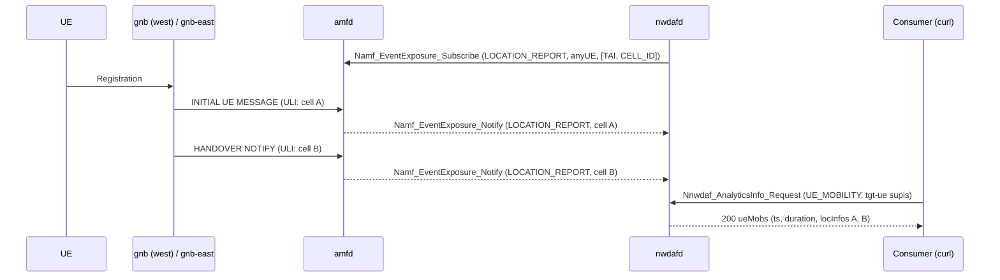

# D441C: UE Mobility analytics from AMF location events

Demo key `d441c-amf-mobility`, ticket
[nextgsim#466](https://github.com/NextgCoreLab/nextgsim/issues/466), program
anchor [nextgsim#458](https://github.com/NextgCoreLab/nextgsim/issues/458).
The code is in nextgcore: amfd in
[nextgcore#1419](https://github.com/NextgCoreLab/nextgcore/pull/1419), nwdafd
in [nextgcore#1425](https://github.com/NextgCoreLab/nextgcore/pull/1425).

## Purpose

To turn nwdafd's UE Mobility analytics from a pinned 204 into a 200 built from
live amfd location events, through the normative Namf_EventExposure path, so
that #464 and other consumers have real data.

- **Success signal:** `GET /nnwdaf-analyticsinfo/v1/analytics?event-id=UE_MOBILITY&tgt-ue=...`
  returns 200 with non-empty `ueMobs[].locInfos` for the simulated SUPI, and
  nwdafd logs `ue-mobility ingest supi=<supi> cell=<ncgi>`.
- **Not the point:** this is not a viewer-facing demo and not a claim about
  prediction quality. It is a milestone that unblocks consumers.

## How it works



### Components

| Piece | Where | What it does |
|---|---|---|
| LOCATION_REPORT on handover | amfd `handle_handover_notify`, `finish_path_switch` (#1419, ungated) | TS 29.518 Table 6.2.6.3.3-1: report the *"Updated Location ... when AMF becomes aware of a location change of the UE"*. Fired after the target location is written. Delivered only to subscriptions whose `locationFilterList` covers what changed (absent = TA changes only, Table 6.2.6.2.3-1). |
| Subscriber | nwdafd `amf_mobility` (#1425) | Discovers an AMF at the NRF and subscribes with LOCATION_REPORT, anyUE, `[TAI, CELL_ID]`, and a 10-minute expiry renewed every 2 minutes. If the AMF lost the subscription (404 on renewal), nwdafd subscribes again. Logs `subscribed to AMF LOCATION_REPORT id=<id>`. |
| Callback | `POST /nnwdaf-callback/v1/amf-location-notify/{token}` on nwdafd's existing SBI listener | TS 33.501 §13.4.1: OAuth 2.0 does not apply to notifications, so the AMF sends no token. The notify is authenticated by the 128-bit random token in the callback URI instead. A wrong token gets a 404 and ingests nothing, and the token is redacted from SBI logs. |
| UE_MOBILITY answer | nwdafd `Nnwdaf_AnalyticsInfo` | TS 29.520 `UeMobility`. Statistics: `ts` = the first observation, `duration` = the observed span, `locInfos` = cells in first-visit order, each with the AMF's own `UserLocation`. Prediction (a future `ana-req` period): the next cell, with `confidence` = the transition share. `tgt-ue` with `supis` is required (§4.3.2.2.2). |
| Runtime support | nwdafd NRF profile, `/metrics` | `UE_MOBILITY` is in `nwdafInfo.eventIds` only while served. `/metrics` (feature builds only) carries `nwdaf_ue_mobility_serving`, `nwdaf_ue_mobility_amf_subscribed` and `nwdaf_ue_mobility_location_reports_total{result}`. |

### Toggles

Follows the #458 convention. Both gates are off by default.

- **Cargo:** nwdafd feature `amf-mobility`. A default build has no route, no
  listener and no subscriber; UE_MOBILITY stays 204.
- **Config** (nwdafd only, config plus restart):

  ```yaml
  demo:
    enabled: true
    d441c-amf-mobility:
      enabled: true
      mode: on        # or baseline
  ```

| Mode | Behaviour |
|---|---|
| `on` | Subscribe, ingest, serve UE_MOBILITY, advertise it to the NRF. |
| `baseline` | No AMF subscription. UE_MOBILITY answers 204 and is not advertised. |

- Outside a demo, `nwdaf.amf_mobility.enabled: true` turns the same feature on.
  An active demo block supersedes it.
- When the demo is active, nwdafd logs `WARN DEMO MODE ACTIVE: d441c-amf-mobility=<mode>`,
  prefixes its lines with `[demo:d441c-amf-mobility]`, and exports
  `nextg_demo_enabled{demo="d441c-amf-mobility",mode="<mode>"} 1`.
- **Startup failures:**
  - `mode: bogus` fails startup with
    `UnknownMode { demo: "d441c-amf-mobility", mode: "bogus" }`;
  - the key in a build without the feature fails with `UnknownKey`.
- amfd's LOCATION_REPORT on handover is base-core behaviour and is not gated.

## How to run it

### Tests

```bash
cd nextgcore/src
cargo test -p nextgcore-amfd --lib -- location_report location_filters intra_ta
cargo test -p nextgcore-nwdafd --features amf-mobility    # includes the amfd end-to-end test
cargo test -p nextgcore-nwdafd                            # demo-off: the 204 path is unchanged
```

### EKS

```bash
k8s/demo-check.sh d441c-amf-mobility on
k8s/demo-check.sh d441c-amf-mobility baseline
k8s/demo-check.sh off off
```

The overlay `deploy/eks/overlays/demo-d441c-amf-mobility/` (ClusterIP only)
adds:

- nwdafd built with `amf-mobility`;
- a second gNB `gnb-east` (NCI 0x020, same TAC), using the #456 two-gNB
  topology;
- the UE's walk from west to east.

`scenario.sh` restarts the UE after the subscription, waits for the N2
handover, then queries nwdafd and the NRF. It captures everything under
`scenario/` in the run directory.

## Results

All of the output below is copied from the devtest1 runs of 2026-11-11. Every
arm ran on the same images, so only `mode` differs: core and gNB/UE at
`demo-d441c-e0848a6`, the overlay at nextgcore e0848a62. Each run directory
sits under `/tmp/eks-val/demos/`.

| Arm | Run directory | Verdict |
|---|---|---|
| demo-off control | `off/off/20261111T182101Z/` | PASS: e2e PASS, 0 `DEMO MODE ACTIVE` lines, 0 `[demo:` lines, 0 `nextg_demo_enabled` series |
| `baseline` | `d441c-amf-mobility/baseline/20261111T180932Z/` | PASS: e2e PASS, scenario PASS |
| `on` | `d441c-amf-mobility/on/20261111T175711Z/` | PASS: e2e PASS, scenario PASS |

- **Core.** `demo-d441c-e0848a6` is nextgcore e0848a62, the main that includes
  nextgcore#1435 and #1436. It is a release build with the demo profile's
  features plus `nextgcore-nwdafd/amf-mobility`.
- **gNB and UE.** These were built in this page's branch worktree, whose code
  is nextgsim ffca9c5; the branch adds only this page. Each run's
  `verdict.txt` records `sim=ffca9c5550e0` (passed as `SIM_SHA`) and the
  deployed `core_image=` and `sim_image=`.
- **A superseded `on` run.** The first `on` run
  (`on/20261111T153855Z/`, core `demo-d441c-64fa1c2` = nextgcore 64fa1c29)
  FAILED on one assertion: `no amfd delivery to sub-... at or after the cell A
  ingest`. The delivery had happened: nwdafd ingested both cells and the GET
  returned 200. But amfd's `Event notification delivered` line was a `debug!`,
  and a dependency compiled every `debug!` out of release builds
  (nextgcore#1433). nextgcore#1435 made that line INFO, and #1436 removed the
  cap. The scenario's assertion was not weakened. That run's `verdict.txt`
  records `sim=86cef79075ac`, which is wrong: demo-check.sh read it from an
  unrelated checkout. nextgcore#1434 fixed that recording.

### `on`

From `scenario.log`:

```text
[scenario] restarting the UE (handover notifies before: 1)
[scenario] UE_MOBILITY GET: 200
[scenario] NRF profile lists UE_MOBILITY: yes; forged notify: 404
[scenario] ueMobs[0].locInfos cells: ['000000010', '000000020']
[scenario] ordered chain ok: created 2026-11-11T17:58:28.167915 <= subscribed 2026-11-11T17:58:28.168908 < ingest A 2026-11-11T17:58:54.229332 < ingest B 2026-11-11T17:59:25.598149; 4 amfd deliveries to sub-903aca22-944a-4b43-8a65-40f79ec29a84
[scenario] PASS (on)
```

The ordered chain, from `scenario/amf-chain.txt` and
`scenario/nwdaf-chain.txt` (pod-log prefix trimmed):

```text
17:58:28.167915Z amfd   Event subscription created: id=sub-903aca22-944a-4b43-8a65-40f79ec29a84, events=["LOCATION_REPORT"], ...
17:58:28.168908Z nwdafd [demo:d441c-amf-mobility] subscribed to AMF LOCATION_REPORT id=sub-903aca22-944a-4b43-8a65-40f79ec29a84
17:58:54.229332Z nwdafd [demo:d441c-amf-mobility] ue-mobility ingest supi=imsi-999700000000001 cell=99970-000000010 tac=0001
17:58:54.230093Z amfd   Event notification delivered: sub=sub-903aca22-944a-4b43-8a65-40f79ec29a84, status=204
17:59:25.596418Z amfd   HandoverNotify from association 2 (amf_ue_ngap_id=1, ran_ue_ngap_id=1)
17:59:25.598149Z nwdafd [demo:d441c-amf-mobility] ue-mobility ingest supi=imsi-999700000000001 cell=99970-000000020 tac=0001
17:59:25.598917Z amfd   Event notification delivered: sub=sub-903aca22-944a-4b43-8a65-40f79ec29a84, status=204
18:01:03.656053Z nwdafd [demo:d441c-amf-mobility] ue-mobility ingest supi=imsi-999700000000001 cell=99970-000000010 tac=0001
18:01:03.656811Z amfd   Event notification delivered: sub=sub-903aca22-944a-4b43-8a65-40f79ec29a84, status=204
18:01:35.048742Z amfd   HandoverNotify from association 2 (amf_ue_ngap_id=2, ran_ue_ngap_id=2)
18:01:35.050464Z nwdafd [demo:d441c-amf-mobility] ue-mobility ingest supi=imsi-999700000000001 cell=99970-000000020 tac=0001
18:01:35.051516Z amfd   Event notification delivered: sub=sub-903aca22-944a-4b43-8a65-40f79ec29a84, status=204
18:01:44.074399Z nwdafd ue-mobility: location notify on a subscription this NWDAF does not hold; refused
```

The second pair of ingests is the scenario's UE restart, which walks west to
east again. The last line is the forged notify. Before the subscription
succeeded, nwdafd logged `the NRF knows no AMF offering namf-evts; retrying`
four times (17:57:58 to 17:58:12), until the AMF appeared at the NRF.

`scenario/ue-mobility.json` (HTTP 200):

```json
{"ueMobs":[{"ts":"2026-11-11T17:58:54+00:00","duration":161,"locInfos":[
  {"loc":{"nrLocation":{"tai":{"plmnId":{"mcc":"999","mnc":"70"},"tac":"0001"},"ncgi":{"plmnId":{"mcc":"999","mnc":"70"},"nrCellId":"000000010"},"ueLocationTimestamp":"2026-11-11T18:01:03Z"}}},
  {"loc":{"nrLocation":{"tai":{"plmnId":{"mcc":"999","mnc":"70"},"tac":"0001"},"ncgi":{"plmnId":{"mcc":"999","mnc":"70"},"nrCellId":"000000020"},"ueLocationTimestamp":"2026-11-11T18:01:35Z"}}}]}],
 "start":"2026-11-11T18:01:42.075675490+00:00","expiry":"2026-11-11T19:01:42.075675490+00:00","timeStampGen":"2026-11-11T18:01:42.075675490+00:00"}
```

`ts` is the first observation (17:58:54), and `duration` 161 s is the span to
the last one (18:01:35). Each cell's `ueLocationTimestamp` (from the AMF's
`UserLocation`) matches that cell's latest report: 18:01:03 and 18:01:35,
from the second walk.

Runtime support, from the run's nwdafd `/metrics` scrape and
`scenario/nrf-nwdaf-profile.json`:

| Signal | `on` | `baseline` |
|---|---|---|
| UE_MOBILITY GET | 200, both cells | 204 |
| NRF `nwdafInfo.eventIds` | `NF_LOAD`, `UE_MOBILITY` | `NF_LOAD` |
| `nwdaf_ue_mobility_serving` | 1 | 0 |
| `nwdaf_ue_mobility_amf_subscribed` | 1 | 0 |
| `nwdaf_ue_mobility_location_reports_total{result="ingested"}` | 4 | 0 |
| `nwdaf_ue_mobility_location_reports_total{result="refused"}` | 1 (the forged notify) | 1 (the forged notify) |
| forged notify (`scenario/forged-notify.status`) | 404 | 404 |
| amfd `Event subscription created` | 1 | 0 |
| `nextg_demo_enabled` | `{demo="d441c-amf-mobility",mode="on"} 1` | `{demo="d441c-amf-mobility",mode="baseline"} 1` |
| nwdafd banner | `WARN DEMO MODE ACTIVE: d441c-amf-mobility=on` | `WARN DEMO MODE ACTIVE: d441c-amf-mobility=baseline` |

The base e2e (`e2e-internet.log`) passed in every arm: ping 0% loss, dig and
curl through the UE tunnel, and the 6G feature smoke.

### `baseline`

From `scenario.log`:

```text
[scenario] restarting the UE (handover notifies before: 1)
[scenario] UE_MOBILITY GET: 204
[scenario] NRF profile lists UE_MOBILITY: no; forged notify: 404
[scenario] PASS (baseline)
```

nwdafd logged `[demo:d441c-amf-mobility] ue-mobility: baseline (no AMF
subscription; UE_MOBILITY answers 204)` (18:10:21).

## Honesty labels and limitations

- The cell history is whatever the simulator's gNBs report.
- The prediction is a first-order transition count, not a learned model.
  `confidence` is the share of observed transitions out of the current cell
  that went to the predicted one.
- UE_MOBILITY is served on Nnwdaf_AnalyticsInfo only. The EventsSubscription
  surface parses no `tgtUe`, which TS 29.520 requires for UE_MOBILITY, so it
  still declares the event unavailable.
- `ratio` is omitted: TS 29.520 makes it a group-of-UEs attribute, and the
  answer is for one UE.
- Known follow-ups:
  - nextgcore#1420: Path Switch fires no presence report.
  - nextgcore#1421: an OAuth2-required listener rejects token-less
    notifications.
  - nextgcore#1424: Registration / Service Request LOCATION_REPORT ignores
    `locationFilterList`.
  - nextgcore#1428: the per-SUPI history map is unbounded.
