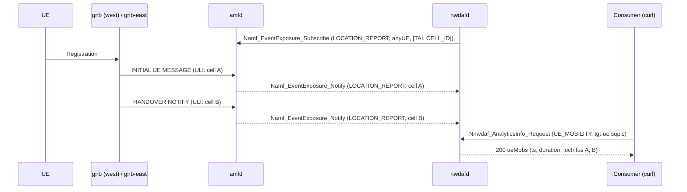

# D441C: UE Mobility analytics from AMF location events

Demo key `d441c-amf-mobility`, ticket
[nextgsim#466](https://github.com/NextgCoreLab/nextgsim/issues/466), program
anchor [nextgsim#458](https://github.com/NextgCoreLab/nextgsim/issues/458).
The code is in nextgcore: amfd in
[nextgcore#1419](https://github.com/NextgCoreLab/nextgcore/pull/1419), nwdafd
in [nextgcore#1425](https://github.com/NextgCoreLab/nextgcore/pull/1425).

## Purpose

To turn nwdafd's UE Mobility analytics from a pinned 204 into a 200 built from
live amfd location events, through the normative Namf_EventExposure path, so
that #464 and other consumers have real data.

- **Success signal:** `GET /nnwdaf-analyticsinfo/v1/analytics?event-id=UE_MOBILITY&tgt-ue=...`
  returns 200 with non-empty `ueMobs[].locInfos` for the simulated SUPI, and
  nwdafd logs `ue-mobility ingest supi=<supi> cell=<ncgi>`.
- **Not the point:** this is not a viewer-facing demo and not a claim about
  prediction quality. It is a milestone that unblocks consumers.

## How it works



### Components

| Piece | Where | What it does |
|---|---|---|
| LOCATION_REPORT on handover | amfd `handle_handover_notify`, `finish_path_switch` (#1419, ungated) | TS 29.518 Table 6.2.6.3.3-1: report the *"Updated Location ... when AMF becomes aware of a location change of the UE"*. Fired after the target location is written. Delivered only to subscriptions whose `locationFilterList` covers what changed (absent = TA changes only, Table 6.2.6.2.3-1). |
| Subscriber | nwdafd `amf_mobility` (#1425) | Discovers an AMF at the NRF and subscribes with LOCATION_REPORT, anyUE, `[TAI, CELL_ID]`, and a 10-minute expiry renewed every 2 minutes. If the AMF lost the subscription (404 on renewal), nwdafd subscribes again. Logs `subscribed to AMF LOCATION_REPORT id=<id>`. |
| Callback | `POST /nnwdaf-callback/v1/amf-location-notify/{token}` on nwdafd's existing SBI listener | TS 33.501 §13.4.1: OAuth 2.0 does not apply to notifications, so the AMF sends no token. The notify is authenticated by the 128-bit random token in the callback URI instead. A wrong token gets a 404 and ingests nothing, and the token is redacted from SBI logs. |
| UE_MOBILITY answer | nwdafd `Nnwdaf_AnalyticsInfo` | TS 29.520 `UeMobility`. Statistics: `ts` = the first observation, `duration` = the observed span, `locInfos` = cells in first-visit order, each with the AMF's own `UserLocation`. Prediction (a future `ana-req` period): the next cell, with `confidence` = the transition share. `tgt-ue` with `supis` is required (§4.3.2.2.2). |
| Runtime support | nwdafd NRF profile, `/metrics` | `UE_MOBILITY` is in `nwdafInfo.eventIds` only while served. `/metrics` (feature builds only) carries `nwdaf_ue_mobility_serving`, `nwdaf_ue_mobility_amf_subscribed` and `nwdaf_ue_mobility_location_reports_total{result}`. |

### Toggles

Follows the #458 convention. Both gates are off by default.

- **Cargo:** nwdafd feature `amf-mobility`. A default build has no route, no
  listener and no subscriber; UE_MOBILITY stays 204.
- **Config** (nwdafd only, config plus restart):

  ```yaml
  demo:
    enabled: true
    d441c-amf-mobility:
      enabled: true
      mode: on        # or baseline
  ```

| Mode | Behaviour |
|---|---|
| `on` | Subscribe, ingest, serve UE_MOBILITY, advertise it to the NRF. |
| `baseline` | No AMF subscription. UE_MOBILITY answers 204 and is not advertised. |

- Outside a demo, `nwdaf.amf_mobility.enabled: true` turns the same feature on.
  An active demo block supersedes it.
- When the demo is active, nwdafd logs `WARN DEMO MODE ACTIVE: d441c-amf-mobility=<mode>`,
  prefixes its lines with `[demo:d441c-amf-mobility]`, and exports
  `nextg_demo_enabled{demo="d441c-amf-mobility",mode="<mode>"} 1`.
- **Startup failures:**
  - `mode: bogus` fails startup with
    `UnknownMode { demo: "d441c-amf-mobility", mode: "bogus" }`;
  - the key in a build without the feature fails with `UnknownKey`.
- amfd's LOCATION_REPORT on handover is base-core behaviour and is not gated.

## How to run it

### Tests

```bash
cd nextgcore/src
cargo test -p nextgcore-amfd --lib -- location_report location_filters intra_ta
cargo test -p nextgcore-nwdafd --features amf-mobility    # includes the amfd end-to-end test
cargo test -p nextgcore-nwdafd                            # demo-off: the 204 path is unchanged
```

### EKS

```bash
k8s/demo-check.sh d441c-amf-mobility on
k8s/demo-check.sh d441c-amf-mobility baseline
k8s/demo-check.sh off off
```

The overlay `deploy/eks/overlays/demo-d441c-amf-mobility/` (ClusterIP only)
adds:

- nwdafd built with `amf-mobility`;
- a second gNB `gnb-east` (NCI 0x020, same TAC), using the #456 two-gNB
  topology;
- the UE's walk from west to east.

`scenario.sh` restarts the UE after the subscription, waits for the N2
handover, then queries nwdafd and the NRF. It captures everything under
`scenario/` in the run directory.

## Results

> **Not yet run.** The EKS validation is blocked: devtest1 has no `nextg/nwdaf`
> ECR repository, and creating one needs operator approval. This section will
> be filled only from the real artefacts in
> `/tmp/eks-val/demos/d441c-amf-mobility/<mode>/`. Nothing here is invented.

## Honesty labels and limitations

- The cell history is whatever the simulator's gNBs report.
- The prediction is a first-order transition count, not a learned model.
  `confidence` is the share of observed transitions out of the current cell
  that went to the predicted one.
- UE_MOBILITY is served on Nnwdaf_AnalyticsInfo only. The EventsSubscription
  surface parses no `tgtUe`, which TS 29.520 requires for UE_MOBILITY, so it
  still declares the event unavailable.
- `ratio` is omitted: TS 29.520 makes it a group-of-UEs attribute, and the
  answer is for one UE.
- Known follow-ups:
  - nextgcore#1420: Path Switch fires no presence report.
  - nextgcore#1421: an OAuth2-required listener rejects token-less
    notifications.
  - nextgcore#1424: Registration / Service Request LOCATION_REPORT ignores
    `locationFilterList`.
  - nextgcore#1428: the per-SUPI history map is unbounded.
