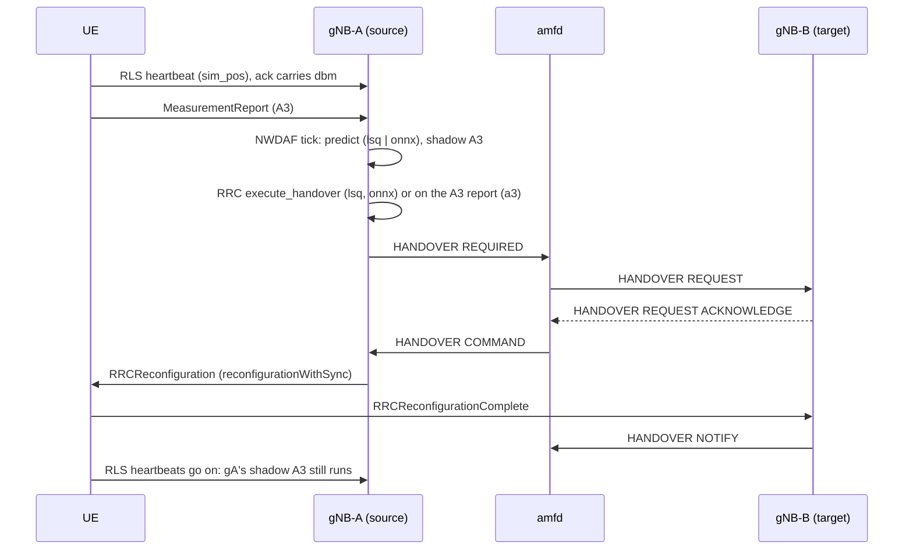

# D441D: predictive N2 handover vs A3

Demo key `d441d-predictive-ho` (nextgsim#467, program #458). Modes: `a3` (the
baseline), `lsq` (the least-squares predictor) and `onnx` (a d440b-verified
model), all on the same route and the same shadowing seeds.

## Purpose

An in-gNB mobility predictor triggers a real N2 handover through amfd earlier
than A3 would. It is measured as a seeded A/B against A3 on the same route and
the same shadowing seeds.

- **Success signal:** per seed, the lead time at the source gNB (the
  `predictive trigger` against the shadow `A3 would trigger`), each followed by
  amfd `HANDOVER NOTIFY` for the UE from the target gNB. A committed table
  reports lead time, ping-pongs and failures per arm.
- **Not the point:** this is not a claim that the predictor is accurate in
  general, and not a RIC or xApp demo. The core sees the same NGAP cause
  (`HandoverDesirableForRadioReason`) in both arms, so handover timing is the
  only evidence at the core.

## How it works



The UE follows a curved `sim_route` (#462) from gnb-west toward gnb-east. Each
gNB adds seeded log-normal shadowing (#467 PR 1) to the level in its heartbeat
ack. Both the UE's A3 evaluation and the gNB's NWDAF feed read that one value.

Every heartbeat reaches the source gNB's NWDAF task. It carries the UE's
position and this cell's level at the UE. Two evaluators run on it:

- **The predictor** runs in modes `lsq` and `onnx`, once a second, for each UE
  this gNB's RRC holds. It fires when all of these hold:
  - the trajectory prediction 2 s ahead is mobility: confidence above 0.7, and
    moving. This is the least-squares fit of #467 PR 2, or the verified model;
  - the measured serving level is falling;
  - at the predicted position, a positioned neighbour beats this cell by the
    same A3 margin the UE is configured with (`a3-Offset` plus hysteresis,
    TS 38.331 §5.5.4.4), under the distance model.

  The predictor knows the neighbour positions and the distance model. It does
  not know the shadowing field. Its recommendation goes to RRC on the existing
  NWDAF path (`handle_nwdaf_handover` → `execute_handover`), and from there as
  HANDOVER REQUIRED.
- **The shadow A3 replica** runs in every mode. The UE evaluates its A3 event
  only once per RRC cycle, every 2.5 s (`RRC_CYCLE_INTERVAL_MS`), on the level
  of the latest heartbeat ack. It reports at the next evaluation that still
  holds `timeToTrigger` (640 ms). The replica evaluates inequality A3-1 the same
  way, on that grid.

  The gNB cannot know the UE's cycle phase. So it runs the grid at 25 phases
  100 ms apart and reports A3 as a range: `[earliest - 100 ms, latest + 100 ms)`,
  2.6 s wide. The UE's own first report falls inside it at any phase. The
  integration test `d441d_replica_brackets_the_ue_a3` checks this against the
  UE's real `MeasurementManager`, at off-grid phases, on 24 seeds.

  The neighbour's level is the one the UE measures: the same shadowed distance
  model, keyed by the neighbour's NCI, with the same `shadowing` block. Every
  gNB of a run must carry the same block. Each gNB logs it at startup, and a run
  checks that the lines agree. The replica keeps running after a predictive
  handover, because the UE still heartbeats this cell. That is how the A3 time
  is known even when the prediction came first.

The guards:

- **Who is predicted:** RRC reports the UEs it has connected and is not
  already handing over. A context in setup, or a handover-in that has not
  arrived, is not included. A UE whose HANDOVER COMMAND has gone out is not
  recommended again.
- **Ping-pong:** a UE served for less than 5 s is not predicted away.
- **Retries:** a UE still served 3 s after an attempt is tried again, at most
  3 times. Then one `exhausted` line is logged, and nothing more until the UE
  is served again.
- **A3 fallback:** in `lsq` and `onnx`, the UE's real A3 MeasurementReport is
  logged and held. If no predictive handover has started within 1 s of the
  first report, RRC acts on A3 after all. It logs
  `[demo:d441d-predictive-ho] A3 fallback=a3 n=<count> UE[<id>] PCI <pci>: ...`
  and counts it in the scorecard. This is a predictive-arm failure: A3 moved
  the UE, not the predictor.
- **Stranded:** a served UE whose replica A3 completed 3.5 s ago, with neither
  a predictive handover nor an A3 fallback, is logged as
  `stranded ue=.. target=..` and counted.

In modes `lsq` and `onnx`, A3 is in shadow, apart from the fallback above. In
mode `a3`, and with the demo off, the #162 A3 path is unchanged.

### Components and toggles

| What | Where |
|---|---|
| decision core (predictor, shadow A3, guards) | `nextgsim-gnb/src/nwdaf/d441d.rs` |
| tick, measurement feed, `nwdaf-status` section | `nextgsim-gnb/src/nwdaf/task.rs` |
| A3 in shadow, served-UE report | `nextgsim-gnb/src/rrc/task.rs` |
| registration, startup checks | `nextgsim-gnb/src/demo.rs` |
| configs | `config/demo-predictive-ho/{gnb-west,gnb-east,ue}.yaml` |

The demo follows the #458 toggle convention:

- **Gates.** The cargo feature `demo-d441d-predictive-ho` (which implies `6g`
  and `model-registry`) and the config block are both off by default:

  ```yaml
  demo:
    enabled: true
    d441d-predictive-ho:
      enabled: true
      mode: lsq        # a3 | lsq | onnx
  ```

- **Startup.** The demo logs `WARN DEMO MODE ACTIVE: d441d-predictive-ho=<mode>`
  and `[demo:d441d-predictive-ho] predictive handover mode=...` with its
  parameters.
- **Refusals.** Each of these fails startup:
  - an unknown mode (`DemoConfigError::UnknownMode`);
  - a block in a build without the feature (`UnknownKey`);
  - `onnx` without `d440b-model-verify` in mode `verify` (`MissingDependency`);
  - `nwdaf_enabled: false`;
  - no `handover_neighbours` entry with a `position`;
  - another handover-triggering demo on the same gNB (`HandoverDemoConflict`,
    for example with D446A).
- **Runtime.** `nr-cli <gnb> demo d441d-predictive-ho set mode=<mode>` /
  `show` / `demo metrics` (`nextg_demo_enabled`). A switch applies from the next
  tick and is audited.
- **Status.** `nr-cli <gnb> nwdaf-status` gains a `handover` section: mode,
  served UEs, predictions, exhausted, A3 triggers, A3 fallbacks, stranded, and
  the last lead times as `[min, max]` ranges. These counts are the predictive
  arm's scorecard at this gNB.
- **Shadowing** is a separate base block, identical in every mode.

### The log chain (strings the code emits)

Predictive arm, at the source gNB, then amfd (the amfd string is the one
`scripts/demo/n2ho-check.sh` asserts):

```text
[demo:d441d-predictive-ho] NWDAF: handover prediction ue=<id> predictor=lsq target=32 conf=0.98 attempt=1/3
RRC: NWDAF-recommended handover for UE <id> to cell 32 (confidence 0.98)
Sent Handover Required: amf_ue_ngap_id=..., ran_ue_ngap_id=...
(amfd) HandoverNotify from association <target> (amf_ue_ngap_id=..., ran_ue_ngap_id=...)
[demo:d441d-predictive-ho] A3 would trigger t=<lo>..<hi> ue=<id> target=32 serving=<dBm> dBm neighbour=<dBm> dBm (the UE's A3 on its 2.5 s cycle, at an unknown phase)
[demo:d441d-predictive-ho] lead time ue=<id> target=32 predictive_t=<ms> a3_t=<lo>..<hi> lead_ms=<min>..<max>
```

In the A3 arm, the handover follows the UE's A3 MeasurementReport
(`measurement-triggered N2 handover to PCI 32`). There is no `NWDAF-recommended`
line. The real report's time falls inside the replica's `A3 would trigger`
range, which is what the arm checks the replica against.

## How to run it

Build the gNB with `--features demo-d441d-predictive-ho` and run nextgcore's
two-gNB stack (`docker/rust/docker-compose.demo-n2ho.yml`, #456). Use:

- gnb-west on `config/demo-predictive-ho/gnb-west.yaml`;
- gnb-east on `config/demo-predictive-ho/gnb-east.yaml`;
- the UE on `config/demo-predictive-ho/ue.yaml`.

For each seed, set `shadowing.seed` to the same value in both gNB configs. For
each arm, change only `mode`. Both stacks publish no port.

The seeded live harness (`scripts/demo/d441d-*.sh`, K seeds per arm, with the
ping-pong and failure counts) and its CI job are the next PR. The EKS overlay
is nextgcore's part, PR 4.

## Results

**Not yet run** on the live stack or EKS. The table (≥ 20 seeds: median and
p10 lead time, ping-pongs and failures per arm) and the captured log chain go
here after the runs, as captured.

What exists now is an offline replay of the decision core:
`nwdaf::d441d::tests::the_seeded_replay_leads_a3_on_most_seeds`. It replays
the committed route at heartbeat cadence through gnb-west's engine, with the
UE handed away at the prediction, on seeds 1..=24 at σ 4 dB. It is a positive
control for the logic, not a result of the demo:

- the predictor triggers once on every seed;
- the lead's lower bound is positive on every seed: 2.4 to 5.4 s, median 4.4 s.
  The upper bound is 2.6 s more;
- the A3 time moves with the seed.

On 100 further seeds (25..=124), the lower bound was positive on all 100:

| σ | lower bound: median | lower bound: range | upper bound: median |
|---|---|---|---|
| 4 dB | 3.4 s | 2.4..5.4 s | 6.0 s |
| 8 dB | 3.4 s | 1.4..7.4 s | 6.0 s |

The replay does not model amfd, the NGAP round trip, the A3 fallback, or a
ping-pong at the target.

## Honesty labels and limitations

- Positions are RLS `sim_pos`: simulator ground truth, not UE-reported.
- Levels are the distance model (−1 dBm per metre) plus seeded log-normal
  shadowing. Shadowing is a non-normative simulator model, and seeds are
  committed before a run.
- The baseline is the gNB's existing A3, with the offset and hysteresis from
  config.
- The predictor is a least-squares fit or a #463-verified model, labelled as
  such: `predictor=fallback` when no verified model served the prediction.
- The prediction-to-handover trigger is gNB implementation. AI/ML models are
  outside 3GPP scope (TS 38.300 §16.20).
- The shadow A3 is a gNB-side replica of the UE's condition on the UE's 2.5 s
  evaluation cycle, at an unknown phase. Its time, and so the lead, is a 2.6 s
  range that contains the UE's report. It is not a single value.
- The replica assumes every gNB of a run uses the same `shadowing` block. If
  the seeds differ, the neighbour's level is wrong with no other sign. Compare
  the gNBs' startup lines.
- Lead time is measured at the source gNB, because the core cannot tell the
  arms apart. It is not asserted positive on every seed.
- A lead is not free. A UE handed over before A3 lands where the source is
  still the stronger cell. The ping-pong and failure columns are where that
  shows.
- `fallback=a3` and `stranded` are failures of the predictive arm, counted as
  such. A fallback handover is still a real N2 handover, but A3 triggered it.
