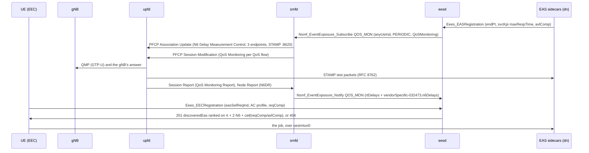

# D443A: the EES picks the edge server on a UPF-measured comm + compute budget

> Non-normative demo. It **proves the loop, not the estimation**: the delays are injected (netem), the compute is a sleep stand-in.

## Purpose

Show core developers that eesd's EAS choice follows the delay the UPF measured plus the EAS's compute, even when no EAS changes its advertisement.

**Success signal:** after netem is added on eas-local's path, eesd logs `EES-SEL ... src=upf-n3+upf-n6 selected=[eas-regional]`, and eas-local's registration stays byte-identical. The same act with exposure off (`src=static`) keeps eas-local, and the UE logs `deadline-miss`.

**Not the point:** delay estimation or ML.

Anchor: nextgsim#471. Program: nextgsim#458.

## How it works



**Components:**
- **nextgcore**
  - upfd: UN6DM (STAMP Session-Sender) and QFQM (QMP).
  - smfd:
    - N6 delay measurement by configuration (#1502);
    - QOS_MON exposure (#1390);
    - with the demo on, the labelled `n6Delays` member in QOS_MON.
  - eesd:
    - the QOS_MON consumer;
    - `measured-budget` ranking with a deadline of 15 ms (EES local policy);
    - the labelled `achievableLatency`;
    - a 404 when no EAS fits;
    - the token-less notify is admitted on its path token (#1525).
- **nextgsim**
  - `nr-she-eas`, three EAS sidecars: EDGE-3 registration, the STAMP reflector and the job listener.
  - The UE's EEC client: EDGE-1 registration with `easSelReqInd`, then the job on the first `discoveredEas`, or on-device on a 404.
  - `nr-cli <ue> she-offload job|status`.

**Toggles (nextgsim#458):**
- Cargo features `demo-d443a-edge-budget` on eesd, smfd, nextgsim-she and nextgsim-ue, plus the `demo:` block with key `d443a-edge-budget`.
- Modes `measured-budget | static`. An unknown mode fails startup.
- On EKS, eesd and smfd switch by config plus restart. The UE switches at runtime with `nr-cli <ue> demo d443a-edge-budget set mode=...` (audited). The UE's mode changes only the `mode=` it logs and reports in its JOB lines: the ranking is eesd's.

## How to run it

**EKS (devtest1, namespace nextg-demo):**

```bash
CORE_SRC=<clean nextgcore> SIM_SRC=<clean nextgsim> \
  deploy/eks/overlays/demo-d443a-edge-budget/run-arms.sh            # every arm
flock /tmp/eks-nextg-demo.lock k8s/demo-check.sh d443a-edge-budget measured-budget
```

**Compose: not yet run.** nextgcore ships `docker/rust/docker-compose.demo-d443a.yml` with the same topology, but it has never been brought up end to end: the validation host has no docker compose. Nothing on this page comes from it, and **EKS is the only validated path**. A manual compose run that captures the success signal, and a CI netem preflight, are tracked in #580.

## Results

Every number and excerpt below comes from **run 8** on devtest1 (namespace nextg-demo, one arm per hold of the EKS lock, torn down after each). The two exceptions are the oauth2 and no-upf-qos arms, which come from **run 10** (below). Run 8 is the first run with:
- the revert arms;
- the restart flip and the oauth2 arm;
- a uid of its own for each EAS;
- a netem-only Act 3;
- the module record on both nodes.

The analyzer is nextgcore PR #1555's `analyze.py`.

**Images** (new tags):
- core NFs: `nextg/*:demo-d443a-edge-budget-f468351a73b3`. This is #1555's branch with nextgcore main (`d1028994`, #1581 included) merged in; the branch's own Rust change is doc comments in `edge_budget.rs`.
- gnb, ue and nr-she-eas: `nextg/{gnb,ue}:demo-d443a-edge-budget-8eb6e19f5d37`, from nextgsim main `8eb6e19`. This page is docs only.

**Run 10** reruns the two arms that power-cycle the UE, oauth2 and no-upf-qos. It used new images:
- core: `nextg/*:demo-d443a-edge-budget-620372cc40ba`. This is #1555's branch with nextgcore main merged in, including #1669, the fix for nextgcore#1648: smfd's Namf requests now carry the NRF token.
- sim: `nextg/{gnb,ue}:demo-d443a-edge-budget-00394912afb8`, from nextgsim main `0039491`.

Its harness, at `c8824872`, waits for the old UE pod to be gone before it captures anything, and records the UE pod at every snapshot. Without that, run 9's oauth2 arm (20261117T074344Z) read a terminating pod's log at the warm snapshot. Run 9 is superseded.

**Artefacts:** `/tmp/eks-val/demos/d443a-<arm>/d443a-edge-budget/<mode>[+<arm>]/<run>/` on the validation host. Each run has its `verdict.txt` (demo-check), `scenario/analyze.txt`, `scenario/meta.txt` and the per-act captures.

| Arm | Run | demo-check | analyze.py | Modules before the first tc: upf node / gnb node |
|---|---|---|---|---|
| main | 20261117T004851Z | PASS | HOLDS (15 checks; accuracy advisory 10/10) | 0-234: sch_netem / 13-23: sch_netem, sch_prio, cls_u32 |
| static | 20261117T024119Z | PASS | HOLDS (13) | 0-234: sch_netem / 22-121: all three |
| restart-flip | 20261117T014602Z | PASS | HOLDS (13) | 0-234: sch_netem / 29-194: all three |
| gates | 20261117T025006Z | PASS | HOLDS (5) | 0-234: sch_netem / 22-121: all three |
| off | 20261117T025723Z | PASS (0 banner lines, 0 `[demo:` lines, 0 `nextg_demo_enabled` series) | HOLDS (3) | 0-234: sch_netem / 23-254: none |
| no-kpi-patch (revert) | 20261117T030329Z | PASS | HOLDS: `load` FAILs, as required | 0-234: sch_netem / 13-23: all three |
| no-qos-mon (revert) | 20261117T005832Z | PASS | HOLDS: `act2` and `act3` FAIL, as required | 0-234: sch_netem / 13-23: all three |
| wrong-callback-token (revert) | 20261117T011327Z | PASS | HOLDS: `act2` and `act3` FAIL, as required | 0-234: sch_netem / 29-194: all three |
| no-upf-qos (revert) | 20261117T080720Z (run 10) | PASS | HOLDS: `act2` and `act3` FAIL, as required | 0-234: sch_netem / 22-121: all three |
| bind-eth0 (revert) | 20261117T013807Z | PASS | HOLDS: `act1` FAILs, as required | 0-234: sch_netem / 22-121: all three |
| oauth2 | 20261117T075659Z (run 10) | PASS | HOLDS (16 checks; accuracy advisory 10/10) | 0-234: sch_netem / 29-194: all three |

The nodes are `ip-10-10-<x>-<y>`. "sch_netem" means that sch_netem was loaded and sch_prio and cls_u32 were absent.

Two checks pass in every arm but off: `caps` and `eas_isolation`.
- `caps` reads the deployed pod specs. It finds exactly NET_ADMIN, SYS_ADMIN, SETUID and SETGID on she-eas, and NET_ADMIN only on the gNB's netem sidecar. Both have `drop: [ALL]`, and neither is privileged or allows privilege escalation.
- `eas_isolation` reads `scenario/eas-keys.txt`, here from main:
  ```
  eas-local uid=65531 keydir=700:65531 jwk=644:65531 cross_uid=65532 cross=denied
  eas-regional uid=65532 keydir=700:65532 jwk=644:65532 cross_uid=65533 cross=denied
  eas-cloud uid=65533 keydir=700:65533 jwk=644:65533 cross_uid=65531 cross=denied
  ```
  `caps` also passes in the off arm.

### main (measured-budget): the success signal

**Start-up.** Each EAS makes its own CCA key, and the scenario puts the public JWKs into the NRF's trust ConfigMap. Until the NRF pod sees the updated ConfigMap, the NRF refuses the EASes' tokens (`status 400, error Some("invalid_client"); retrying`), and they retry until it trusts them.

**Measurements in place before Act 1:**
- smfd's `smf_n6_delay_ms{endpoint,stat="avg"}`: eas-local 3, eas-regional 4, eas-cloud 21 ms (the emulated distances are 4, 6 and 40 ms one way, on each EAS's egress only).
- The association order (`assoc_order`): smfd's log has the Association Update at line 33 and the QoS monitoring Session Modification at line 61:
  ```
  UPF 10.10.10.74:8805 accepted N6 Delay Measurement Control Information x1 (Association Update, TS 29.244 §5.33.8.2)
  ref=1: QoS monitoring of QFI 9 requested from the UPF: SRR 1, Periodic every 2 s (QOS_MON subscription 6c5f1773-dc68-401f-a6de-02a122b74582)
  ```
- QOS_MON from smfd, admitted token-less on its path token:
  ```
  [demo:d443a-edge-budget] QOS_MON rt=3 ms n6=[10.60.0.11=3ms,10.60.0.12=4ms,10.60.0.13=21ms]
  ```

**Act 1.** 10 jobs, all on eas-local and all within the deadline. EAS-EXEC shows the UE's own address (`src=10.45.0.2`, kept by `UPF_NAT_EXCLUDE`).
```
EES-SEL ac=ac-d443a src=upf-n3+upf-n6 selected=[eas-local,eas-regional] budget=[eas-local=11,eas-regional=13,eas-cloud=46] deadline=15 n3_rt=3 result=201
JOB job=1 eas=eas-local rtt=9 predicted=11 src=upf-n3+upf-n6 deadline=15 mode=measured-budget result=ok
```
Prediction: all 10 jobs are within max(3 ms, 25 %) of the measured rtt (predicted 11, measured 9; advisory). The prediction is at or above the measurement because `rtDelays` includes the gNB's stated 1 + 1 ms RAN delay, which the simulated radio never incurs.

**Act 2.** netem on eas-local's path goes from 4 to 20 ms one way, and smfd then reports `smf_n6_delay_ms{endpoint="10.60.0.11",stat="avg"} 11`. During the act, eas-local logged no EAS-REG and no KPI-PATCH, and eesd merge-patched nothing, so eas-local's registration stayed byte-identical.
```
EES-SEL ac=ac-d443a src=upf-n3+upf-n6 selected=[eas-regional] budget=[eas-local=27,eas-regional=13,eas-cloud=46] deadline=15 n3_rt=3 result=201
JOB job=11 eas=eas-regional rtt=11 predicted=13 src=upf-n3+upf-n6 deadline=15 mode=measured-budget result=ok
```
All three Act 2 jobs (11-13) ran on eas-regional at rtt 11.

**Act 3.** A root netem of 20 ms on the gNB's eth0 raises the per-flow delay from 3 to 23 ms. No EAS fits the deadline, so eesd answers 404 and the UE runs the job on the device:
```
EES-SEL ac=ac-d443a src=upf-n3+upf-n6 selected=[] budget=[eas-local=31,eas-regional=33,eas-cloud=66] deadline=15 n3_rt=23 result=404
JOB job=14 on-device fallback reason=ees-404 mode=measured-budget
```

**Load act.** SIGUSR1, sent as eas-local's own uid, lowers its avlComp from 50 to 5, and eas-local merge-patches its KPI:
```
[demo:d443a-edge-budget] EAS-KPI-PATCH eas=eas-local svcKpi.avlComp=5 (200)
EES-SEL ac=ac-d443a src=upf-n3+upf-n6 selected=[eas-regional] budget=[eas-local=29,eas-regional=13,eas-cloud=46] deadline=15 n3_rt=3 result=201
JOB job=16 eas=eas-regional rtt=11 predicted=13 src=upf-n3+upf-n6 deadline=15 mode=measured-budget result=ok
```

eesd `/metrics` at the end of the run:
```
nextg_demo_enabled{demo="d443a-edge-budget",mode="measured-budget"} 1
eees_selection_total{src="upf-n3+upf-n6",result="201"} 16
eees_selection_total{src="upf-n3+upf-n6",result="404"} 2
eees_d443a_qos_mon_notifications_total{outcome="accepted"} 111
eees_d443a_qos_mon_subscribed 1
```

### restart-flip: eesd restarted from measured-budget to static under Act 2's netem

Acts 1 and 2 are as in main: Act 2 selects eas-regional, with N6 local at 11 ms. Then, with the netem still on, eesd's config is switched to `mode: static` and eesd is restarted:
```
[demo:d443a-edge-budget] edge-budget: on (mode=static, deadline=15 ms local policy, ...)
EAS-REG eas=eas-local registration http://ees.nextg-demo.svc.cluster.local:7777/eees-easregistration/v1/registrations/... is gone at the EES (restarted?): registering
EES-SEL ac=ac-d443a src=static selected=[eas-local,eas-regional] budget=[eas-local=10,eas-regional=14,eas-cloud=40] deadline=15 result=201
JOB job=14 eas=eas-local rtt=25 predicted=10 src=static deadline=15 mode=measured-budget result=deadline-miss
```
The selection flips back to eas-local. All three EASes re-register, and jobs 14-16 run on eas-local at rtt 25, 26 and 25, missing the deadline.

### static: the baseline arm

The EES ranks on the advertised `maxRespTime` (local 10, regional 14, cloud 40), whatever is measured. All 18 selections in the run are the same line:
```
EES-SEL ac=ac-d443a src=static selected=[eas-local,eas-regional] budget=[eas-local=10,eas-regional=14,eas-cloud=40] deadline=15 result=201
```
- **Act 1:** jobs 1-10 run on eas-local, on time (rtt 9-10).
- **Act 2:** jobs 11-13 run on eas-local at rtt 25, `deadline-miss`.
- **Act 3:** jobs 14-15 run on eas-local at rtt 49, `deadline-miss`. The gNB's root netem delays the job both ways: on the radio link to the UE and on N3.
- **Load act:** jobs 16-18 run on eas-local at rtt 27, `deadline-miss`.

### The revert arms

Each revert arm holds only when the acts it names FAIL **and** its cause is shown (its `*_pre` check).

**no-kpi-patch** (the load act fails). eas-local applies the load locally and does not tell the EES:
```
LOAD eas=eas-local avlComp 50 -> 5 locally; --no-kpi-patch: the EES is NOT told (revert arm)
JOB job=11 eas=eas-local rtt=27 predicted=11 src=upf-n3+upf-n6 deadline=15 mode=measured-budget result=deadline-miss
```

**no-qos-mon** (Acts 2 and 3 fail). eesd has no `smf_uri`, so it holds no subscription and gets no report:
```
[demo:d443a-edge-budget] no ees.edge_budget.smf_uri: no QOS_MON subscription, so measured-budget ranks on the advertisement (src=static-fallback)
EES-SEL ac=ac-d443a src=static-fallback selected=[eas-local,eas-regional] budget=[eas-local=10,eas-regional=14,eas-cloud=40] deadline=15 result=201
JOB job=11 eas=eas-local rtt=25 predicted=10 src=static-fallback deadline=15 mode=measured-budget result=deadline-miss
```

**wrong-callback-token** (Acts 2 and 3 fail).
- smfd accepts a QOS_MON subscription that the scenario itself posts (`HTTP/2 201`). Its notifUri carries a random path token that eesd never minted.
- eesd refuses every one of the 64 notifies on that token:
  ```
  Nsmf_EventExposure_Notify QOS_MON (SUPI imsi-999700000000001, PSI 1) → subscription 40f99e49-88b7-4336-a87a-5e973549c5bc: status=401
  ```
- So eesd ranks `static-fallback`, as in no-qos-mon.

**no-upf-qos** (Acts 2 and 3 fail; run 10). upfd is restarted without `UPF_N6_DELAY_MEASUREMENT` and `UPF_QOS_FLOW_MONITORING`.
- smfd provisions neither:
  ```
  UPF 10.10.0.228:8805 does not advertise UN6DM: N6 delay measurement not requested
  ref=2: QOS_MON subscription 5298a7f1-9c05-490d-94c8-dab0038bf565 but 10.10.0.228:8805 did not advertise QFQM (TS 29.244 §5.24.4.1): no QoS monitoring requested
  ```
- eesd's subscription stands, but no report comes, so it ranks `static-fallback`. Job 11 runs at rtt 25 and job 14 at rtt 50, both `deadline-miss`.
- One UE pod is captured throughout, `ue-9d6598d84-dm2kb`, which replaced `ue-9d6598d84-prbj7`.

**bind-eth0** (Act 1 fails). The UE's EEC is bound to `device: eth0`, off the PDU session.
- eesd still selects eas-local on the measured budget, for all 10 jobs.
- No job reaches dn, and there is no EAS-EXEC:
  ```
  JOB job=1 eas=eas-local rtt=? deadline=15 mode=measured-budget result=deadline-miss (no answer from 10.60.0.11:9471 in 1s)
  ```

### oauth2: the same acts with SBI OAuth2 required (run 10)

amfd and smfd run with `NEXTGCORE_SBI_OAUTH2_REQUIRE=1` and CCA keys that the NRF trusts. eesd runs with `--nrf-uri` (#1581).

**Enforcement.** A bare Subscribe at smfd is refused, and both NFs log that enforcement is on:
```
amf: ... INFO  nextgcore_amfd] OAuth2 enforcement enabled (JWKS: http://nrf.nextg-demo.svc.cluster.local:7777/nnrf-oauth2/v1/jwks)
smf: ... INFO  nextgcore_smfd] OAuth2 enforcement enabled (JWKS: http://nrf.nextg-demo.svc.cluster.local:7777/nnrf-oauth2/v1/jwks)
bare-subscribe: 401
```

**eesd's token.** eesd registers at the NRF as an AF and subscribes with an NRF token:
```
EES registered at the NRF as AF nfInstanceId 42255cd9-9d60-4e4d-ace4-2ad9db03abb0 (TS 23.558 §6.2), for 5GC access tokens
[demo:d443a-edge-budget] Nsmf_EventExposure_Subscribe QOS_MON (anyUeInd, PERIODIC 2 s, QoSMonitoring) at http://smf.nextg-demo.svc.cluster.local:7777: 201 /nsmf-event-exposure/v1/subscriptions/a4a559fe-4fbf-408b-8020-be8efc29aabf
```

**N1N2.** smfd's N1N2MessageTransfer carries its token since #1669, so it is accepted (`N1N2MessageTransfer (policy modification, ...) → 10.10.22.199:7777: status=200`). The NG-RAN then gets the QoS Monitoring Request, and 18 QOS_MON reports with n6Delays reach eesd before Act 1.

**The acts** match main's:
- N6 is local 3, regional 4, cloud 21 ms.
- Act 1: 10 jobs on eas-local, at rtt 9-10 against a predicted 11:
  ```
  EES-SEL ac=ac-d443a src=upf-n3+upf-n6 selected=[eas-local,eas-regional] budget=[eas-local=11,eas-regional=13,eas-cloud=46] deadline=15 n3_rt=3 result=201
  ```
- Act 2: N6 local rises to 11 ms, and the selection moves to `selected=[eas-regional]` with budgets 27/13/46.
- Act 3: rt rises to 23 ms, and eesd answers `result=404`.
- Load act: eas-local's PATCH moves the selection to eas-regional, with budgets 29/13/46.

eesd's `/metrics` at the end: `eees_selection_total{src="upf-n3+upf-n6",result="201"} 16`, `...result="404"} 2` and `eees_d443a_qos_mon_subscribed 1`.

**Earlier oauth2 runs.**
- Run 8 (20261117T021959Z) failed on nextgcore#1648: smfd's bare N1N2MessageTransfer got 401 at amfd, so no QoS Monitoring Request reached the NG-RAN.
- Run 9 (20261117T074344Z) failed on the UE pod capture race described above.

Both are superseded.

### off: the demo-off arm

The overlay's topology is deployed with no `demo:` block anywhere:
- smfd still provisions N6 delay measurement, because #1502 is config only: `UPF 10.10.1.217:8805 accepted N6 Delay Measurement Control Information x1 (Association Update, TS 29.244 §5.33.8.2)`;
- no process logs a demo line, and smfd adds no `n6Delays`;
- the UE answers `ERROR: Unknown command: she-offload`;
- nr-she-eas refuses to start (rc=1): `nr-she-eas: /tmp/d443a/off.yaml: nr-she-eas runs only with demo d443a-edge-budget enabled (demo.enabled and demo.d443a-edge-budget.enabled)`.

### gates

`mode: bogus` fails nr-she-eas, eesd, smfd and nr-ue at startup. Each exits with rc=1 and the same named error. For example, eesd:
```
Error: demo config: unknown mode "bogus" for demo "d443a-edge-budget" (known modes ["measured-budget", "static"]) (UnknownMode { demo: "d443a-edge-budget", mode: "bogus", known: ["measured-budget", "static"] })
```

At runtime, `nr-cli <ue> -e "demo d443a-edge-budget set mode=bogus"` is refused:
- the reply is `ERROR: demo config: unknown mode "bogus" ...` (rc=1);
- the UE logs `audit: rejected set mode="bogus" from nr-cli: ...; mode unchanged (measured-budget)`;
- `show` still says `mode=measured-budget`.

`set mode=static` is accepted: `mode=static (was measured-budget; applies to the next decision)`, and the UE audits `mode measured-budget -> static from nr-cli`.

### Superseded runs

Runs 1-7 (20261116T000159Z to 20261116T143326Z) are superseded, and nothing on this page comes from them:
- They ran with the earlier harness: one uid for all EASes, a prio and u32 Act 3, and a sch_netem record on the upf node only.
- They had no revert arms but no-kpi-patch, no restart flip and no oauth2 arm.
- Their images were core `-2d9973eb6f1d`, `-883f9a27635c` and `-d6c10bb0c346`, and sim `-aa24f4916fe0`, `-e1ed2103e839` and `-47096d7e9f75`.

## Honesty labels and limitations

- **Non-normative.** TS 29.508 has no N6 member, so the N6 delay reaches the EES in a TS 29.500 §6.6.3 vendor-specific member, `vendorSpecific-032473` (PEN 32473 is the RFC 5612 documentation PEN). Per spec, the SMF uses N6 delay for PSA reselection or EAS rediscovery (TS 23.501 §5.8.2.23).
- **Emulated distance.** The distance and slowness are netem only (no prio qdisc, no u32 classifier): on each EAS's veth toward the UPF, and as a root qdisc on the gNB's eth0.
  - Base distances: local 4, regional 6, cloud 40 ms one way.
  - Act 2 sets eas-local's to 20 ms.
  - Act 3 adds 20 ms on all of the gNB's egress: N3 (GTP-U, so the QMP answers) and with it N2 and the radio link to the UE, which Act 3 does not depend on.
  - On EKS the three EASes share the upf pod; without netem every N6 delay is about 1 ms.
  - **On EKS, netem runs in the temporary nextg-demo pods only.** The anchor had said "netem is compose-only (needs NET_ADMIN)". What changed:
    - the gNB's netem sidecar has NET_ADMIN only;
    - the EAS sidecar (`she-eas`, in the upf pod) runs as root, not privileged, with exactly NET_ADMIN (bridge, veths, tc), SYS_ADMIN (`ip netns` for the per-EAS namespaces), SETUID and SETGID (the drop to each EAS's uid): the set the operator approved on 2026-11-16, and analyze.py asserts it from the deployed pod spec in every arm;
    - each nr-she-eas runs as a uid of its own (eas-local 65531, eas-regional 65532, eas-cloud 65533) with no capabilities. Each EAS makes its own 0700 key directory and its own JWK directory, and creates its CCA key there; the private key never leaves the pod, and no other EAS can read it (`eas_isolation`, from `scenario/eas-keys.txt`). Only the public JWKs go to the NRF.
  - **Kernel modules on the nodes.** A NET_ADMIN tc in a pod can make its node's kernel autoload a qdisc or classifier module, which outlives the namespace. The operator accepts that for sch_netem on devtest1. Both sidecars log, at start and before any tc, which of sch_netem, sch_prio and cls_u32 their node had loaded, and the node's name. Every arm records both (`modules_upf`, `modules_gnb` in meta.txt), and the Results table gives them. Limits of that record:
    - The demo uses netem only, so it cannot load sch_prio or cls_u32. Where the table shows them `loaded`, they were loaded before the run. Runs 1-7 used a prio qdisc and a u32 classifier for Act 3 on the gnb nodes ip-10-10-22-121 and ip-10-10-29-194, so those runs may have loaded them there. ip-10-10-13-23 had them too. The one fresh gnb node in run 8, ip-10-10-23-254, had none of the three. The operator's acceptance names sch_netem only.
    - The runs share nodes, one after another. A `loaded` sch_netem in a later arm can be an earlier arm's autoload. The first record of a node in these runs is the one that says whether the module was there before this demo touched it.
- **Revert-arm faults are applied to the deployed overlay.** The demo-check deploys one overlay, so each revert arm's fault is set by `scenario.sh` before the act that needs it: an edited `ees-config` (no `smf_uri`), a QOS_MON subscription the scenario itself posts at smfd (wrong path token), `kubectl set env` on upfd (plus an upf and smf restart) or on the UE's EEC config init container. The oauth2 arm also restarts amfd, smfd and the gNB this way.
- **Compute.** The compute term is a sleep of `ceil(reqComp/avlComp)` ms. `reqComp` is a string in TS 24.558 and an integer here.
- **RAN delay.** The RAN part of `rtDelays` is the gNB's stated `ran_{dl,ul}_delay_ms`, not a measurement. The N3 part is unsynced (T2−T1+T4−T3)/2.
- **Single UE.** The N3 term is the most recent QOS_MON report of any UE.
- **Deadline.** The 15 ms deadline is EES local policy: `respTime` is a DurationSec and cannot carry 15 ms.
- **STAMP security.** STAMP is unauthenticated, a TS 33.501 T.5 departure. The reflectors live on the internal dn only, on port 8620. The reflector refuses nonzero MBZ octets 24..44 and reflector ports, so that two reflectors cannot loop; refusing nonzero MBZ octets is itself a departure from RFC 8762's "ignored on receipt".
- **Tokens.** The EASes and the EEC get NRF client-credential tokens, standing in for TS 33.558 / CAPIF. The EES is not an NRF NF type (TS 29.510; TS 23.558 §6.2), so a **labelled stand-in** EES profile (custom nfType `EES`) is registered at the NRF so that it issues `eees-*` tokens.
- **Name resolution on EKS.** The UE's EEC is bound to its TUN and takes IP literals, so the ees and nrf ClusterIPs are resolved once at pod start, on the pod network.
- **Known gaps.**
  - Outside the oauth2 arm, amfd and smfd run the dev SBI profile (no OAuth2 required), and eesd's Subscribe carries no token. The oauth2 arm (#1581, with nextgcore#1648 fixed by #1669) runs the same acts with OAuth2 required, and holds.
  - The compose stack has not been run; the manual run and a CI netem preflight are #580.
  - A SIGKILL'd eesd can orphan one QOS_MON subscription at smfd.
