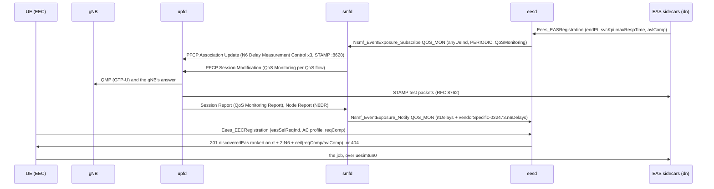

# D443A: the EES picks the edge server on a UPF-measured comm + compute budget

> Non-normative demo. It **proves the loop, not the estimation**: the delays are injected (netem), the compute is a sleep stand-in.

## Purpose

Show core developers that eesd's EAS choice follows the delay the UPF measured plus the EAS's compute, even when no EAS changes its advertisement.

**Success signal:** after netem is added on eas-local's path, eesd logs `EES-SEL ... src=upf-n3+upf-n6 selected=[eas-regional]`, and eas-local's registration stays byte-identical. The same act with exposure off (`src=static`) keeps eas-local, and the UE logs `deadline-miss`.

**Not the point:** delay estimation or ML.

Anchor: nextgsim#471. Program: nextgsim#458.

## How it works



**Components:**
- **nextgcore**
  - upfd: UN6DM (STAMP Session-Sender) and QFQM (QMP).
  - smfd:
    - N6 delay measurement by configuration (#1502);
    - QOS_MON exposure (#1390);
    - with the demo on, the labelled `n6Delays` member in QOS_MON.
  - eesd:
    - the QOS_MON consumer;
    - `measured-budget` ranking with a deadline of 15 ms (EES local policy);
    - the labelled `achievableLatency`;
    - a 404 when no EAS fits;
    - the token-less notify is admitted on its path token (#1525).
- **nextgsim**
  - `nr-she-eas`, three EAS sidecars: EDGE-3 registration, the STAMP reflector and the job listener.
  - The UE's EEC client: EDGE-1 registration with `easSelReqInd`, then the job on the first `discoveredEas`, or on-device on a 404.
  - `nr-cli <ue> she-offload job|status`.

**Toggles (nextgsim#458):**
- Cargo features `demo-d443a-edge-budget` on eesd, smfd, nextgsim-she and nextgsim-ue, plus the `demo:` block with key `d443a-edge-budget`.
- Modes `measured-budget | static`. An unknown mode fails startup.
- On EKS, eesd and smfd switch by config plus restart. The UE switches at runtime with `nr-cli <ue> demo d443a-edge-budget set mode=...` (audited); its behaviour is the same in both modes, because the ranking is eesd's.

## How to run it

**EKS (devtest1, namespace nextg-demo):**

```bash
CORE_SRC=<clean nextgcore> SIM_SRC=<clean nextgsim> \
  deploy/eks/overlays/demo-d443a-edge-budget/run-arms.sh            # every arm
flock /tmp/eks-nextg-demo.lock k8s/demo-check.sh d443a-edge-budget measured-budget
```

**Compose:**

```bash
docker compose -f docker/rust/docker-compose.demo-d443a.yml up -d
```

The file's header lists the act commands.

## Results

Filled from the EKS artefacts only: pending the devtest1 run.

## Honesty labels and limitations

- **Non-normative.** TS 29.508 has no N6 member, so the N6 delay reaches the EES in a TS 29.500 §6.6.3 vendor-specific member, `vendorSpecific-032473` (PEN 32473 is the RFC 5612 documentation PEN). Per spec, the SMF uses N6 delay for PSA reselection or EAS rediscovery (TS 23.501 §5.8.2.23).
- **Emulated distance.** The distance and slowness are netem on eas-local's veth (Act 2) and on the gNB's GTP-U egress (Act 3).
- **Compute.** The compute term is a sleep of `ceil(reqComp/avlComp)` ms. `reqComp` is a string in TS 24.558 and an integer here.
- **RAN delay.** The RAN part of `rtDelays` is the gNB's stated `ran_{dl,ul}_delay_ms`, not a measurement. The N3 part is unsynced (T2−T1+T4−T3)/2.
- **Single UE.** The N3 term is the most recent QOS_MON report of any UE.
- **Deadline.** The 15 ms deadline is EES local policy: `respTime` is a DurationSec and cannot carry 15 ms.
- **STAMP security.** STAMP is unauthenticated, a TS 33.501 T.5 departure. The reflectors live on the internal dn only, on port 8620. The reflector refuses nonzero MBZ octets 24..44 and reflector ports, so that two reflectors cannot loop; refusing nonzero MBZ octets is itself a departure from RFC 8762's "ignored on receipt".
- **Tokens.** The EASes and the EEC get NRF client-credential tokens, standing in for TS 33.558 / CAPIF. The EES is not an NRF NF type (TS 29.510; TS 23.558 §6.2), so a **labelled stand-in** EES profile (custom nfType `EES`) is registered at the NRF so that it issues `eees-*` tokens.
- **Name resolution on EKS.** The UE's EEC is bound to its TUN and takes IP literals, so the ees and nrf ClusterIPs are resolved once at pod start, on the pod network.
- **Known gaps.**
  - The OAuth2-required arm waits for #1529: the EES does not yet act as an OAuth2 client of the SMF, so its Subscribe carries no token. smfd runs the dev SBI profile in this demo.
  - A SIGKILL'd eesd can orphan one QOS_MON subscription at smfd.
