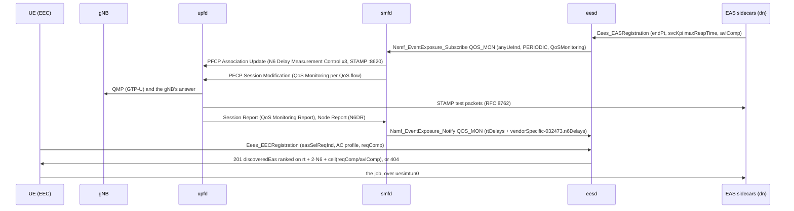

# D443A: the EES picks the edge server on a UPF-measured comm + compute budget

> Non-normative demo. It **proves the loop, not the estimation**: the delays are injected (netem), the compute is a sleep stand-in.

## Purpose

Show core developers that eesd's EAS choice follows the delay the UPF measured plus the EAS's compute, even when no EAS changes its advertisement.

**Success signal:** after netem is added on eas-local's path, eesd logs `EES-SEL ... src=upf-n3+upf-n6 selected=[eas-regional]`, and eas-local's registration stays byte-identical. The same act with exposure off (`src=static`) keeps eas-local, and the UE logs `deadline-miss`.

**Not the point:** delay estimation or ML.

Anchor: nextgsim#471. Program: nextgsim#458.

## How it works



**Components:**
- **nextgcore**
  - upfd: UN6DM (STAMP Session-Sender) and QFQM (QMP).
  - smfd:
    - N6 delay measurement by configuration (#1502);
    - QOS_MON exposure (#1390);
    - with the demo on, the labelled `n6Delays` member in QOS_MON.
  - eesd:
    - the QOS_MON consumer;
    - `measured-budget` ranking with a deadline of 15 ms (EES local policy);
    - the labelled `achievableLatency`;
    - a 404 when no EAS fits;
    - the token-less notify is admitted on its path token (#1525).
- **nextgsim**
  - `nr-she-eas`, three EAS sidecars: EDGE-3 registration, the STAMP reflector and the job listener.
  - The UE's EEC client: EDGE-1 registration with `easSelReqInd`, then the job on the first `discoveredEas`, or on-device on a 404.
  - `nr-cli <ue> she-offload job|status`.

**Toggles (nextgsim#458):**
- Cargo features `demo-d443a-edge-budget` on eesd, smfd, nextgsim-she and nextgsim-ue, plus the `demo:` block with key `d443a-edge-budget`.
- Modes `measured-budget | static`. An unknown mode fails startup.
- On EKS, eesd and smfd switch by config plus restart. The UE switches at runtime with `nr-cli <ue> demo d443a-edge-budget set mode=...` (audited); its behaviour is the same in both modes, because the ranking is eesd's.

## How to run it

**EKS (devtest1, namespace nextg-demo):**

```bash
CORE_SRC=<clean nextgcore> SIM_SRC=<clean nextgsim> \
  deploy/eks/overlays/demo-d443a-edge-budget/run-arms.sh            # every arm
flock /tmp/eks-nextg-demo.lock k8s/demo-check.sh d443a-edge-budget measured-budget
```

**Compose:**

```bash
docker compose -f docker/rust/docker-compose.demo-d443a.yml up -d
```

The file's header lists the act commands.

## Results

Every number below comes from the devtest1 artefacts (namespace nextg-demo, one arm per hold of the EKS lock, torn down after each).

**Images:**
- core NFs: `nextg/*:demo-d443a-edge-budget-883f9a27635c` (nextgcore main with #1552);
- gnb and ue: `nextg/{gnb,ue}:demo-d443a-edge-budget-e1ed2103e839`.

**Artefacts:** `/tmp/eks-val/demos/d443a-<arm>/d443a-edge-budget/<mode>/<run>/`, with the `verdict.txt`, `scenario/analyze.txt` and per-act captures of each run.

| Arm (run) | Mode | demo-check | analyze.py |
|---|---|---|---|
| main (20261116T003320Z) | measured-budget | PASS | HOLDS (11 checks, accuracy advisory 10/10) |
| static (20261116T004505Z) | static | PASS | HOLDS |
| no-kpi-patch, revert (20261116T005352Z) | measured-budget | PASS | HOLDS (`load` FAILs, as the revert arm requires) |
| gates (20261116T011728Z) | measured-budget | PASS | HOLDS |
| off (20261116T011013Z) | off | PASS (0 banner lines, 0 `[demo:` lines, 0 `nextg_demo_enabled` series) | HOLDS |

### main (measured-budget): the success signal

Measurements in place before Act 1:
- smfd `smf_n6_delay_ms{endpoint,stat="avg"}`: eas-local 3, eas-regional 4, eas-cloud 21 ms. These are the emulated distances of 4, 6 and 40 ms one way, halved and rounded up by upfd.
- QOS_MON from smfd, admitted token-less on its path token:
  ```
  [demo:d443a-edge-budget] QOS_MON rt=3 ms n6=[10.60.0.11=3ms,10.60.0.12=4ms,10.60.0.13=21ms]
  ```

**Act 1.** 10 jobs, all on eas-local and within the deadline. EAS-EXEC shows the UE's own address (`src=10.45.0.2`, kept by `UPF_NAT_EXCLUDE`).
```
EES-SEL ac=ac-d443a src=upf-n3+upf-n6 selected=[eas-local,eas-regional] budget=[eas-local=11,eas-regional=13,eas-cloud=46] deadline=15 n3_rt=3 result=201
JOB job=1 eas=eas-local rtt=9 predicted=11 src=upf-n3+upf-n6 deadline=15 mode=measured-budget result=ok
[eas-local] EAS-EXEC job=1 src=10.45.0.2 eas=eas-local reqComp=100 avlComp=50 compute=2ms
```
Prediction: 10 of 10 jobs are within max(3 ms, 25 %) of the measured rtt (predicted 11, measured 9; advisory).

**Act 2.** netem on eas-local's path rises from 4 to 20 ms one way. smfd then reports `smf_n6_delay_ms{endpoint="10.60.0.11",stat="avg"} 11`. eas-local logged no EAS-REG and no KPI-PATCH during the act, and eesd merge-patched nothing, so eas-local's registration is byte-identical.
```
QOS_MON rt=3 ms n6=[10.60.0.11=11ms,10.60.0.12=4ms,10.60.0.13=21ms]
EES-SEL ac=ac-d443a src=upf-n3+upf-n6 selected=[eas-regional] budget=[eas-local=27,eas-regional=13,eas-cloud=46] deadline=15 n3_rt=3 result=201
JOB job=11 eas=eas-regional rtt=11 predicted=13 src=upf-n3+upf-n6 deadline=15 mode=measured-budget result=ok
```

**Act 3.** netem +20 ms on the gNB's GTP-U egress raises the per-flow delay from 3 to 23 ms:
```
QOS_MON rt=23 ms n6=[10.60.0.11=3ms,10.60.0.12=4ms,10.60.0.13=21ms]
EES-SEL ac=ac-d443a src=upf-n3+upf-n6 selected=[] budget=[eas-local=31,eas-regional=33,eas-cloud=66] deadline=15 n3_rt=23 result=404
JOB job=14 on-device fallback reason=ees-404 mode=measured-budget
```

**Load act.** SIGUSR1 lowers eas-local's avlComp from 50 to 5, and it merge-patches its KPI:
```
[eas-local] EAS-KPI-PATCH eas=eas-local svcKpi.avlComp=5 (200)
EES-SEL ac=ac-d443a src=upf-n3+upf-n6 selected=[eas-regional] budget=[eas-local=29,eas-regional=13,eas-cloud=46] deadline=15 n3_rt=3 result=201
JOB job=16 eas=eas-regional rtt=11 predicted=13 src=upf-n3+upf-n6 deadline=15 mode=measured-budget result=ok
```

eesd `/metrics` at the end of the run:
```
nextg_demo_enabled{demo="d443a-edge-budget",mode="measured-budget"} 1
eees_selection_total{src="upf-n3+upf-n6",result="201"} 16
eees_selection_total{src="upf-n3+upf-n6",result="404"} 2
eees_d443a_qos_mon_notifications_total{outcome="accepted"} 81
eees_d443a_qos_mon_subscribed 1
```

### static: the baseline arm

The EES ranks on the advertised `maxRespTime` (local 10, regional 14, cloud 40), whatever is measured.
- **Act 1:** eas-local is selected, and the jobs are on time.
- **Act 2:** eas-local is still selected:
  ```
  EES-SEL ac=ac-d443a src=static selected=[eas-local,eas-regional] budget=[eas-local=10,eas-regional=14,eas-cloud=40] deadline=15 result=201
  JOB job=13 eas=eas-local rtt=25 predicted=10 src=static deadline=15 mode=static result=deadline-miss
  ```
- **Act 3:** still eas-local, `rtt=29 ... result=deadline-miss`.
- **Load act:** still eas-local, `rtt=27 ... result=deadline-miss`.

### no-kpi-patch: the revert arm

eas-local applies the load locally and does not tell the EES:
```
LOAD eas=eas-local avlComp 50 -> 5 locally; --no-kpi-patch: the EES is NOT told (revert arm)
```
So the EES keeps ranking eas-local on the stale KPI, and the UE misses its deadline:
```
EES-SEL ... src=upf-n3+upf-n6 selected=[eas-local,eas-regional] budget=[eas-local=11,...]
JOB job=13 eas=eas-local rtt=28 predicted=11 ... result=deadline-miss
```
The load act fails, which is what this arm exists to show.

### off: the demo-off arm

The overlay's topology is deployed with no `demo:` block anywhere:
- smfd still provisions N6 delay measurement (#1502 is config only, so it logs `accepted N6 Delay Measurement Control Information x1`);
- no process logs a demo line, and smfd adds no `n6Delays`;
- the UE answers `ERROR: Unknown command: she-offload`;
- nr-she-eas refuses to start: `nr-she-eas runs only with demo d443a-edge-budget enabled`.

### gates

`mode: bogus` fails nr-she-eas, eesd, smfd and nr-ue at startup. Each exits with rc=1 and the same named error, for example eesd:
```
Error: demo config: unknown mode "bogus" for demo "d443a-edge-budget" (known modes ["measured-budget", "static"]) (UnknownMode { demo: "d443a-edge-budget", mode: "bogus", known: ["measured-budget", "static"] })
```

At runtime, `nr-cli <ue> -e "demo d443a-edge-budget set mode=bogus"` is refused:
- the reply is `ERROR: demo config: unknown mode "bogus" ...`;
- the UE logs an `audit: rejected set mode="bogus" from nr-cli` line;
- `show` still says `mode=measured-budget`.

`set mode=static` is accepted: `mode=static (was measured-budget; applies to the next decision)`.

A first gates run (20261116T010236Z) failed on two harness defects, both since fixed:
- the gate lines were cut at 400 characters, before eesd's error;
- the audit line was read from a capture taken before it was written.

The binaries behaved the same in both runs.

## Honesty labels and limitations

- **Non-normative.** TS 29.508 has no N6 member, so the N6 delay reaches the EES in a TS 29.500 §6.6.3 vendor-specific member, `vendorSpecific-032473` (PEN 32473 is the RFC 5612 documentation PEN). Per spec, the SMF uses N6 delay for PSA reselection or EAS rediscovery (TS 23.501 §5.8.2.23).
- **Emulated distance.** The distance and slowness are netem, on each EAS's veth toward the UPF and on the gNB's GTP-U egress.
  - Base distances: local 4, regional 6, cloud 40 ms one way.
  - Act 2 sets eas-local's to 20 ms.
  - Act 3 adds 20 ms on the gNB's GTP-U egress.
  - On EKS the three EASes share the upf pod; without netem every N6 delay is about 1 ms.
- **Compute.** The compute term is a sleep of `ceil(reqComp/avlComp)` ms. `reqComp` is a string in TS 24.558 and an integer here.
- **RAN delay.** The RAN part of `rtDelays` is the gNB's stated `ran_{dl,ul}_delay_ms`, not a measurement. The N3 part is unsynced (T2−T1+T4−T3)/2.
- **Single UE.** The N3 term is the most recent QOS_MON report of any UE.
- **Deadline.** The 15 ms deadline is EES local policy: `respTime` is a DurationSec and cannot carry 15 ms.
- **STAMP security.** STAMP is unauthenticated, a TS 33.501 T.5 departure. The reflectors live on the internal dn only, on port 8620. The reflector refuses nonzero MBZ octets 24..44 and reflector ports, so that two reflectors cannot loop; refusing nonzero MBZ octets is itself a departure from RFC 8762's "ignored on receipt".
- **Tokens.** The EASes and the EEC get NRF client-credential tokens, standing in for TS 33.558 / CAPIF. The EES is not an NRF NF type (TS 29.510; TS 23.558 §6.2), so a **labelled stand-in** EES profile (custom nfType `EES`) is registered at the NRF so that it issues `eees-*` tokens.
- **Name resolution on EKS.** The UE's EEC is bound to its TUN and takes IP literals, so the ees and nrf ClusterIPs are resolved once at pod start, on the pod network.
- **Known gaps.**
  - The OAuth2-required arm waits for #1529: the EES does not yet act as an OAuth2 client of the SMF, so its Subscribe carries no token. smfd runs the dev SBI profile in this demo.
  - A SIGKILL'd eesd can orphan one QOS_MON subscription at smfd.
