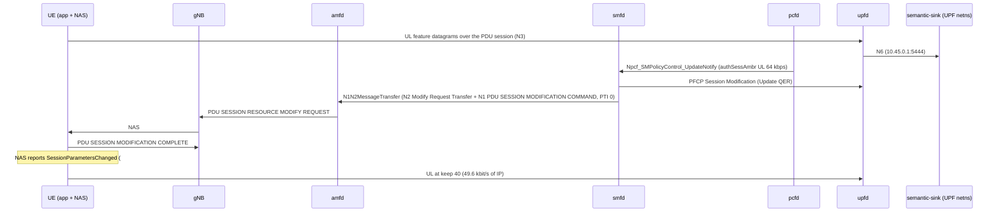

# D444A: app adaptation to a network-signalled Session-AMBR

Ticket: [nextgsim#477](https://github.com/NextgCoreLab/nextgsim/issues/477), program anchor [#458](https://github.com/NextgCoreLab/nextgsim/issues/458). Demo key `d444a-ambr-adapt`.

## Purpose

Show the people evaluating nextgcore that a PCF-changed Session-AMBR reaches the UE over NAS (TS 23.502 step 3b), and that a UE application adapts its send rate to it.

- **Success signal:** after a throttle, the UE logs `rate target … from session-AMBR (PSI 1), keep 128->40`, and the sink's next epoch has no `qer_gate` drops. The ordered smfd → gNB → UE NAS log chain proves it.
- **Not the point:** this is not semantic-communication evidence. The codec is a fitted linear PCA, and its accuracy gap is generator ground truth.

## How it works



Components:

| Piece | Where | Gate |
|---|---|---|
| Codec, generator, wire datagram, epoch scorer | `nextgsim-semantic/src/rate_adapt.rs` | library, no runtime effect |
| UE stream (keep re-plan, 50 Hz datagrams, `semantic-status`) | `nextgsim-ue/src/semantic_codec/d444a.rs` | cargo `demo-d444a-ambr-adapt` + `demo:` block + `semantic_comm_enabled` + `semantic_stream:` |
| App task forwards #454's event to the semantic codec task | `nextgsim-ue/src/app/task.rs` | compiled with `nextgsim-semantic`; the task ignores it unless the demo is active |
| `semantic-sink` | `nextgsim-semantic/src/bin/semantic_sink.rs` | cargo `demo-d444a-ambr-adapt`; refuses to start unless the demo is enabled |
| smfd step 3b | nextgcore#1385 | base core, spec-mandated, not gated |

Link budget: 80 % of the uplink Session-AMBR, 50 datagrams per second, 28 B IP/UDP + 16 B header + 2 B per feature, `keep` a multiple of 8. 64 kbps gives 128 B per datagram, so keep 40 (124 B, 49.6 kbit/s). All 128 features is 300 B, 120 kbit/s: what the `raw` control sends and the QER polices.

Modes (`demo.d444a-ambr-adapt.mode`):
- `semantic`: the app follows the Session-AMBR with the PCA codec. The sink also scores the top-variance raw (fair) and mean-pool (ablation) baselines on the same received samples at the same keep, hence equal bytes.
- `raw`: the control. The app ignores the AMBR and sends 128 raw features.

Switching: `nr-cli <ue> demo d444a-ambr-adapt set mode=<mode>` (from the next epoch, audited); the sink is config plus restart. `nr-cli <ue> semantic-status` shows mode, keep, the last UL Session-AMBR and the counters.

On the pinned generator (seed 444) the accuracy at each keep, over 2000 samples, is (`cargo test -p nextgsim-semantic --lib calibration_probe -- --ignored --nocapture`):

| keep | PCA | top-variance raw | mean-pool |
|---|---|---|---|
| 8 | 0.964 | 0.532 | 0.309 |
| 40 | 0.966 | 0.832 | 0.661 |
| 128 | 0.971 | 0.971 | 0.971 |

That table is generator ground truth, not a result about semantic communication.

## How to run it

Compose: `config/demo-semantic/README.md` (over nextgcore's standalone `docker-compose.demo-n2ho.yml`; UE config, sink in `network_mode: service:upf`).

EKS (devtest1), nextgcore `deploy/eks/overlays/demo-d444a-ambr-adapt/` (ClusterIP only), with nextgcore and nextgsim checked out side by side at the commits to test:

- Images. `build-images.sh` builds and pushes only `nextg/gnb` and `nextg/ue` (the UE image also carries `semantic-sink` and `nr-cli`), tagged `demo-d444a-ambr-adapt-<nextgsim sha>`. The ten core NFs must be built as well, from a nextgcore that has smfd's step 3b (#1385) and pcfd's re-authorisation from its subscriber store (#299, #1461, #1467). Build them with the demo profile's 6G features (`deploy/eks/profiles/6g/profile.env`) in `rust:1.95.0-bookworm`, package them with `docker/rust/Dockerfile.nf` as `build-and-push.sh` does, and push them under a new `demo-d444a-ambr-adapt-<nextgcore sha>` tag. Never overwrite an existing tag.
- Run, one arm per lock hold:

```bash
export YES=true KUBE_CONTEXT=devtest1 CORE_IMAGE_TAG=demo-d444a-ambr-adapt-<core sha> \
  SIM_IMAGE_TAG=demo-d444a-ambr-adapt-<sim sha> SIM_SHA=<sim sha>
flock /tmp/eks-nextg-demo.lock k8s/demo-check.sh d444a-ambr-adapt semantic
flock /tmp/eks-nextg-demo.lock k8s/demo-check.sh d444a-ambr-adapt raw
flock /tmp/eks-nextg-demo.lock k8s/demo-check.sh off off
```

- Manual arms, all in `patches/ue-d444a-config.yaml` with the semantic arm. For `follow_session_ambr: false`, set it to `false`. For no `device:`, delete the `device:` line. Run the unknown mode as `k8s/demo-check.sh d444a-ambr-adapt bogus`.
- Harness: nextgcore #1472 or later. Without it, the UE's log can rotate away before the restore chain is read (see Results). The raw control needs upfd's MBR fix too (nextgcore #1476): before it, no Session-AMBR was policed at the UPF.

Code revert arms: `scripts/demo/d444a-reverts.sh`.

## Results

**Both demo arms and the demo-off control pass on EKS.** The semantic arm and the off control passed in round 2. The raw control failed then, on an upfd MBR unit defect (nextgcore #1475). It passes in round 3, on nextgcore main with that fix (#1476) and the capture fix (#1472) merged. The UPF now polices raw's 120 kbit/s down to the 64 kbps UL Session-AMBR (`qer_gate 377 -> 674`), and the sink receives 63.8 kbit/s. So the round-2 semantic result (no loss at 49.6 kbit/s) now stands against a UPF that does police at 64 kbps. The semantic arm itself was not rerun on the #1476 images. The PCA-vs-baseline gap at keep 40 is what the pinned generator predicts (the table above), not a finding about semantic communication.

Captured on EKS (devtest1) with `k8s/demo-check.sh`, one arm per lock hold, each in a `nextg-demo` namespace that the run created. Every quoted line is copied from the run artefacts under `/tmp/eks-val/demos/` on the operator host. The code blocks are selected lines. In each line, the kubelet timestamp prefix and the ANSI colour codes are trimmed. Nothing is reconstructed. The arms ran with `KEEP=true`, so that the subscriber's restored state could be read back (`post/`) before a wrapper deleted the namespace in the same lock hold. That is why the verdicts say `teardown=kept`.

### Round 3: the raw control on nextgcore main (#1472, #1476)

| arm | artefacts (under `/tmp/eks-val/demos/`) | harness (nextgcore) | VERDICT |
|---|---|---|---|
| `d444a-ambr-adapt raw` | `d444a-ambr-adapt/raw/20261112T163446Z` | `55c6afcb0eda` (main) | PASS |
| `d444a-ambr-adapt raw` (first try) | `d444a-ambr-adapt/raw/20261112T161809Z` | `55c6afcb0eda` | FAIL before the demo: pcfd never registered with the NRF (nextgcore #1479), so the UE could not register |

- **Images** (devtest1 ECR, new tags only): `nextg/{nrf,amf,smf,upf,ausf,udm,udr,pcf,nssf,bsf}:demo-d444a-ambr-adapt-55c6afcb0eda` (nextgcore main, the demo profile's 6G features), and `nextg/{gnb,ue}:demo-d444a-ambr-adapt-65fa4c899312` (nextgsim main `65fa4c8`; the UE image carries `nr-cli` and `semantic-sink`, checked before the push).
- **e2e and toggle.** `e2e_rc=0 scenario_rc=0`, `demo_banner_lines=2 demo_prefix_lines=29 nextg_demo_enabled_series=1`, `VERDICT: PASS`.
- The semantic arm was not rerun. #1476 changes only how upfd reads the MBR, and the semantic stream stays under it (49.6 of 64 kbit/s).

The scenario's checks (`scenario.log`):

```
ok:   ordered smfd -> gNB -> UE chain (5 steps)
ok:   raw: no rate target line
ok:   epoch B: lost=234 qer_gate=297
ok:   UL session AMBR and sm-data restored to the originals
ok:   restore chain
d444a scenario: PASS
```

The chain (`d444a/chain.txt`, head and tail):

```
[2026-11-12T16:37:59.382Z INFO  nextgcore_smfd] ref=1: network-requested PDU Session Modification (AMBR UL/DL 1000000000/1000000000 -> 64000/1000000000 bps, 5QI 9 -> 9, ARP PL 8 -> 8)
2026-11-12T16:37:59.400220Z  INFO nextgsim_ue::semantic_codec::d444a: [demo:d444a-ambr-adapt] session-AMBR (PSI 1) UL 64000 bps not followed: mode raw, keep 128
```

upfd installs the new QER and now polices to it. Epoch 7 is before the throttle, epoch 8 straddles it, and epochs 9 and 10 are under it (`logs/<upf-pod>_upf.log`; `d444a/sink-rows.txt`; `d444a/qer-gate.txt`):

```
[2026-11-12T16:37:59.381Z INFO  nextgcore_upfd] Installed 1 QERs for SEID=0x1
2026-11-12T16:37:51.285815Z  INFO semantic_sink: [demo:d444a-ambr-adapt] epoch=7 mode=raw encoder=raw keep=128 received=500 lost=0 ip_bytes=150000 ul_kbps=120.0 acc=0.950
2026-11-12T16:38:01.305810Z  INFO semantic_sink: [demo:d444a-ambr-adapt] epoch=8 mode=raw encoder=raw keep=128 received=460 lost=40 ip_bytes=138000 ul_kbps=110.4 acc=0.959
2026-11-12T16:38:11.286412Z  INFO semantic_sink: [demo:d444a-ambr-adapt] epoch=9 mode=raw encoder=raw keep=128 received=266 lost=234 ip_bytes=79800 ul_kbps=63.8 acc=0.966
2026-11-12T16:38:21.305919Z  INFO semantic_sink: [demo:d444a-ambr-adapt] epoch=10 mode=raw encoder=raw keep=128 received=267 lost=233 ip_bytes=80100 ul_kbps=64.1 acc=0.974
qer_gate 377 -> 674
```

The restore (`d444a/restore-chain.txt`, first line) and the subscriber afterwards (`post/mongo-ambr-after.json`; `post/udr-sm-data-after.json` is byte-identical to `d444a/orig-sm-data.json`):

```
[2026-11-12T16:38:31.313Z INFO  nextgcore_smfd] ref=1: network-requested PDU Session Modification (AMBR UL/DL 64000/1000000000 -> 1000000000/1000000000 bps, 5QI 9 -> 9, ARP PL 8 -> 8)
{"uplink":{"value":1,"unit":3},"downlink":{"value":1,"unit":3}}
```

**The first round-3 try failed in the base core, not in the demo.** pcfd lost a start-up race and ran without an NRF registration. amfd's AM policy create then failed on every attempt, so the UE never registered and the base e2e found no PDU session (`logs/<pcf-pod>_pcf.log`, `logs/<amf-pod>_amf.log`, `e2e-internet.log`):

```
[2026-11-12T16:18:58.513Z ERROR nextgcore_pcfd::app] PCF self instance not published by pcf_sbi_open; NRF registration and BSF pcfId would disagree. Continuing without NRF registration.
[2026-11-12T16:19:50.017Z ERROR nextgcore_amfd::ngap_path] [imsi-999700000000001] Npcf_AMPolicyControl_Create failed: Request failed: AM policy create failed: HTTP/2 connection error: Connection refused (os error 111)
```

This was filed as nextgcore #1479 and is fixed on main by nextgcore #1483, which merged after these runs. The PASS run's pcfd registered (`PCF registered with NRF (id=de13d6cf-a460-48f0-8f4a-94c2fc319657, status=201)`).

### Round 2

The build and run scripts of round 2 are kept beside its artefacts: `d444a-ambr-adapt/{build-core.sh,push-core.sh,run-arm.sh}`.

**What ran (round 2).**

| arm | artefacts (under `/tmp/eks-val/demos/`) | harness (nextgcore) | VERDICT |
|---|---|---|---|
| `d444a-ambr-adapt semantic` | `d444a-ambr-adapt/semantic/20261112T125949Z` | `5c23175c` (#1472) | PASS |
| `d444a-ambr-adapt raw` | `d444a-ambr-adapt/raw/20261112T131532Z` | `5c23175c` | FAIL: `epoch B: qer_gate delta=0, want > 0` (the upfd MBR defect) |
| `off off` (demo-off control) | `off/off/20261112T133039Z` | `5c23175c` | PASS |
| manual: `follow_session_ambr: false` | `d444a-ambr-adapt/follow-false/20261112T134352Z` (`overlay.diff` is the edit) | `5c23175c` + that edit | FAIL at the adapt step, as a revert arm must |
| `d444a-ambr-adapt semantic`, merged harness | `d444a-ambr-adapt/semantic/20261112T124534Z` | `ff97da6b` (main) | FAIL: restore chain, lost to UE log rotation |

- **Images** (devtest1 ECR, new tags only):
  - `nextg/{nrf,amf,smf,upf,ausf,udm,udr,pcf,nssf,bsf}:demo-d444a-ambr-adapt-ff97da6b0185`: nextgcore main with #1461 and #1467, built with the demo profile's 6G features;
  - `nextg/gnb:demo-d444a-ambr-adapt-7f36bcfcedf5` and `nextg/ue:demo-d444a-ambr-adapt-7f36bcfcedf5`: nextgsim at the #520 merge, unchanged since round 1. Nothing merged in nextgsim since then touches the UE, the sink or `k8s/`.
- **e2e.** In every arm, the base e2e (`e2e-internet.sh`, PROFILE=demo) passed: `e2e_rc=0`.
- **The demo-off control:** `demo_banner_lines=0 demo_prefix_lines=0 nextg_demo_enabled_series=0`, `VERDICT: PASS`. With #1461 in, the session now gets the subscriber's provisioned Session-AMBR, with the demo off as well (`logs/<smf-pod>_smf.log`):

```
[2026-11-12T13:32:23.935Z INFO  nextgcore_smfd] SM policy created: id=ad601416-09fd-45a6-a7c7-ff715655ba1c, 5QI=9, AMBR UL/DL=1000000000/1000000000 bps, 1 PCC rule(s)
```

### semantic: the chain (`d444a/chain.txt`)

The ordered smfd → gNB → UE chain, in the scenario's own matched lines:

```
[2026-11-12T13:03:28.144Z INFO  nextgcore_smfd] ref=1: network-requested PDU Session Modification (AMBR UL/DL 1000000000/1000000000 -> 64000/1000000000 bps, 5QI 9 -> 9, ARP PL 8 -> 8)
2026-11-12T13:03:28.217628Z  INFO nextgsim_gnb::ngap::task: PDU Session Resource Modify Request: amf_ue_ngap_id=1, ran_ue_ngap_id=1, 1 items
2026-11-12T13:03:28.217674Z  INFO nextgsim_gnb::ngap::task: PDU Session Resource Modify Response sent to AMF
2026-11-12T13:03:28.218498Z  INFO nextgsim_ue::nas::sm::orchestrator: Sending PDU Session Modification Complete: PSI=1, PTI=0
2026-11-12T13:03:28.218526Z  INFO nextgsim_ue::semantic_codec::d444a: [demo:d444a-ambr-adapt] rate target 51200 bps from session-AMBR (PSI 1), keep 128->40 (UL Session-AMBR 64000 bps, 50 Hz, 124 B per datagram)
```

### semantic: the sink (`d444a/sink-rows.txt`)

These are the epoch that straddles the throttle, then epoch B (the first wholly after it), then the next one:

```
2026-11-12T13:03:29.571254Z  INFO semantic_sink: [demo:d444a-ambr-adapt] epoch=9 mode=semantic encoder=pca keep=128..40 received=500 lost=0 ip_bytes=138208 ul_kbps=110.6 acc=0.956 baseline top-variance-raw acc=0.936 mean-pool acc=0.926 (equal bytes) margin=+0.020/+0.030
2026-11-12T13:03:39.571517Z  INFO semantic_sink: [demo:d444a-ambr-adapt] epoch=10 mode=semantic encoder=pca keep=40 received=500 lost=0 ip_bytes=62000 ul_kbps=49.6 acc=0.968 baseline top-variance-raw acc=0.810 mean-pool acc=0.684 (equal bytes) margin=+0.158/+0.284
2026-11-12T13:03:49.570745Z  INFO semantic_sink: [demo:d444a-ambr-adapt] epoch=11 mode=semantic encoder=pca keep=40 received=500 lost=0 ip_bytes=62000 ul_kbps=49.6 acc=0.960 baseline top-variance-raw acc=0.806 mean-pool acc=0.672 (equal bytes) margin=+0.154/+0.288
```

The scenario's verdict on epoch B (`scenario.log`) was `ok:   epoch B: acc=0.968 top-variance-raw=0.810 mean-pool=0.684 lost=0 qer_gate=0`, and the upfd counter read `qer_gate 0 -> 0` (`d444a/qer-gate.txt`). That "no `qer_gate` drops" holds, but it is weaker than it looks. Because of the upfd defect below, the UPF would not have dropped anything at 120 kbit/s either. The stream staying at 49.6 kbit/s is the app's doing, and it is not yet shown to matter at the UPF. Round 3 shows the UPF policing at 64 kbps since #1476.

### semantic: the restore (`d444a/restore-chain.txt`)

```
[2026-11-12T13:04:10.785Z INFO  nextgcore_smfd] ref=1: network-requested PDU Session Modification (AMBR UL/DL 64000/1000000000 -> 1000000000/1000000000 bps, 5QI 9 -> 9, ARP PL 8 -> 8)
2026-11-12T13:04:10.836579Z  INFO nextgsim_ue::nas::sm::orchestrator: Sending PDU Session Modification Complete: PSI=1, PTI=0
2026-11-12T13:04:10.836602Z  INFO nextgsim_ue::semantic_codec::d444a: [demo:d444a-ambr-adapt] rate target 800000000 bps from session-AMBR (PSI 1), keep 40->128 (UL Session-AMBR 1000000000 bps, 50 Hz, 300 B per datagram)
```

The banners of both demo processes and the UE's demo metric (`log-chain.txt`; `metrics/<ue-pod>-nr-cli.prom`):

```
2026-11-12T13:00:23.738718Z  WARN nextgsim_demo: DEMO MODE ACTIVE: d444a-ambr-adapt=semantic
2026-11-12T13:01:44.394304Z  WARN nextgsim_demo: DEMO MODE ACTIVE: d444a-ambr-adapt=semantic
nextg_demo_enabled{demo="d444a-ambr-adapt",mode="semantic"} 1
```

The first line is from the sink and the second from the UE. Each is shown without its `log-chain.txt` prefix (the kubelet stamp and the `[<pod>_<container>]` tag).

**T3591.** smfd retransmitted the PDU SESSION MODIFICATION COMMAND six times in this run (`logs/<smf-pod>_smf.log`). The UE sent its COMPLETE (the chains above), but amfd did not yet relay it to smfd at the time of this run. This was fixed by nextgcore #1470, which is in the round-3 core (`55c6afcb0eda`): the round-3 raw run on main logs no T3591 retransmission (`raw/20261112T163446Z/logs/<smf-pod>_smf.log`, no `T3591 expired` line):

```
[2026-11-12T13:03:44.154Z WARN  nextgcore_smfd] SMF_TIMER_T3591 expired for ref=1; retransmitting the 5GSM command (attempt 1)
```

These retransmissions are not counted as a failure. Neither chain depends on them.

### raw (round 2, superseded by round 3): the control is not policed

The chain and the raw UE line held (`d444a/chain.txt`, tail):

```
2026-11-12T13:18:46.634211Z  INFO nextgsim_ue::nas::sm::orchestrator: Sending PDU Session Modification Complete: PSI=1, PTI=0
2026-11-12T13:18:46.634238Z  INFO nextgsim_ue::semantic_codec::d444a: [demo:d444a-ambr-adapt] session-AMBR (PSI 1) UL 64000 bps not followed: mode raw, keep 128
```

upfd installed the new QER, and then forwarded every datagram of the 120 kbit/s stream. Epoch 9 straddles the throttle, and epoch 10 is epoch B (`logs/<upf-pod>_upf.log`; `d444a/sink-rows.txt`; `d444a/upf.prom`):

```
[2026-11-12T13:18:46.532Z INFO  nextgcore_upfd] Installed 1 QERs for SEID=0x1
2026-11-12T13:18:54.189598Z  INFO semantic_sink: [demo:d444a-ambr-adapt] epoch=9 mode=raw encoder=raw keep=128 received=500 lost=0 ip_bytes=150000 ul_kbps=120.0 acc=0.960
2026-11-12T13:19:04.189767Z  INFO semantic_sink: [demo:d444a-ambr-adapt] epoch=10 mode=raw encoder=raw keep=128 received=500 lost=0 ip_bytes=150000 ul_kbps=120.0 acc=0.970
upf_dataplane_dropped_packets_by_reason_total{reason="qer_gate"} 0
```

**Diagnosis: upfd's MBR is 1000 times too loose.** smfd encodes the MBR IE correctly, in kbit/s (TS 29.244 §8.2.8, `n4_build.rs` `add_mbr`, `div_ceil(1000)`). upfd's parser then multiplies the kbit/s field by 1000 ("convert to bit/s for the internal rate policer", upfd `n4_build.rs`, since c6877b26). But `ParsedCreateQer.ul_mbr` is documented as kbps, and the policer takes it as kbps: `DataPlaneQer::set_mbr(ul_kbps, …)` → `TokenBucket::from_mbr_kbps`, at kbps × 125 bytes/s. So a 64 kbps Session-AMBR is policed as 64 Mbps. The same conversion is applied to GBR. This was nextgcore #1475, fixed by #1476; round 3 above is the raw arm on the fix.

### follow_session_ambr: false (revert arm)

With the flag off, the network side runs exactly as in the semantic arm, and the UE declines to adapt. The chain stops at the adapt step (`scenario.log`):

```
FAIL: chain: missing or out of order: /\[demo:d444a-ambr-adapt\] rate target 51200 bps from session-AMBR \(PSI 1\), keep 128->40/
```

The matched steps before it (`d444a/chain.txt`), the UE's own lines (`d444a/ue.log`), and an epoch after the throttle (`d444a/sink-rows.txt`):

```
[2026-11-12T13:46:41.235Z INFO  nextgcore_smfd] ref=1: network-requested PDU Session Modification (AMBR UL/DL 1000000000/1000000000 -> 64000/1000000000 bps, 5QI 9 -> 9, ARP PL 8 -> 8)
2026-11-12T13:46:41.279180Z  INFO nextgsim_ue::nas::sm::orchestrator: Sending PDU Session Modification Complete: PSI=1, PTI=0
2026-11-12T13:45:24.224727Z  INFO nextgsim_ue::semantic_codec::d444a: [demo:d444a-ambr-adapt] UL feature stream to 10.45.0.1:5444 via uesimtun0 at 50 Hz, mode semantic, keep 128, follow_session_ambr=false
2026-11-12T13:46:41.279207Z  INFO nextgsim_ue::semantic_codec::d444a: [demo:d444a-ambr-adapt] session-AMBR (PSI 1) UL 64000 bps not followed: follow_session_ambr is false, keep 128
2026-11-12T13:47:59.412778Z  INFO semantic_sink: [demo:d444a-ambr-adapt] epoch=14 mode=semantic encoder=pca keep=128 received=500 lost=0 ip_bytes=150000 ul_kbps=120.0 acc=0.954 baseline top-variance-raw acc=0.954 mean-pool acc=0.954 (equal bytes) margin=+0.000/+0.000
```

### The restore (EXIT trap)

Every arm restored subscriber 999700000000001: semantic (both runs), raw and follow-false. `d444a/orig-ul.json` was `{"value":1,"unit":3}`. After the run, with the namespace still up, `post/mongo-ambr-after.json` read:

```
{"uplink":{"value":1,"unit":3},"downlink":{"value":1,"unit":3}}
```

The UDR's `sm-data` read back afterwards (`post/udr-sm-data-after.json`) is byte-identical to the original GET (`d444a/orig-sm-data.json`). The restore PUT returned `204` (`d444a/udr-put-restore.txt`).

### The capture fix (nextgcore #1472)

On the merged harness (`semantic/20261112T124534Z`), the throttle chain and epoch B passed, and the restore chain failed (`scenario.log`):

```
FAIL: restore chain: missing or out of order: /network-requested PDU Session Modification \(AMBR UL/DL 64000//
```

smfd had sent the restore modification (`logs/<smf-pod>_smf.log`):

```
[2026-11-12T12:51:02.438Z INFO  nextgcore_smfd] ref=1: network-requested PDU Session Modification (AMBR UL/DL 64000/1000000000 -> 1000000000/1000000000 bps, 5QI 9 -> 9, ARP PL 8 -> 8)
```

The scenario missed it because `d444a/restore.log` was empty. The UE logs every datagram and every MIB/SIB at info, so kubelet had rotated its container log. The re-collected merged log was shorter than the line count the scenario took before the restore, and the slice by line number ran past its end. #1472 runs the d444a UE with `RUST_LOG=info,nr_ue=warn,nextgsim_ue::rrc=warn`, and slices by kubelet timestamp. In the round-2 arms the UE's log is complete from its start, and the verdicts count both banners (`demo_banner_lines=2`).

### Round 1 (superseded): the pcfd defects

The first runs, on images `demo-d444a-ambr-adapt-2e04e3c9396e` (core) and `-7f36bcfcedf5` (sim), with the #1446 harness, failed before the UE. pcfd subscribed to UDR policy-data changes only once, at startup, and lost that race to the UDR's NRF registration in 4 of 6 deploys (fixed by #1467). It also never opened its database, so every session got the 100 Mbps default and a re-authorisation changed nothing (fixed by #1461). From the round-1 run where pcfd did subscribe (`d444a-ambr-adapt/semantic/20261112T075413Z`, `logs/<pcf-pod>_pcf.log`, `logs/<smf-pod>_smf.log`):

```
[2026-11-12T07:56:05.829Z WARN  nextgcore_pcfd::nudr_handler] [imsi-999700000000001] Failed to query session data from DB: Database not initialized, using defaults
[2026-11-12T07:57:36.481Z INFO  nextgcore_smfd] Applying PCF-updated policy to ref=1: AMBR UL/DL=100000000/100000000 bps, 5QI=9
```

The other round-1 artefacts are `d444a-ambr-adapt/semantic/20261112T072955Z`, `d444a-ambr-adapt/raw/20261112T074032Z`, `off/off/20261112T074810Z` (PASS) and `d444a-ambr-adapt/semantic-diag-pcf-restart/20261112T080141Z` (a diagnostic, not a verdict). Two round-1 manual arms still stand, because the gnb/ue images are the same:

- **No `device:`** (`d444a-ambr-adapt/no-device/20261112T080920Z`). The arm's verdict is `VERDICT: FAIL`, because it ran on the round-1 core with the pcfd defects; it is used here only for what the sink received. The UE started without `SO_BINDTODEVICE`, and the sink still received every datagram. On the EKS UE pod the routing table already sends 10.45.0.1 through the session's TUN, so this arm does not discriminate there:

```
2026-11-12T08:11:09.306354Z  INFO nextgsim_ue::semantic_codec::d444a: [demo:d444a-ambr-adapt] UL feature stream to 10.45.0.1:5444 via the routing table at 50 Hz, mode semantic, keep 128, follow_session_ambr=true
2026-11-12T08:15:24.075148Z DEBUG nextgsim_ue::tun::task: Read V4 packet (300 bytes) from TUN interface for PSI 1
```

- **Mode `bogus`** (`d444a-ambr-adapt/mode-bogus/20261112T081824Z`). Both ends refuse to start, and the deploy fails (`deploy=false`). These lines have no ANSI codes in the artefacts:

```
2026-11-12T08:22:55.775679Z ERROR nr_ue: UE failed: Invalid demo block in /etc/nextgsim/ue.yaml: demo config: unknown mode "bogus" for demo "d444a-ambr-adapt" (known modes ["semantic", "raw"])
2026-11-12T08:21:46.670010Z ERROR semantic_sink: semantic-sink: /tmp/sink.yaml: demo config: unknown mode "bogus" for demo "d444a-ambr-adapt" (known modes ["semantic", "raw"])
```

## Honesty labels and limitations

- Non-normative: the app, codec, datagram and sink have no Stage-3 behind them. TR 22.870 §9.13 (PR 9.13.6-1) is framing only, and it is downlink; this demo is uplink.
- The accuracy gap is the pinned generator's spectrum. The datagram carries the sample's ground-truth label so the sink can score it.
- "Raw is policed at 64 kbps" is arithmetic, a QER control, not a finding.
- The UE application staying under its Session-AMBR is an application choice, not the UE's UL Session-AMBR enforcement (TS 23.501 §5.7.2.6), which nextgsim does not implement.
- The stream starts at keep 128 and learns the Session-AMBR only from a PDU SESSION MODIFICATION COMMAND, not from the establishment accept. After a re-establishment it keeps the last modified keep until the next change. The demo's flow starts at the provisioned 1 Gbps, so this does not affect it.
- Below about 30 kbit/s the floor of 8 features (60 B per datagram, 24 kbit/s at 50 Hz) is above the 80 % target, although the log still prints the target.
- The throttle source: the EKS scenario lowers the subscriber's session AMBR in the UDR and re-authorises the SM policy association (TS 29.512 §4.2.3.2). It still does so although #465's pcfd controller has merged (nextgcore #1447); the scenario does not use that controller. On devtest1 it reaches the UE since nextgcore #1461 and #1467, and the UPF enforces it since #1476 (round 3).
