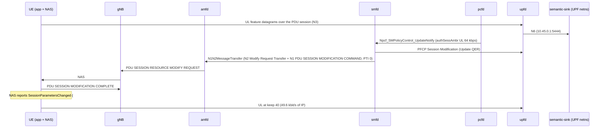

# D444A: app adaptation to a network-signalled Session-AMBR

Ticket: [nextgsim#477](https://github.com/NextgCoreLab/nextgsim/issues/477), program anchor [#458](https://github.com/NextgCoreLab/nextgsim/issues/458). Demo key `d444a-ambr-adapt`.

## Purpose

Show the people evaluating nextgcore that a PCF-changed Session-AMBR reaches the UE over NAS (TS 23.502 step 3b), and that a UE application adapts its send rate to it.

- **Success signal:** after a throttle, the UE logs `rate target … from session-AMBR (PSI 1), keep 128->40`, and the sink's next epoch has no `qer_gate` drops. The ordered smfd → gNB → UE NAS log chain proves it.
- **Not the point:** this is not semantic-communication evidence. The codec is a fitted linear PCA, and its accuracy gap is generator ground truth.

## How it works



Components:

| Piece | Where | Gate |
|---|---|---|
| Codec, generator, wire datagram, epoch scorer | `nextgsim-semantic/src/rate_adapt.rs` | library, no runtime effect |
| UE stream (keep re-plan, 50 Hz datagrams, `semantic-status`) | `nextgsim-ue/src/semantic_codec/d444a.rs` | cargo `demo-d444a-ambr-adapt` + `demo:` block + `semantic_comm_enabled` + `semantic_stream:` |
| App task forwards #454's event to the semantic codec task | `nextgsim-ue/src/app/task.rs` | compiled with `nextgsim-semantic`; the task ignores it unless the demo is active |
| `semantic-sink` | `nextgsim-semantic/src/bin/semantic_sink.rs` | cargo `demo-d444a-ambr-adapt`; refuses to start unless the demo is enabled |
| smfd step 3b | nextgcore#1385 | base core, spec-mandated, not gated |

Link budget: 80 % of the uplink Session-AMBR, 50 datagrams per second, 28 B IP/UDP + 16 B header + 2 B per feature, `keep` a multiple of 8. 64 kbps gives 128 B per datagram, so keep 40 (124 B, 49.6 kbit/s). All 128 features is 300 B, 120 kbit/s: what the `raw` control sends and the QER polices.

Modes (`demo.d444a-ambr-adapt.mode`):
- `semantic`: the app follows the Session-AMBR with the PCA codec. The sink also scores the top-variance raw (fair) and mean-pool (ablation) baselines on the same received samples at the same keep, hence equal bytes.
- `raw`: the control. The app ignores the AMBR and sends 128 raw features.

Switching: `nr-cli <ue> demo d444a-ambr-adapt set mode=<mode>` (from the next epoch, audited); the sink is config plus restart. `nr-cli <ue> semantic-status` shows mode, keep, the last UL Session-AMBR and the counters.

On the pinned generator (seed 444) the accuracy at each keep, over 2000 samples, is (`cargo test -p nextgsim-semantic --lib calibration_probe -- --ignored --nocapture`):

| keep | PCA | top-variance raw | mean-pool |
|---|---|---|---|
| 8 | 0.964 | 0.532 | 0.309 |
| 40 | 0.966 | 0.832 | 0.661 |
| 128 | 0.971 | 0.971 | 0.971 |

That table is generator ground truth, not a result about semantic communication.

## How to run it

Compose: `config/demo-semantic/README.md` (over nextgcore's standalone `docker-compose.demo-n2ho.yml`; UE config, sink in `network_mode: service:upf`).

EKS (devtest1): nextgcore `deploy/eks/overlays/demo-d444a-ambr-adapt/` — build the images with its `build-images.sh`, then

```bash
SIM_IMAGE_TAG=<tag> flock /tmp/eks-nextg-demo.lock k8s/demo-check.sh d444a-ambr-adapt semantic
SIM_IMAGE_TAG=<tag> flock /tmp/eks-nextg-demo.lock k8s/demo-check.sh d444a-ambr-adapt raw
flock /tmp/eks-nextg-demo.lock k8s/demo-check.sh off off
```

Code revert arms: `scripts/demo/d444a-reverts.sh`.

## Results

Not yet run on devtest1. This section is filled from the captured artefacts (`/tmp/eks-val/demos/d444a-ambr-adapt/<mode>/`) after the EKS runs; nothing here is invented ahead of them.

## Honesty labels and limitations

- Non-normative: the app, codec, datagram and sink have no Stage-3 behind them. TR 22.870 §9.13 (PR 9.13.6-1) is framing only, and it is downlink; this demo is uplink.
- The accuracy gap is the pinned generator's spectrum. The datagram carries the sample's ground-truth label so the sink can score it.
- "Raw is policed at 64 kbps" is arithmetic, a QER control, not a finding.
- The UE application staying under its Session-AMBR is an application choice, not the UE's UL Session-AMBR enforcement (TS 23.501 §5.7.2.6), which nextgsim does not implement.
- The throttle source: until nextgsim#465's pcfd controller merges, the EKS scenario lowers the subscriber's session AMBR in the UDR and re-authorises the SM policy association (TS 29.512 §4.2.3.2). That pcfd startup check (`MissingDependency` on `d441a-congestion-loop`) lands with #465's pcfd demo registry.
