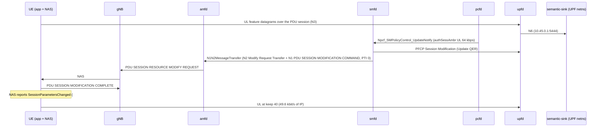

# D444A: app adaptation to a network-signalled Session-AMBR

Ticket: [nextgsim#477](https://github.com/NextgCoreLab/nextgsim/issues/477), program anchor [#458](https://github.com/NextgCoreLab/nextgsim/issues/458). Demo key `d444a-ambr-adapt`.

## Purpose

Show the people evaluating nextgcore that a PCF-changed Session-AMBR reaches the UE over NAS (TS 23.502 step 3b), and that a UE application adapts its send rate to it.

- **Success signal:** after a throttle, the UE logs `rate target … from session-AMBR (PSI 1), keep 128->40`, and the sink's next epoch has no `qer_gate` drops. The ordered smfd → gNB → UE NAS log chain proves it.
- **Not the point:** this is not semantic-communication evidence. The codec is a fitted linear PCA, and its accuracy gap is generator ground truth.

## How it works



Components:

| Piece | Where | Gate |
|---|---|---|
| Codec, generator, wire datagram, epoch scorer | `nextgsim-semantic/src/rate_adapt.rs` | library, no runtime effect |
| UE stream (keep re-plan, 50 Hz datagrams, `semantic-status`) | `nextgsim-ue/src/semantic_codec/d444a.rs` | cargo `demo-d444a-ambr-adapt` + `demo:` block + `semantic_comm_enabled` + `semantic_stream:` |
| App task forwards #454's event to the semantic codec task | `nextgsim-ue/src/app/task.rs` | compiled with `nextgsim-semantic`; the task ignores it unless the demo is active |
| `semantic-sink` | `nextgsim-semantic/src/bin/semantic_sink.rs` | cargo `demo-d444a-ambr-adapt`; refuses to start unless the demo is enabled |
| smfd step 3b | nextgcore#1385 | base core, spec-mandated, not gated |

Link budget: 80 % of the uplink Session-AMBR, 50 datagrams per second, 28 B IP/UDP + 16 B header + 2 B per feature, `keep` a multiple of 8. 64 kbps gives 128 B per datagram, so keep 40 (124 B, 49.6 kbit/s). All 128 features is 300 B, 120 kbit/s: what the `raw` control sends and the QER polices.

Modes (`demo.d444a-ambr-adapt.mode`):
- `semantic`: the app follows the Session-AMBR with the PCA codec. The sink also scores the top-variance raw (fair) and mean-pool (ablation) baselines on the same received samples at the same keep, hence equal bytes.
- `raw`: the control. The app ignores the AMBR and sends 128 raw features.

Switching: `nr-cli <ue> demo d444a-ambr-adapt set mode=<mode>` (from the next epoch, audited); the sink is config plus restart. `nr-cli <ue> semantic-status` shows mode, keep, the last UL Session-AMBR and the counters.

On the pinned generator (seed 444) the accuracy at each keep, over 2000 samples, is (`cargo test -p nextgsim-semantic --lib calibration_probe -- --ignored --nocapture`):

| keep | PCA | top-variance raw | mean-pool |
|---|---|---|---|
| 8 | 0.964 | 0.532 | 0.309 |
| 40 | 0.966 | 0.832 | 0.661 |
| 128 | 0.971 | 0.971 | 0.971 |

That table is generator ground truth, not a result about semantic communication.

## How to run it

Compose: `config/demo-semantic/README.md` (over nextgcore's standalone `docker-compose.demo-n2ho.yml`; UE config, sink in `network_mode: service:upf`).

EKS (devtest1), nextgcore `deploy/eks/overlays/demo-d444a-ambr-adapt/` (ClusterIP only), with nextgcore and nextgsim checked out side by side at the commits to test:

- Images. `build-images.sh` builds and pushes only `nextg/gnb` and `nextg/ue` (the UE image also carries `semantic-sink` and `nr-cli`), tagged `demo-d444a-ambr-adapt-<nextgsim sha>`. The ten core NFs must be built as well, because smfd's step 3b (nextgcore#1385) and pcfd's re-authorisation (#299) have to be in the images. Build them with the demo profile's 6G features (`deploy/eks/profiles/6g/profile.env`) in `rust:1.95.0-bookworm`, package them with `docker/rust/Dockerfile.nf` as `build-and-push.sh` does, and push them under a new `demo-d444a-ambr-adapt-<nextgcore sha>` tag. Never overwrite an existing tag.
- Run, one arm per lock hold:

```bash
export YES=true KUBE_CONTEXT=devtest1 CORE_IMAGE_TAG=demo-d444a-ambr-adapt-<core sha> \
  SIM_IMAGE_TAG=demo-d444a-ambr-adapt-<sim sha> SIM_SHA=<sim sha>
flock /tmp/eks-nextg-demo.lock k8s/demo-check.sh d444a-ambr-adapt semantic
flock /tmp/eks-nextg-demo.lock k8s/demo-check.sh d444a-ambr-adapt raw
flock /tmp/eks-nextg-demo.lock k8s/demo-check.sh off off
```

- Manual arms. Run `no device:` by deleting the `device:` line from `patches/ue-d444a-config.yaml` and running the semantic arm. Run the unknown mode as `k8s/demo-check.sh d444a-ambr-adapt bogus`. For `follow_session_ambr: false`, set it in the same patch; its distinguishing UE line needs a throttle that reaches the UE (see Results).

Code revert arms: `scripts/demo/d444a-reverts.sh`.

## Results

**The demo does not pass on EKS yet.** The UE, sink, codec and toggles work on the cluster. The throttle the scenario uses never reaches the UE, because of two pcfd defects found in these runs (below). So the success signal was **not** observed: no step 3b, no `keep 128->40`, and no throttled epoch. The UE-side adaptation is proven only by the in-tree tests (`nextgsim-ue/tests/d444a_stream.rs` and the revert arms).

Captured on EKS (devtest1) with `k8s/demo-check.sh`, one arm per lock hold. Each arm ran in a `nextg-demo` namespace that the run created and that was deleted afterwards. Every quoted line is copied from the run artefacts under `/tmp/eks-val/demos/` on the operator host. The code blocks are selected lines. In each line, the kubelet timestamp prefix and the ANSI colour codes are trimmed. Nothing is reconstructed.

**What ran.** The harness is nextgcore `2e04e3c9396e` (the #1446 merge) for every arm. The arms were run with `KEEP=true`, so that the subscriber's restored state could be read back before the namespace was deleted. That is why the verdicts say `teardown=kept`. A wrapper then read the state into `post/` and deleted the namespace, in the same lock hold. The scripts used to build and run are kept beside the artefacts: `d444a-ambr-adapt/{build-core.sh,push-core.sh,run-arm.sh,run-diag.sh}`.

| arm | artefacts (under `/tmp/eks-val/demos/`) | VERDICT | what failed |
|---|---|---|---|
| `d444a-ambr-adapt semantic` | `d444a-ambr-adapt/semantic/20261112T072955Z` | FAIL | scenario: no smfd step 3b. pcfd had not subscribed to the UDR (defect 1) and reads no DB (defect 2) |
| `d444a-ambr-adapt raw` | `d444a-ambr-adapt/raw/20261112T074032Z` | FAIL | scenario: the same. `qer_gate 0 -> 0`, since nothing was throttled |
| `off off` (demo-off control) | `off/off/20261112T074810Z` | PASS | |
| `d444a-ambr-adapt semantic`, second run | `d444a-ambr-adapt/semantic/20261112T075413Z` | FAIL | scenario: pcfd **did** subscribe in this run, and still no step 3b (defect 2 alone) |
| manual: no `device:` | `d444a-ambr-adapt/no-device/20261112T080920Z` (`overlay.diff` is the edit) | FAIL (as the semantic arms) | the stream reached the sink anyway (below) |
| manual: mode `bogus` | `d444a-ambr-adapt/mode-bogus/20261112T081824Z` | FAIL at deploy, as required | the UE and the sink refuse the mode |
| manual: `follow_session_ambr: false` | not run | | its distinguishing line needs a throttle that reaches the UE |
| diagnostic, not a verdict: semantic after a pcfd restart | `d444a-ambr-adapt/semantic-diag-pcf-restart/20261112T080141Z` | scenario FAIL | the same as the second run |

- **Images, the same for every arm** (devtest1 ECR, new tags only):
  - `nextg/{nrf,amf,smf,upf,ausf,udm,udr,pcf,nssf,bsf}:demo-d444a-ambr-adapt-2e04e3c9396e`: nextgcore at the #1446 merge, with the demo profile's 6G features;
  - `nextg/gnb:demo-d444a-ambr-adapt-7f36bcfcedf5` and `nextg/ue:demo-d444a-ambr-adapt-7f36bcfcedf5`: nextgsim at the #520 merge, built by `build-images.sh`. The upf pod's `semantic-sink` container runs the same UE image.
- **e2e.** In every arm that deployed, the base e2e (`e2e-internet.sh`, PROFILE=demo) passed: `e2e_rc=0`.
- **The demo-off control** ran the same images with no `demo:` block: `demo_banner_lines=0 demo_prefix_lines=0 nextg_demo_enabled_series=0`, `VERDICT: PASS`.

### What works on the cluster

The demo banner and the stream from the UE, in the raw arm (`d444a/ue.log`), the semantic second run (`semantic/20261112T075413Z/d444a/ue.log`), and the sink:

```
2026-11-12T07:42:07.536328Z  WARN nextgsim_demo: DEMO MODE ACTIVE: d444a-ambr-adapt=raw
2026-11-12T07:42:07.536759Z  INFO nextgsim_ue::semantic_codec::d444a: [demo:d444a-ambr-adapt] UL feature stream to 10.45.0.1:5444 via uesimtun0 at 50 Hz, mode raw, keep 128, follow_session_ambr=true
2026-11-12T07:56:01.586127Z  INFO nextgsim_ue::semantic_codec::d444a: [demo:d444a-ambr-adapt] UL feature stream to 10.45.0.1:5444 via uesimtun0 at 50 Hz, mode semantic, keep 128, follow_session_ambr=true
2026-11-12T07:30:18.395450Z  INFO semantic_sink: [demo:d444a-ambr-adapt] semantic-sink listening on 10.45.0.1:5444 (seed 444, 500 datagrams per epoch at 50 Hz)
```

The sink scores the stream over the PDU session, losing nothing at keep 128 (`d444a/sink-rows.txt`; semantic first run, then raw):

```
2026-11-12T07:33:21.393380Z  INFO semantic_sink: [demo:d444a-ambr-adapt] epoch=1 mode=semantic encoder=pca keep=128 received=500 lost=0 ip_bytes=150000 ul_kbps=120.0 acc=0.972 baseline top-variance-raw acc=0.972 mean-pool acc=0.972 (equal bytes) margin=+0.000/+0.000
2026-11-12T07:42:32.729798Z  INFO semantic_sink: [demo:d444a-ambr-adapt] epoch=1 mode=raw encoder=raw keep=128 received=500 lost=0 ip_bytes=150000 ul_kbps=120.0 acc=0.972
```

`nr-cli <ue> demo metrics` (`metrics/<ue-pod>-nr-cli.prom`) in the semantic and raw arms:

```
nextg_demo_enabled{demo="d444a-ambr-adapt",mode="semantic"} 1
nextg_demo_enabled{demo="d444a-ambr-adapt",mode="raw"} 1
```

The scenario's own checks, in the semantic first run (`scenario.log`):

```
ok:   the sink is scoring the UE's stream
ok:   nextg_demo_enabled series via nr-cli
ok:   UL session AMBR 64 Kbps provisioned and re-authorised
FAIL: chain: missing or out of order: /network-requested PDU Session Modification \(AMBR UL/DL [0-9]+/[0-9]+ -> 64000/[0-9]+ bps/
FAIL: epoch B: epoch B is not pca at keep 40: 2026-11-12T07:33:21.393464238Z 2026-11-12T07:33:21.393380Z  INFO semantic_sink: [demo:d444a-ambr-adapt] epoch=1 mode=semantic encoder=pca keep=128 received=500 lost=0 ip_bytes=150000 ul_kbps=120.0 acc=0.972 baseline top-variance-raw acc=0.972 mean-pool acc=0.972 (equal bytes) margin=+0.000/+0.000
ok:   UL session AMBR and sm-data restored to the originals
FAIL: restore chain: missing or out of order: /network-requested PDU Session Modification \(AMBR UL/DL 64000//
d444a scenario: FAIL (3)
```

This block is complete. Only the ANSI colour codes are removed, from the sink line that the `epoch B` check quotes with its kubelet timestamp.

The "provisioned and re-authorised" check passed only because the writes were accepted: the subscriber update matched one document (`d444a/mongo-64-1.txt`: `1`), and the UDR `sm-data` PUT returned `201` (`d444a/udr-put-throttle.txt`). It does not show that the PCF re-authorised anything.

### Why the throttle never reaches the UE

**Defect 1: pcfd subscribes to UDR policy-data changes once, at startup, with no retry.** `pcf_subscribe_udr_policy_data` (pcfd `sbi_path.rs`) gives up when the NRF knows no UDR yet. In the semantic first run the PCF's discovery came 367 ms before the UDR registered, so the UDR's change notification had no subscriber:

```
[2026-11-12T07:30:44.349Z INFO  nextgcore_pcfd::sbi_path] No UDR discoverable: not subscribing to policy-data changes. An operator edit will reach a live SM policy association through no path (#299).
[2026-11-12T07:30:44.349Z INFO  nextgcore_nrfd] Found 0 matching NF instances for type UDR (page 1, size 100, returning 0)
[2026-11-12T07:30:44.716Z INFO  nextgcore_nrfd] NF a3f5b756-542c-4ff3-9afd-2d1526108188 (UDR) registered successfully
```

The first line is from pcfd and the next two from nrfd. The race was lost in 4 of the 6 deploys (the semantic first run, raw, no-device and off) and won in 2 (the semantic second run and mode `bogus`).

**Defect 2: pcfd never initialises its database connection**, although `pcf.yaml` sets `db_uri`. pcfd reads the subscriber's session data (Session-AMBR, 5QI) through `nextgcore_dbi`, but it never calls `nextgcore_dbi_init*`, as udrd does. The unit tests provision an in-process test store, so they pass. On the cluster, every read fails, and the session is authorised with the PCF default rather than the subscriber's 1 Gbps. The second semantic run (`semantic/20261112T075413Z`, PCF subscribed, nothing restarted) shows the whole chain up to that point: the UDR notifies, the PCF re-authorises, and it re-sends 100 Mbps, so smfd has no AMBR change to signal:

```
[2026-11-12T07:55:07.504Z INFO  nextgcore_pcfd::sbi_path] Subscribed to UDR policy-data changes; notifications arrive at http://10.10.2.106:7777/npcf-callback/v1/<redacted> (subscription /nudr-dr/v2/policy-data/subs-to-notify/1)
[2026-11-12T07:56:05.829Z WARN  nextgcore_pcfd::nudr_handler] [imsi-999700000000001] Failed to query session data from DB: Database not initialized, using defaults
[2026-11-12T07:56:05.885Z INFO  nextgcore_smfd] SM policy created: id=bb3652b3-601c-4c4a-9711-c2b19e1d4bec, 5QI=9, AMBR UL/DL=100000000/100000000 bps, 1 PCC rule(s)
[2026-11-12T07:57:36.481Z WARN  nextgcore_pcfd::sbi_path] [imsi-999700000000001] SM policy update notify for sm_policy_id=bb3652b3-601c-4c4a-9711-c2b19e1d4bec: session data unreadable (Database not initialized); using the session data the current decision was built from
[2026-11-12T07:57:36.481Z INFO  nextgcore_smfd] Applying PCF-updated policy to ref=1: AMBR UL/DL=100000000/100000000 bps, 5QI=9
[2026-11-12T07:57:36.536Z INFO  nextgcore_pcfd::app] Policy-data change for imsi-999700000000001 (/nudr-dr/v2/policy-data/ues/imsi-999700000000001/sm-data): re-authorised 1 SM policy association(s); AM policy notified: false; UE policy re-delivered to 0 association(s)
```

These lines are interleaved from the pcf and smf pod logs, in time order. The diagnostic run (`semantic-diag-pcf-restart/`) restarted pcfd and then the UE, so that the session's association lived on a subscribed PCF. It shows the same `Database not initialized` re-authorisation at 100 Mbps. It is evidence for the diagnosis only, not a workaround: no arm here passes by restarting a pod.

Both defects are nextgcore code and go to a nextgcore fix PR, through review. Neither is patched here. Defect 2 also means that on EKS every session gets pcfd's default 100 Mbps, not the subscriber's provisioned Session-AMBR, with the demo off as well. The demo-off control's smf log (`off/off/20261112T074810Z/logs/<smf-pod>_smf.log`) shows it:

```
[2026-11-12T07:49:54.766Z INFO  nextgcore_smfd] SM policy created: id=e582517a-1d25-475c-ba1c-0fcc32c04bf9, 5QI=9, AMBR UL/DL=100000000/100000000 bps, 1 PCC rule(s)
```

### The restore (EXIT trap)

Every arm that reached the throttle restored the subscriber. `d444a/orig-ul.json` was `{"value":1,"unit":3}`. After the run, with the namespace still up, `post/mongo-ambr-after.json` read:

```
{"uplink":{"value":1,"unit":3},"downlink":{"value":1,"unit":3}}
```

The restore PUT returned `204` (`d444a/udr-put-restore.txt`). The UDR's `sm-data` read back afterwards (`post/udr-sm-data-after.json`) is byte-identical to the original GET (`d444a/orig-sm-data.json`):

```
{"smPolicySnssaiData":{"01-000000":{"snssai":{"sst":1,"sd":"000000"},"smPolicyDnnData":{"internet":{"dnn":"internet"}}}}}
```

This holds for the semantic first run, the raw run and the no-device run. In the diagnostic run it was checked in the run directory itself, not under `post/`.

### Manual arms

**No `device:`.** The UE started without `SO_BINDTODEVICE`, and the sink still received every datagram over the PDU session. On the EKS UE pod, the routing table already sends 10.45.0.1 through the session's TUN, so this arm does not discriminate there. `device:` is what pins the stream to the session, not what makes it reach the sink. From `d444a/ue.log`, `logs/<ue-pod>_ue.log` and `d444a/sink-rows.txt`:

```
2026-11-12T08:11:09.306354Z  INFO nextgsim_ue::semantic_codec::d444a: [demo:d444a-ambr-adapt] UL feature stream to 10.45.0.1:5444 via the routing table at 50 Hz, mode semantic, keep 128, follow_session_ambr=true
2026-11-12T08:15:24.075148Z DEBUG nextgsim_ue::tun::task: Read V4 packet (300 bytes) from TUN interface for PSI 1
```

**Mode `bogus`.** Both ends refuse to start, and the deploy fails (`deploy=false`). From `logs/<ue-pod>_ue.log` and `logs/<upf-pod>_semantic-sink.log`:

```
2026-11-12T08:22:55.775679Z ERROR nr_ue: UE failed: Invalid demo block in /etc/nextgsim/ue.yaml: demo config: unknown mode "bogus" for demo "d444a-ambr-adapt" (known modes ["semantic", "raw"])
2026-11-12T08:21:46.670010Z ERROR semantic_sink: semantic-sink: /tmp/sink.yaml: demo config: unknown mode "bogus" for demo "d444a-ambr-adapt" (known modes ["semantic", "raw"])
```

These two lines have no ANSI codes in the artefacts. Only the kubelet timestamp is trimmed.

**`follow_session_ambr: false`: not run.** Its only distinguishing output is `session-AMBR (PSI 1) UL … bps not followed: follow_session_ambr is false`, logged on an AMBR change. No AMBR change reaches the UE until the defects above are fixed.

### Capture caveat

The UE logs every user-plane packet at DEBUG, 50 per second, so kubelet rotates its container log within minutes. `demo-check.sh`'s final `logs/<ue-pod>_ue.log` holds only the last rotation. In the semantic first run it starts at 07:36:39, after the throttle, and so does the scenario's last `d444a/ue.log`. In that run the UE's own `DEMO MODE ACTIVE` line is in neither file, and the verdict's `demo_banner_lines=1` is the sink's banner. The raw and the second semantic runs' `d444a/ue.log` were captured before rotation and do hold the UE's banner (quoted above). Once the defects are fixed, the UE's chain lines could be lost the same way. Lowering the UE's `RUST_LOG` in the overlay, or reading the UE log right after the chain, would avoid that.

## Honesty labels and limitations

- Non-normative: the app, codec, datagram and sink have no Stage-3 behind them. TR 22.870 §9.13 (PR 9.13.6-1) is framing only, and it is downlink; this demo is uplink.
- The accuracy gap is the pinned generator's spectrum. The datagram carries the sample's ground-truth label so the sink can score it.
- "Raw is policed at 64 kbps" is arithmetic, a QER control, not a finding.
- The UE application staying under its Session-AMBR is an application choice, not the UE's UL Session-AMBR enforcement (TS 23.501 §5.7.2.6), which nextgsim does not implement.
- The stream starts at keep 128 and learns the Session-AMBR only from a PDU SESSION MODIFICATION COMMAND, not from the establishment accept. After a re-establishment it keeps the last modified keep until the next change. The demo's flow starts at the provisioned 1 Gbps, so this does not affect it.
- Below about 30 kbit/s the floor of 8 features (60 B per datagram, 24 kbit/s at 50 Hz) is above the 80 % target, although the log still prints the target.
- The throttle source: until nextgsim#465's pcfd controller merges, the EKS scenario lowers the subscriber's session AMBR in the UDR and re-authorises the SM policy association (TS 29.512 §4.2.3.2). That pcfd startup check (`MissingDependency` on `d441a-congestion-loop`) lands with #465's pcfd demo registry. On devtest1 this throttle does not reach the UE: pcfd reads no database and can miss its UDR subscription (see Results).
