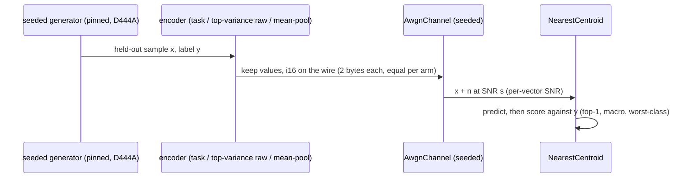

# D444C: task-oriented classification vs raw under an emulated AWGN sweep

Ticket: [nextgsim#479](https://github.com/NextgCoreLab/nextgsim/issues/479), program anchor [#458](https://github.com/NextgCoreLab/nextgsim/issues/458). Demo key `d444c-task-vs-raw`.

**This is a crate-level demo.** It is supporting / stage-2 in the program: it changes no nextgcore behaviour and runs no gNB, UE or NF, so it is not presented as a program demo.

## Purpose

Give codec reviewers a seeded, reproducible accuracy-vs-bytes-vs-SNR table that compares the task-oriented encoder with raw at equal bytes.

- **Success signal:** the `task_vs_raw` example prints the same table on every run with the same seed, and the golden test asserts each row.
- **Not the point:** this is not a network demo. The noise is emulated in the receiver, and a PDU session would deliver the bytes bit-exact or drop them. It makes no claim beyond the pinned synthetic generator.

## How it works

This demo has no 3GPP participant and no network message. The sequence is in-process.



Components (all in `nextgsim-semantic`):

| Piece | Where | What |
|---|---|---|
| generator | `rate_adapt::FeatureGenerator` (#477) | 8 classes, 128 features; class means on a decaying spectrum in a random rotation; seed pinned at 444 |
| task encoder | `rate_adapt::PcaEncoder` (#477) | linear PCA fitted on 2048 training samples; `encode(x, keep)` keeps the `keep` largest-variance components |
| top-variance raw | `rate_adapt::TopVarianceRaw` (#477) | the `keep` raw dimensions with the largest training variance (the fair baseline) |
| mean-pool | `rate_adapt::MeanPool` (#477) | `keep` contiguous mean-pooled bins (an ablation) |
| wire | `rate_adapt::quantise_roundtrip` | i16 fixed point with a per-vector scale, 2 bytes per value |
| channel | `AwgnChannel::transmit_with_rng` | AWGN from a supplied RNG; `transmit()` still draws from `thread_rng()` |
| classifier | `metrics::NearestCentroid` | per-class means of the noiseless training encodings, squared-L2 |
| score | `metrics::ClassificationScore` | top-1, macro (mean per-class) and worst-class accuracy |
| sweep | `task_vs_raw` (feature-gated) | keep 8/16/32/64 × SNR 0/5/10/15/20 dB × 3 arms over held-out samples `0..2000` |

The noise seed drives only the channel. Each sample's noise is drawn from `ChaCha8Rng` (value-stable across `rand_chacha` versions) on stream `keep << 32 | seq`, so it depends on (seed, keep, sample) only: every arm and every SNR sees the same unit draws, and a single-arm mode prints exactly its rows of `all`.

### Toggles

| Gate | Value |
|---|---|
| cargo feature | `demo-d444c-task-vs-raw` on `nextgsim-semantic`; builds the `task_vs_raw` module and example (`required-features`) |
| config | `--config <file>` with only a `demo:` block: `demo.enabled` and `demo.d444c-task-vs-raw.{enabled, mode}`; `mode` is required |
| modes | `all` (every arm and the deltas), `task-encoder`, `top-variance`, `mean-pool` (one arm each) |
| seed | `--seed <u64>` (default 444), the channel noise only |

Crate-level limits of the #458 convention: the process has no `/metrics` and opens no listener, so the `nextg_demo_enabled` series is written once to stderr; the `WARN DEMO MODE ACTIVE` banner and the `[demo:d444c-task-vs-raw]` log lines go to stderr; the table goes to stdout and carries no prefix. There is no runtime switch (one-shot process). There is no nextgcore EKS overlay: the sweep has no network path. Instead, a portable demo-only Kubernetes Job runs the same example on any cluster (see [Run on Kubernetes](#run-on-kubernetes)); it shows that the shipped container reproduces the golden table, not anything about a network.

## How to run it

```sh
cargo run -p nextgsim-semantic --features demo-d444c-task-vs-raw --example task_vs_raw -- \
    --config config/demo-task-vs-raw/task_vs_raw.yaml --seed 444
cargo test -p nextgsim-semantic --features demo-d444c-task-vs-raw   # golden + acceptance
scripts/demo/d444c-reverts.sh                                       # revert arms
```

There is no compose variant (crate-level). To run it on a cluster, see [Run on Kubernetes](#run-on-kubernetes).

## Results

Captured from this demo's PR branch, debug build, Linux x86_64. Two runs with `--seed 444` printed byte-identical stdout (sha256 `be4bf0cdab4bea412734bb4390194b4441c1bdcb3135d52898e77a5b2343ec70`), equal to the committed golden `nextgsim-semantic/src/task_vs_raw/golden_seed444.txt`; `--seed 445` changed 81 of its 85 lines.

### Mode `all`, seed 444 (stdout)

```text
# d444c-task-vs-raw mode=all: task encoder vs raw at equal bytes, emulated AWGN, non-normative
# data: synthetic, pinned generator seed 444 (8 classes, 128 features); held-out 2000 samples; noise seed 444
# channel: emulated AWGN on the dequantised i16 symbols, SNR per vector; classifier: nearest centroid fitted noiseless
arm          keep bytes snr_db   top1  macro  worst
task-encoder    8    16      0 0.6755 0.6757 0.6069
task-encoder    8    16      5 0.8780 0.8777 0.8244
task-encoder    8    16     10 0.9415 0.9411 0.9008
task-encoder    8    16     15 0.9570 0.9568 0.9198
task-encoder    8    16     20 0.9630 0.9628 0.9275
task-encoder   16    32      0 0.7585 0.7579 0.7101
task-encoder   16    32      5 0.9020 0.9020 0.8511
task-encoder   16    32     10 0.9510 0.9511 0.9122
task-encoder   16    32     15 0.9605 0.9605 0.9198
task-encoder   16    32     20 0.9635 0.9634 0.9275
task-encoder   32    64      0 0.8075 0.8068 0.7269
task-encoder   32    64      5 0.9070 0.9060 0.8529
task-encoder   32    64     10 0.9480 0.9478 0.9160
task-encoder   32    64     15 0.9610 0.9609 0.9275
task-encoder   32    64     20 0.9635 0.9633 0.9313
task-encoder   64   128      0 0.8320 0.8320 0.7939
task-encoder   64   128      5 0.9170 0.9168 0.8855
task-encoder   64   128     10 0.9470 0.9470 0.9198
task-encoder   64   128     15 0.9600 0.9600 0.9198
task-encoder   64   128     20 0.9645 0.9642 0.9275
top-variance    8    16      0 0.3790 0.3754 0.2311
top-variance    8    16      5 0.4725 0.4688 0.3109
top-variance    8    16     10 0.5150 0.5111 0.3571
top-variance    8    16     15 0.5345 0.5303 0.3655
top-variance    8    16     20 0.5340 0.5297 0.3739
top-variance   16    32      0 0.4655 0.4630 0.3319
top-variance   16    32      5 0.5825 0.5792 0.4538
top-variance   16    32     10 0.6315 0.6280 0.4832
top-variance   16    32     15 0.6610 0.6570 0.5042
top-variance   16    32     20 0.6690 0.6650 0.5084
top-variance   32    64      0 0.5960 0.5955 0.4328
top-variance   32    64      5 0.7040 0.7029 0.5588
top-variance   32    64     10 0.7515 0.7503 0.6092
top-variance   32    64     15 0.7690 0.7675 0.6092
top-variance   32    64     20 0.7740 0.7732 0.6261
top-variance   64   128      0 0.7245 0.7236 0.6261
top-variance   64   128      5 0.8435 0.8431 0.7479
top-variance   64   128     10 0.8835 0.8832 0.8109
top-variance   64   128     15 0.8940 0.8937 0.8277
top-variance   64   128     20 0.8965 0.8962 0.8361
mean-pool       8    16      0 0.2385 0.2411 0.1231
mean-pool       8    16      5 0.2805 0.2832 0.1500
mean-pool       8    16     10 0.2985 0.3012 0.1500
mean-pool       8    16     15 0.3040 0.3069 0.1615
mean-pool       8    16     20 0.3065 0.3095 0.1654
mean-pool      16    32      0 0.3560 0.3537 0.1903
mean-pool      16    32      5 0.4245 0.4211 0.2345
mean-pool      16    32     10 0.4610 0.4577 0.2920
mean-pool      16    32     15 0.4720 0.4689 0.3319
mean-pool      16    32     20 0.4790 0.4763 0.3319
mean-pool      32    64      0 0.4465 0.4456 0.3584
mean-pool      32    64      5 0.5485 0.5486 0.4542
mean-pool      32    64     10 0.5890 0.5887 0.5000
mean-pool      32    64     15 0.6015 0.6013 0.5038
mean-pool      32    64     20 0.6035 0.6032 0.5000
mean-pool      64   128      0 0.6275 0.6243 0.4779
mean-pool      64   128      5 0.7460 0.7435 0.6416
mean-pool      64   128     10 0.7950 0.7927 0.6947
mean-pool      64   128     15 0.8105 0.8085 0.7212
mean-pool      64   128     20 0.8205 0.8189 0.7434
delta        keep bytes snr_db task-minus-top-variance task-minus-mean-pool
delta           8    16      0                 +0.2965              +0.4370
delta           8    16      5                 +0.4055              +0.5975
delta           8    16     10                 +0.4265              +0.6430
delta           8    16     15                 +0.4225              +0.6530
delta           8    16     20                 +0.4290              +0.6565
delta          16    32      0                 +0.2930              +0.4025
delta          16    32      5                 +0.3195              +0.4775
delta          16    32     10                 +0.3195              +0.4900
delta          16    32     15                 +0.2995              +0.4885
delta          16    32     20                 +0.2945              +0.4845
delta          32    64      0                 +0.2115              +0.3610
delta          32    64      5                 +0.2030              +0.3585
delta          32    64     10                 +0.1965              +0.3590
delta          32    64     15                 +0.1920              +0.3595
delta          32    64     20                 +0.1895              +0.3600
delta          64   128      0                 +0.1075              +0.2045
delta          64   128      5                 +0.0735              +0.1710
delta          64   128     10                 +0.0635              +0.1520
delta          64   128     15                 +0.0660              +0.1495
delta          64   128     20                 +0.0680              +0.1440
```

Reading it: at every point the three arms send the same bytes (2 per kept value, measured from the encoded vectors). The task encoder leads top-variance raw by +0.0635 to +0.4290 top-1 and mean-pool by +0.1440 to +0.6565; at every SNR both leads are largest at keep 8 and smallest at keep 64. Top-1 accuracy is non-decreasing with SNR to within 0.01 for every arm and keep, and 20 dB ≥ 0 dB everywhere (the tested criterion). It is not strictly monotone: top-variance at keep 8 goes 0.5345 → 0.5340 (top-1) and 0.5303 → 0.5297 (macro) from 15 to 20 dB, and mean-pool at keep 32 goes 0.5038 → 0.5000 worst-class; that residual wiggle is held-out sampling noise (2000 samples). All of this is the pinned generator's spectrum (see the honesty labels).

### Mode `all`, seed 444 (stderr)

```text
2026-11-14T20:50:50.179050Z  WARN nextgsim_demo: DEMO MODE ACTIVE: d444c-task-vs-raw=all
2026-11-14T20:50:50.179101Z  INFO task_vs_raw: [demo:d444c-task-vs-raw] nextg_demo_enabled{demo="d444c-task-vs-raw",mode="all"} 1 (one-shot: this process has no /metrics)
2026-11-14T20:50:50.179118Z  INFO task_vs_raw: [demo:d444c-task-vs-raw] sweep: mode all, noise seed 444, emulated AWGN (non-normative)
2026-11-14T20:51:12.287660Z  INFO task_vs_raw: [demo:d444c-task-vs-raw] printed 60 rows
```

### Mode `task-encoder` (first five rows; all 20 equal the `task-encoder` rows of `all`)

```text
task-encoder    8    16      0 0.6755 0.6757 0.6069
task-encoder    8    16      5 0.8780 0.8777 0.8244
task-encoder    8    16     10 0.9415 0.9411 0.9008
task-encoder    8    16     15 0.9570 0.9568 0.9198
task-encoder    8    16     20 0.9630 0.9628 0.9275
```

```text
2026-11-14T20:52:08.299271Z  WARN nextgsim_demo: DEMO MODE ACTIVE: d444c-task-vs-raw=task-encoder
2026-11-14T20:52:08.299321Z  INFO task_vs_raw: [demo:d444c-task-vs-raw] nextg_demo_enabled{demo="d444c-task-vs-raw",mode="task-encoder"} 1 (one-shot: this process has no /metrics)
2026-11-14T20:52:08.299337Z  INFO task_vs_raw: [demo:d444c-task-vs-raw] sweep: mode task-encoder, noise seed 444, emulated AWGN (non-normative)
2026-11-14T20:52:18.239213Z  INFO task_vs_raw: [demo:d444c-task-vs-raw] printed 20 rows
```

The `top-variance` and `mean-pool` modes likewise printed exactly their 20 rows of `all` and no delta section.

### Kill switch (`demo.enabled: false`, `d444c-task-vs-raw.enabled: true`): exit 0, empty stdout, no WARN

```text
task_vs_raw: demo d444c-task-vs-raw is not enabled (demo.enabled and demo.d444c-task-vs-raw.enabled): no table
```

### Invalid mode (`mode: bogus`): exit 2, empty stdout

```text
task_vs_raw: bogus.yaml: demo config: unknown mode "bogus" for demo "d444c-task-vs-raw" (known modes ["all", "task-encoder", "top-variance", "mean-pool"])
Demo(UnknownMode { demo: "d444c-task-vs-raw", mode: "bogus", known: ["all", "task-encoder", "top-variance", "mean-pool"] })
```

### Revert arms

| Arm | Patch | Must fail |
|---|---|---|
| `479-thread-rng` | the seeded channel path draws from `thread_rng()` | `two_runs_with_the_same_seed_print_byte_identical_tables` |
| `479-top-k-scorer` | the sweep scores with `metrics::top_k_accuracy` (feature indices) instead of `NearestCentroid` | `shuffled_labels_score_at_chance` |

Both fail as required (`scripts/demo/d444c-reverts.sh`, run in CI).

## Run on Kubernetes

The same sweep can run as a one-shot Kubernetes Job on any conformant cluster (kind, minikube, EKS, GKE, AKS, on-prem). The Job uses only kubectl and plain kustomize; nothing in it is cloud-specific.

Two assumptions hold on most clusters but not all:

- **PodSecurity admission.** The Pod Security `restricted` refusal described below needs the built-in PodSecurity admission plugin, which is on by default from Kubernetes 1.25. Without it, the label does nothing and the Job still runs.
- **OpenShift.** The `restricted-v2` SCC assigns each namespace a UID range, and the fixed `runAsUser: 65532` falls outside it, so the pod is refused. On OpenShift, patch out `runAsUser` and `runAsGroup` (the image's `USER` is non-root either way), or grant the namespace an SCC that allows the UID.

| Piece | Where | What |
|---|---|---|
| image | `docker/demo/Dockerfile.nr-semantic-demo` | `nr-semantic-demo`: a self-contained two-stage build of the `task_vs_raw` example (`--features demo-d444c-task-vs-raw`, release) on `rust:1.95-bookworm`, copied into `gcr.io/distroless/cc-debian12:nonroot` (both pinned by digest). It has no shell, runs as uid 65532 and bakes in only `config/demo-task-vs-raw/task_vs_raw.yaml` |
| manifest | `deploy/k8s/demo-d444c-task-vs-raw/` | a kustomize base with one Job, `task_vs_raw --config /etc/nextgsim/task_vs_raw.yaml --seed 444` (mode `all`) |
| runner | `scripts/demo/d444c-k8s.sh` | creates a temporary namespace, applies, waits, captures, diffs against the golden and always deletes the namespace |
| self-test | `scripts/demo/d444c-k8s-selftest.sh [--mutants]` | the runner against a fake kubectl with one namespace store per context (including a context switched mid-run), run in CI (`demo-harness`) |

**The image is demo-only.** It is listed under `excluded` in `docker/release-images.json` (with the local name `nextgsim/nr-semantic-demo`), so `release.yml` never builds or publishes it, and it changes no release image. Build it yourself, from the repo root:

```sh
docker build -f docker/demo/Dockerfile.nr-semantic-demo -t nextgsim/nr-semantic-demo:local .
```

**The Job is private and hardened.** It has no Service, no ports, no `hostNetwork`, no `hostPath` and no volumes, and it opens no listener. The pod sets `runAsNonRoot`, `readOnlyRootFilesystem`, `allowPrivilegeEscalation: false`, drops ALL capabilities, uses seccomp `RuntimeDefault`, mounts no service-account token and gets no service links. It has CPU and memory requests (250m, 64Mi) and limits (1, 256Mi), `backoffLimit: 0`, `activeDeadlineSeconds: 300` and `ttlSecondsAfterFinished: 3600`. The runner labels its namespace `pod-security.kubernetes.io/enforce=restricted`, so the cluster itself refuses the pod if this hardening ever regresses. On kind, a copy of the Job with `allowPrivilegeEscalation: true` was refused (`FailedCreate: ... violates PodSecurity "restricted:latest"`), and the run failed (run `kind-neg-psa-20261116T003741Z` below).

### Running it

```sh
# kind (or any cluster whose nodes already hold the image): the base's
# nextgsim/nr-semantic-demo:local is imagePullPolicy Never, never pulled
kind load docker-image nextgsim/nr-semantic-demo:local --name <cluster>
scripts/demo/d444c-k8s.sh --context kind-<cluster>

# a cluster that pulls from a registry: push the image there first
docker tag nextgsim/nr-semantic-demo:local <registry>/<repo>:<tag>
docker push <registry>/<repo>:<tag>
scripts/demo/d444c-k8s.sh --context <ctx> --image <registry>/<repo>:<tag>   # or <registry>/<repo>@sha256:<digest>
```

Options:

- `--namespace NS` sets the temporary namespace (default `d444c-<run-id>`). It must not already exist: the runner refuses an existing namespace and never adopts it.
- `--context CTX` selects the cluster. Without it, the runner reads the current context **once** at start. Either way the context is pinned: every kubectl call passes `--context`, so a `kubectl config use-context`, `kind create cluster` or `aws eks update-kubeconfig` elsewhere during the run cannot redirect the run or its cleanup. The current context is never switched, and `KUBECONFIG` is honoured.
- `--arch ARCH` sets the node architecture the Job is pinned to (`kubernetes.io/arch`, default `amd64`).
- `--timeout SECS` defaults to 360.
- `--run-id ID` names the artefact directory and the namespace's `nextg.demo/run-id` label. It must be new.

The runner creates the namespace with all its labels in one call and records its UID. It deletes the namespace only on the pinned context, and only while the UID and the run label still match. The delete itself selects by that label and the name.

The image, pull policy, namespace and arch are plain kustomize fields, so without the runner you can write the same overlay yourself:

```yaml
# my-overlay/kustomization.yaml (copy or reference deploy/k8s/demo-d444c-task-vs-raw as ../base)
resources: [../base]
namespace: my-demo-ns
images:
  - name: nextgsim/nr-semantic-demo
    newName: <registry>/<repo>
    newTag: <tag>
patches:
  - target: {kind: Job, name: d444c-task-vs-raw}
    patch: |-
      - op: replace   # the base is Never: a registry image must be pulled
        path: /spec/template/spec/containers/0/imagePullPolicy
        value: IfNotPresent
      # - op: replace # only for a native arm64 build of the image
      #   path: /spec/template/spec/nodeSelector/kubernetes.io~1arch
      #   value: arm64
```

**Image pull and arch.** The base image `nextgsim/nr-semantic-demo:local` is `imagePullPolicy: Never`. An unqualified name would resolve to Docker Hub's `nextgsim` namespace, which this repo does not control, so a node that lacks the image fails with `ErrImageNeverPull` instead of pulling it. `--image` switches the policy to `IfNotPresent`.

The image is amd64: it is built on an amd64 host, and the Dockerfile builds for the host. The Job therefore carries `nodeSelector: kubernetes.io/arch: amd64`, a well-known label every kubelet sets.

- On a mixed-arch cluster this keeps the pod off arm64 nodes, where an amd64 binary dies with `exec format error`.
- On an arm64-only cluster the pod stays Pending (`FailedScheduling`, untolerated or mismatched node affinity), and the run fails on its timeout.

The runner names the pod state and the first `FailedCreate` or `FailedScheduling` event in its failure message. For arm64, build the image on an arm64 host and pass `--arch arm64`. Expect that a native arm64 build may differ from the x86_64-pinned golden in the last digit, which the diff then reports.

The runner writes its artefacts to `/tmp/eks-val/demos/d444c-task-vs-raw/<run-id>/` (override the root with `D444C_ARTEFACTS_ROOT`):

- `job.log` (the merged pod log), split into `table.txt` and `stderr.txt`;
- `table.diff` and `table.sha256`;
- `rendered.yaml`, `overlay-kustomization.yaml`, `job.yaml`, `job-describe.txt`, `pods.txt`, `pod-status.txt`, `pod-image.txt` (the node and the pod's `imageID`, as the node's runtime reports it) and `events.txt`;
- `run.env`, which holds the pinned context, the namespace UID, the verdict and `namespace_deleted`.

It exits 0 only when every check passes. A failed check (each prints `DEMO CHECK FAILED: <why>`) or a namespace it could not delete exits 1. A usage error, a reused run id, a failed create or an existing namespace exits 2, and INT or TERM exits 130 or 143, still deleting the namespace.

### What the diff proves

`kubectl logs` merges stdout and stderr. The runner drops exactly the example's stderr lines (tracing lines and its own `task_vs_raw:` messages) and keeps everything else, so a panic or a stray line fails the diff. It then requires the result to be byte-equal to `nextgsim-semantic/src/task_vs_raw/golden_seed444.txt`. That is the same file the unit test `the_seed_444_table_matches_the_committed_golden_row_by_row` reads with `include_str!`, so there is one source of truth: changing one golden row fails both the unit test and the cluster run (both were checked). The runner also requires the Job to be `Complete`, the `WARN DEMO MODE ACTIVE: d444c-task-vs-raw=all` banner, and the `nextg_demo_enabled{demo="d444c-task-vs-raw",mode="all"} 1` series.

A pass proves that the image built from this tree, scheduled by that cluster on its nodes (their CPU and the image's own bookworm glibc `libm`), prints the CI-pinned table byte for byte. In other words, the pinned determinism holds in a container on real nodes. It proves nothing about a network, a channel or 3GPP: the Job talks to nothing, and the noise is still emulated in-process (see the honesty labels).

### Results

These runs used the runner as of commit `ae241d1`, which pins the context and guards the delete by UID and label. The image was built from that commit as `nextgsim/nr-semantic-demo:demo-d444c-ae241d1`. In devtest1 ECR it is `nextg/semantic-demo:demo-d444c-ae241d1`; the ECR repos follow the `nextg/<component>` naming, and this repo holds only the demo-only `nr-semantic-demo` image.

The build pushed an OCI index `sha256:56e233c71805290dc79f9f30c5048855ab9cd953df9efb92697632e2e423699e`. It holds one amd64 image, manifest `sha256:cbb7bd211c7d643bbd9174fbce9acf599921f72e0a217c6572ce98ffb2422849` and config `sha256:9a0cacdf2b66caf6d862319c71ca5bb1bb1a0eee6f0ed306138c3f0fb601c5ff`, plus a build attestation. The pod `imageID` each cluster reports names the same image differently:

- **EKS** pulls by tag and reports the repo digest, which is the index (`…/nextg/semantic-demo@sha256:56e233c7…`).
- **kind** gets the image through `kind load docker-image`, with no registry and no repo digest. Its containerd reports the image's config ID (`sha256:9a0cacdf…`).

The first-round image (`demo-d444c-8b01512`, index `sha256:cca2eba1…`) has the same amd64 manifest and config. Only its attestation differs, so the binary that ran is the same in every run.

| Cluster | Run id | Server | Node | Job | Table | Namespace |
|---|---|---|---|---|---|---|
| kind (local, single node) | `kind-20261116T003656Z` (`--context`, `--image …:demo-d444c-ae241d1`) | v1.32.2 | `d444c-479k-control-plane`, imageID `sha256:9a0cacdf…` | Complete after 9 s | 85 lines, byte-identical to the golden, sha256 `be4bf0cd…43ec70` | created with UID `8e493608-…`, then deleted |
| kind (local) | `kind-base-20261116T003644Z` (no `--context`, so the current context is pinned at start; the base image `:local`, pull `Never`) | v1.32.2 | `d444c-479k-control-plane`, imageID `sha256:9a0cacdf…` | Complete after 4 s | the same, sha256 `be4bf0cd…43ec70` | created with UID `e2e0ef13-…`, then deleted |
| devtest1 EKS (us-west-2) | `eks-devtest1-20261116T003844Z` (`--context devtest1`, under `flock /tmp/eks-nextg-demo.lock`) | v1.36.5-eks-91f89a9 | `ip-10-10-13-23.us-west-2.compute.internal` (amd64); image pulled in 1.133 s; imageID `…/nextg/semantic-demo@sha256:56e233c7…` | Complete after 4 s | the same, sha256 `be4bf0cd…43ec70` | created with UID `95c41293-…`, then deleted |

Every table has the sha256 of the local run in [Results](#results) above (`be4bf0cdab4bea412734bb4390194b4441c1bdcb3135d52898e77a5b2343ec70`), so the stdout block shown there is what each cluster printed. The first-round runs (`kind-20261115T234110Z` and `eks-devtest1-20261115T234126Z`, on the image built from `8b01512`, before the review fixes) passed with the same sha256.

Runner output on devtest1:

```text
[d444c-k8s] created namespace d444c-eks-devtest1-20261116t003844z (uid 95c41293-294a-48b0-bc20-1566cff2a141) on devtest1 (run eks-devtest1-20261116T003844Z, artefacts /tmp/eks-val/demos/d444c-task-vs-raw/eks-devtest1-20261116T003844Z)
[d444c-k8s] applied job/d444c-task-vs-raw
[d444c-k8s] job/d444c-task-vs-raw: Complete after 4s
[d444c-k8s] table: 85 lines, byte-identical to nextgsim-semantic/src/task_vs_raw/golden_seed444.txt
[d444c-k8s] PASS: job complete, banner present, table equals the golden; artefacts in /tmp/eks-val/demos/d444c-task-vs-raw/eks-devtest1-20261116T003844Z
[d444c-k8s] deleting namespace d444c-eks-devtest1-20261116t003844z (uid 95c41293-294a-48b0-bc20-1566cff2a141) on devtest1
[d444c-k8s] namespace d444c-eks-devtest1-20261116t003844z deleted
```

The pod's stderr on devtest1 (`stderr.txt`):

```text
2026-11-16T00:44:31.375381Z  WARN nextgsim_demo: DEMO MODE ACTIVE: d444c-task-vs-raw=all
2026-11-16T00:44:31.375396Z  INFO task_vs_raw: [demo:d444c-task-vs-raw] nextg_demo_enabled{demo="d444c-task-vs-raw",mode="all"} 1 (one-shot: this process has no /metrics)
2026-11-16T00:44:31.375401Z  INFO task_vs_raw: [demo:d444c-task-vs-raw] sweep: mode all, noise seed 444, emulated AWGN (non-normative)
2026-11-16T00:44:32.604061Z  INFO task_vs_raw: [demo:d444c-task-vs-raw] printed 60 rows
```

The pod's stderr on kind (`kind-20261116T003656Z`):

```text
2026-11-16T00:36:57.217902Z  WARN nextgsim_demo: DEMO MODE ACTIVE: d444c-task-vs-raw=all
2026-11-16T00:36:57.217920Z  INFO task_vs_raw: [demo:d444c-task-vs-raw] nextg_demo_enabled{demo="d444c-task-vs-raw",mode="all"} 1 (one-shot: this process has no /metrics)
2026-11-16T00:36:57.217927Z  INFO task_vs_raw: [demo:d444c-task-vs-raw] sweep: mode all, noise seed 444, emulated AWGN (non-normative)
2026-11-16T00:36:58.684946Z  INFO task_vs_raw: [demo:d444c-task-vs-raw] printed 60 rows
```

The release build prints the table in about 1.2 s on devtest1 and 1.5 s on kind (from the `sweep:` line to the `printed` line), against about 22 s for the debug build above.

Negative runs on kind. Each one's artefacts are kept under `/tmp/eks-val/demos/d444c-task-vs-raw/<run id>/`.

- **`kind-neg-pullnever-20261116T003552Z`: the base image was not loaded and no `--image` was given.** The pod stayed Pending with `ErrImageNeverPull` (`Container image "nextgsim/nr-semantic-demo:local" is not present with pull policy of Never`). Nothing was pulled, and the runner named that cause in its Job failure.
- **`kind-neg-golden-row-20261116T003723Z`: one golden row changed.** In a scratch copy of the tree, the `task-encoder 16 32 0` top-1 went from `0.7585` to `0.7586` (the edited file is kept as `golden-as-edited.txt`). The runner printed `DEMO CHECK FAILED: the printed table differs ...` and exited 1. The same edit fails the unit test (`the_seed_444_table_matches_the_committed_golden_row_by_row ... FAILED`).
- **`kind-neg-psa-20261116T003741Z`: `allowPrivilegeEscalation: true`, run with `--timeout 20`.** Pod Security `restricted` refused the pod (`FailedCreate: ... violates PodSecurity "restricted:latest": allowPrivilegeEscalation != false`), and the runner named that event. The run failed on the timeout, Job, banner and table checks, and the namespace was deleted.

**How kind ran on this host.** The host is cgroup v1 (docker `cgroupfs`), with kind v0.27.0 and the node image's Kubernetes v1.32.2. On the first day, `kind create cluster` came up normally (control plane Ready after 18 s). On a later attempt, the node's kubelet looped on `failed to initialize top level QOS containers ... missing paths: /sys/fs/cgroup/systemd/kubelet.slice/kubelet-kubepods.slice`, the same failure the reviewer hit. Creating that one directory inside the node container while kind waited (`docker exec <node> mkdir -p /sys/fs/cgroup/systemd/kubelet.slice/kubelet-kubepods.slice`) let the kubelet start, and the cluster went Ready. This is a host workaround for kind on cgroup v1, not part of the demo. On a cgroup v2 host, kind needs no workaround.

## Honesty labels and limitations

- **Synthetic data.** The generator is D444A's pinned synthetic task. The gap between arms is set by its pinned spectrum: ground truth of the generator, not a learned or semantic-communication result.
- **The "task encoder" is an unsupervised linear PCA,** fitted on generator samples without labels; no neural network and nothing trained by gradient. It is task-oriented only because the generator's within-class noise is isotropic, so its top-variance directions are the discriminative ones. The classifier is nearest-centroid on class means.
- **The channel is emulated.** AWGN is added in-process to the dequantised symbol values (an analog-channel abstraction: no bits, no coding, no fading, no network). SNR is relative to each transmitted vector's own power, so every arm is compared at equal SNR.
- **Baselines at equal bytes:** top-variance raw dimensions (the fair one) and mean-pool (an ablation).
- **Non-normative.** TR 22.870 §9.13 names semantic communication (`22870-k00.txt:33833-33835`) and §6.59.1 discusses token error tolerance (`:22020-22029`); both are Stage-1 framing only.
- **Determinism** is per platform: the golden is pinned on Linux x86_64 with the platform's `f64` `ln`/`cos`/`sqrt`. The image is amd64 and the Job is pinned to amd64 nodes. On an arm64 node the amd64 binary would not start at all (`exec format error`), which is why the Job carries the nodeSelector. A native arm64 build is untested and may differ from the x86_64 golden in the last digit; the diff would report it.
- **The Kubernetes run is a reproducibility check, not a network demo.** The Job talks to nothing, and the cluster contributes only scheduling and a container runtime.
