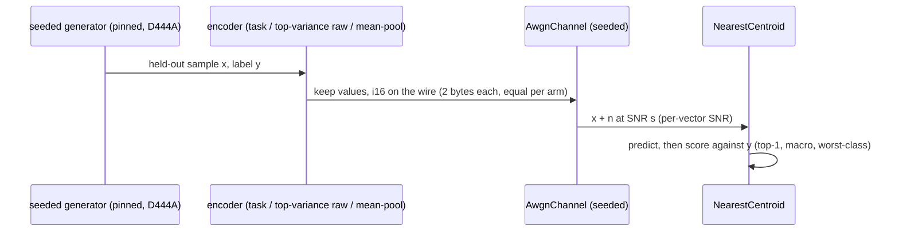

# D444C: task-oriented classification vs raw under an emulated AWGN sweep

Ticket: [nextgsim#479](https://github.com/NextgCoreLab/nextgsim/issues/479), program anchor [#458](https://github.com/NextgCoreLab/nextgsim/issues/458). Demo key `d444c-task-vs-raw`.

**This is a crate-level demo.** It is supporting / stage-2 in the program: it changes no nextgcore behaviour and runs no gNB, UE or NF, so it is not presented as a program demo.

## Purpose

Give codec reviewers a seeded, reproducible accuracy-vs-bytes-vs-SNR table that compares the task-oriented encoder with raw at equal bytes.

- **Success signal:** the `task_vs_raw` example prints the same table on every run with the same seed, and the golden test asserts each row.
- **Not the point:** this is not a network demo. The noise is emulated in the receiver, and a PDU session would deliver the bytes bit-exact or drop them. It makes no claim beyond the pinned synthetic generator.

## How it works

This demo has no 3GPP participant and no network message. The sequence is in-process.



Components (all in `nextgsim-semantic`):

| Piece | Where | What |
|---|---|---|
| generator | `rate_adapt::FeatureGenerator` (#477) | 8 classes, 128 features; class means on a decaying spectrum in a random rotation; seed pinned at 444 |
| task encoder | `rate_adapt::PcaEncoder` (#477) | linear PCA fitted on 2048 training samples; `encode(x, keep)` keeps the `keep` largest-variance components |
| top-variance raw | `rate_adapt::TopVarianceRaw` (#477) | the `keep` raw dimensions with the largest training variance (the fair baseline) |
| mean-pool | `rate_adapt::MeanPool` (#477) | `keep` contiguous mean-pooled bins (an ablation) |
| wire | `rate_adapt::quantise_roundtrip` | i16 fixed point with a per-vector scale, 2 bytes per value |
| channel | `AwgnChannel::transmit_with_rng` | AWGN from a supplied RNG; `transmit()` still draws from `thread_rng()` |
| classifier | `metrics::NearestCentroid` | per-class means of the noiseless training encodings, squared-L2 |
| score | `metrics::ClassificationScore` | top-1, macro (mean per-class) and worst-class accuracy |
| sweep | `task_vs_raw` (feature-gated) | keep 8/16/32/64 × SNR 0/5/10/15/20 dB × 3 arms over held-out samples `0..2000` |

The noise seed drives only the channel. Each sample's noise is drawn from `ChaCha8Rng` (value-stable across `rand_chacha` versions) on stream `keep << 32 | seq`, so it depends on (seed, keep, sample) only: every arm and every SNR sees the same unit draws, and a single-arm mode prints exactly its rows of `all`.

### Toggles

| Gate | Value |
|---|---|
| cargo feature | `demo-d444c-task-vs-raw` on `nextgsim-semantic`; builds the `task_vs_raw` module and example (`required-features`) |
| config | `--config <file>` with only a `demo:` block: `demo.enabled` and `demo.d444c-task-vs-raw.{enabled, mode}`; `mode` is required |
| modes | `all` (every arm and the deltas), `task-encoder`, `top-variance`, `mean-pool` (one arm each) |
| seed | `--seed <u64>` (default 444), the channel noise only |

Crate-level limits of the #458 convention: the process has no `/metrics` and opens no listener, so the `nextg_demo_enabled` series is written once to stderr; the `WARN DEMO MODE ACTIVE` banner and the `[demo:d444c-task-vs-raw]` log lines go to stderr; the table goes to stdout and carries no prefix. There is no runtime switch (one-shot process) and no EKS overlay: the sweep has no network path, so a pod would run the same arithmetic and add no evidence.

## How to run it

```sh
cargo run -p nextgsim-semantic --features demo-d444c-task-vs-raw --example task_vs_raw -- \
    --config config/demo-task-vs-raw/task_vs_raw.yaml --seed 444
cargo test -p nextgsim-semantic --features demo-d444c-task-vs-raw   # golden + acceptance
scripts/demo/d444c-reverts.sh                                       # revert arms
```

There is no compose or EKS variant (crate-level).

## Results

Captured from this demo's PR branch, debug build, Linux x86_64. Two runs with `--seed 444` printed byte-identical stdout (sha256 `be4bf0cdab4bea412734bb4390194b4441c1bdcb3135d52898e77a5b2343ec70`), equal to the committed golden `nextgsim-semantic/src/task_vs_raw/golden_seed444.txt`; `--seed 445` changed 81 of its 85 lines.

### Mode `all`, seed 444 (stdout)

```text
# d444c-task-vs-raw mode=all: task encoder vs raw at equal bytes, emulated AWGN, non-normative
# data: synthetic, pinned generator seed 444 (8 classes, 128 features); held-out 2000 samples; noise seed 444
# channel: emulated AWGN on the dequantised i16 symbols, SNR per vector; classifier: nearest centroid fitted noiseless
arm          keep bytes snr_db   top1  macro  worst
task-encoder    8    16      0 0.6755 0.6757 0.6069
task-encoder    8    16      5 0.8780 0.8777 0.8244
task-encoder    8    16     10 0.9415 0.9411 0.9008
task-encoder    8    16     15 0.9570 0.9568 0.9198
task-encoder    8    16     20 0.9630 0.9628 0.9275
task-encoder   16    32      0 0.7585 0.7579 0.7101
task-encoder   16    32      5 0.9020 0.9020 0.8511
task-encoder   16    32     10 0.9510 0.9511 0.9122
task-encoder   16    32     15 0.9605 0.9605 0.9198
task-encoder   16    32     20 0.9635 0.9634 0.9275
task-encoder   32    64      0 0.8075 0.8068 0.7269
task-encoder   32    64      5 0.9070 0.9060 0.8529
task-encoder   32    64     10 0.9480 0.9478 0.9160
task-encoder   32    64     15 0.9610 0.9609 0.9275
task-encoder   32    64     20 0.9635 0.9633 0.9313
task-encoder   64   128      0 0.8320 0.8320 0.7939
task-encoder   64   128      5 0.9170 0.9168 0.8855
task-encoder   64   128     10 0.9470 0.9470 0.9198
task-encoder   64   128     15 0.9600 0.9600 0.9198
task-encoder   64   128     20 0.9645 0.9642 0.9275
top-variance    8    16      0 0.3790 0.3754 0.2311
top-variance    8    16      5 0.4725 0.4688 0.3109
top-variance    8    16     10 0.5150 0.5111 0.3571
top-variance    8    16     15 0.5345 0.5303 0.3655
top-variance    8    16     20 0.5340 0.5297 0.3739
top-variance   16    32      0 0.4655 0.4630 0.3319
top-variance   16    32      5 0.5825 0.5792 0.4538
top-variance   16    32     10 0.6315 0.6280 0.4832
top-variance   16    32     15 0.6610 0.6570 0.5042
top-variance   16    32     20 0.6690 0.6650 0.5084
top-variance   32    64      0 0.5960 0.5955 0.4328
top-variance   32    64      5 0.7040 0.7029 0.5588
top-variance   32    64     10 0.7515 0.7503 0.6092
top-variance   32    64     15 0.7690 0.7675 0.6092
top-variance   32    64     20 0.7740 0.7732 0.6261
top-variance   64   128      0 0.7245 0.7236 0.6261
top-variance   64   128      5 0.8435 0.8431 0.7479
top-variance   64   128     10 0.8835 0.8832 0.8109
top-variance   64   128     15 0.8940 0.8937 0.8277
top-variance   64   128     20 0.8965 0.8962 0.8361
mean-pool       8    16      0 0.2385 0.2411 0.1231
mean-pool       8    16      5 0.2805 0.2832 0.1500
mean-pool       8    16     10 0.2985 0.3012 0.1500
mean-pool       8    16     15 0.3040 0.3069 0.1615
mean-pool       8    16     20 0.3065 0.3095 0.1654
mean-pool      16    32      0 0.3560 0.3537 0.1903
mean-pool      16    32      5 0.4245 0.4211 0.2345
mean-pool      16    32     10 0.4610 0.4577 0.2920
mean-pool      16    32     15 0.4720 0.4689 0.3319
mean-pool      16    32     20 0.4790 0.4763 0.3319
mean-pool      32    64      0 0.4465 0.4456 0.3584
mean-pool      32    64      5 0.5485 0.5486 0.4542
mean-pool      32    64     10 0.5890 0.5887 0.5000
mean-pool      32    64     15 0.6015 0.6013 0.5038
mean-pool      32    64     20 0.6035 0.6032 0.5000
mean-pool      64   128      0 0.6275 0.6243 0.4779
mean-pool      64   128      5 0.7460 0.7435 0.6416
mean-pool      64   128     10 0.7950 0.7927 0.6947
mean-pool      64   128     15 0.8105 0.8085 0.7212
mean-pool      64   128     20 0.8205 0.8189 0.7434
delta        keep bytes snr_db task-minus-top-variance task-minus-mean-pool
delta           8    16      0                 +0.2965              +0.4370
delta           8    16      5                 +0.4055              +0.5975
delta           8    16     10                 +0.4265              +0.6430
delta           8    16     15                 +0.4225              +0.6530
delta           8    16     20                 +0.4290              +0.6565
delta          16    32      0                 +0.2930              +0.4025
delta          16    32      5                 +0.3195              +0.4775
delta          16    32     10                 +0.3195              +0.4900
delta          16    32     15                 +0.2995              +0.4885
delta          16    32     20                 +0.2945              +0.4845
delta          32    64      0                 +0.2115              +0.3610
delta          32    64      5                 +0.2030              +0.3585
delta          32    64     10                 +0.1965              +0.3590
delta          32    64     15                 +0.1920              +0.3595
delta          32    64     20                 +0.1895              +0.3600
delta          64   128      0                 +0.1075              +0.2045
delta          64   128      5                 +0.0735              +0.1710
delta          64   128     10                 +0.0635              +0.1520
delta          64   128     15                 +0.0660              +0.1495
delta          64   128     20                 +0.0680              +0.1440
```

Reading it: at every point the three arms send the same bytes (2 per kept value, measured from the encoded vectors). The task encoder leads top-variance raw by +0.0635 to +0.4290 top-1 and mean-pool by +0.1440 to +0.6565; at every SNR both leads are largest at keep 8 and smallest at keep 64. Top-1 accuracy is non-decreasing with SNR to within 0.01 for every arm and keep, and 20 dB ≥ 0 dB everywhere (the tested criterion). It is not strictly monotone: top-variance at keep 8 goes 0.5345 → 0.5340 (top-1) and 0.5303 → 0.5297 (macro) from 15 to 20 dB, and mean-pool at keep 32 goes 0.5038 → 0.5000 worst-class; that residual wiggle is held-out sampling noise (2000 samples). All of this is the pinned generator's spectrum (see the honesty labels).

### Mode `all`, seed 444 (stderr)

```text
2026-11-14T20:50:50.179050Z  WARN nextgsim_demo: DEMO MODE ACTIVE: d444c-task-vs-raw=all
2026-11-14T20:50:50.179101Z  INFO task_vs_raw: [demo:d444c-task-vs-raw] nextg_demo_enabled{demo="d444c-task-vs-raw",mode="all"} 1 (one-shot: this process has no /metrics)
2026-11-14T20:50:50.179118Z  INFO task_vs_raw: [demo:d444c-task-vs-raw] sweep: mode all, noise seed 444, emulated AWGN (non-normative)
2026-11-14T20:51:12.287660Z  INFO task_vs_raw: [demo:d444c-task-vs-raw] printed 60 rows
```

### Mode `task-encoder` (first five rows; all 20 equal the `task-encoder` rows of `all`)

```text
task-encoder    8    16      0 0.6755 0.6757 0.6069
task-encoder    8    16      5 0.8780 0.8777 0.8244
task-encoder    8    16     10 0.9415 0.9411 0.9008
task-encoder    8    16     15 0.9570 0.9568 0.9198
task-encoder    8    16     20 0.9630 0.9628 0.9275
```

```text
2026-11-14T20:52:08.299271Z  WARN nextgsim_demo: DEMO MODE ACTIVE: d444c-task-vs-raw=task-encoder
2026-11-14T20:52:08.299321Z  INFO task_vs_raw: [demo:d444c-task-vs-raw] nextg_demo_enabled{demo="d444c-task-vs-raw",mode="task-encoder"} 1 (one-shot: this process has no /metrics)
2026-11-14T20:52:08.299337Z  INFO task_vs_raw: [demo:d444c-task-vs-raw] sweep: mode task-encoder, noise seed 444, emulated AWGN (non-normative)
2026-11-14T20:52:18.239213Z  INFO task_vs_raw: [demo:d444c-task-vs-raw] printed 20 rows
```

The `top-variance` and `mean-pool` modes likewise printed exactly their 20 rows of `all` and no delta section.

### Kill switch (`demo.enabled: false`, `d444c-task-vs-raw.enabled: true`): exit 0, empty stdout, no WARN

```text
task_vs_raw: demo d444c-task-vs-raw is not enabled (demo.enabled and demo.d444c-task-vs-raw.enabled): no table
```

### Invalid mode (`mode: bogus`): exit 2, empty stdout

```text
task_vs_raw: bogus.yaml: demo config: unknown mode "bogus" for demo "d444c-task-vs-raw" (known modes ["all", "task-encoder", "top-variance", "mean-pool"])
Demo(UnknownMode { demo: "d444c-task-vs-raw", mode: "bogus", known: ["all", "task-encoder", "top-variance", "mean-pool"] })
```

### Revert arms

| Arm | Patch | Must fail |
|---|---|---|
| `479-thread-rng` | the seeded channel path draws from `thread_rng()` | `two_runs_with_the_same_seed_print_byte_identical_tables` |
| `479-top-k-scorer` | the sweep scores with `metrics::top_k_accuracy` (feature indices) instead of `NearestCentroid` | `shuffled_labels_score_at_chance` |

Both fail as required (`scripts/demo/d444c-reverts.sh`, run in CI).

## Honesty labels and limitations

- **Synthetic data.** The generator is D444A's pinned synthetic task. The gap between arms is set by its pinned spectrum: ground truth of the generator, not a learned or semantic-communication result.
- **The "task encoder" is an unsupervised linear PCA,** fitted on generator samples without labels; no neural network and nothing trained by gradient. It is task-oriented only because the generator's within-class noise is isotropic, so its top-variance directions are the discriminative ones. The classifier is nearest-centroid on class means.
- **The channel is emulated.** AWGN is added in-process to the dequantised symbol values (an analog-channel abstraction: no bits, no coding, no fading, no network). SNR is relative to each transmitted vector's own power, so every arm is compared at equal SNR.
- **Baselines at equal bytes:** top-variance raw dimensions (the fair one) and mean-pool (an ablation).
- **Non-normative.** TR 22.870 §9.13 names semantic communication (`22870-k00.txt:33833-33835`) and §6.59.1 discusses token error tolerance (`:22020-22029`); both are Stage-1 framing only.
- **Determinism** is per platform: the golden is pinned on Linux x86_64 with the platform's `f64` `ln`/`cos`/`sqrt`.
