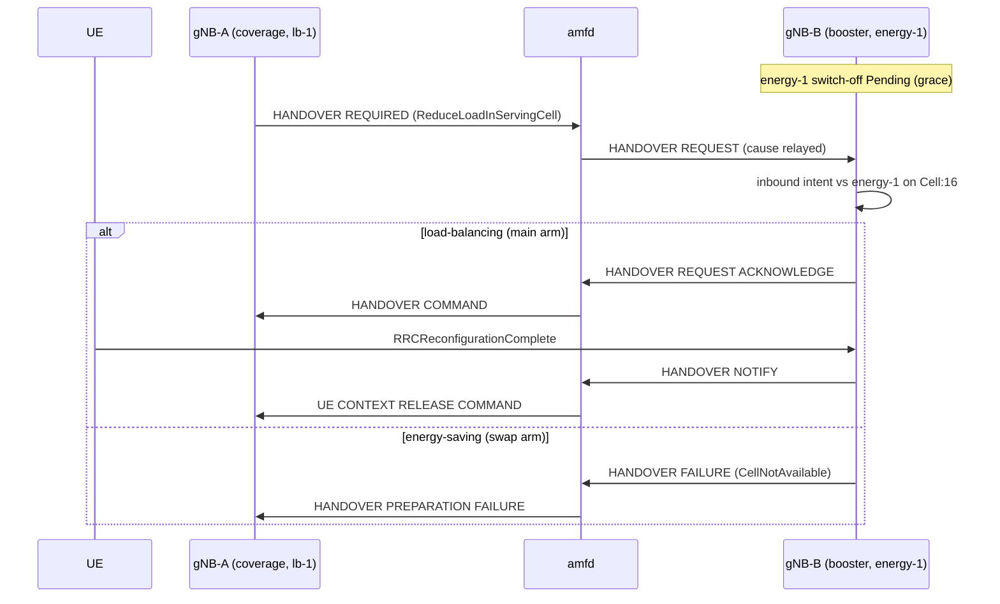

# D446A: load-balancing vs energy-saving agents over a booster cell

Demo key `d446a-agent-conflict` (nextgsim#483, program #458). Modes:
`load-balancing` (the main arm) and `energy-saving` (the swap arm), plus a
runtime-switch arm that changes between them through `nr-cli`.

## Purpose

Two agents have genuinely opposing intents on one booster cell. This demo shows
the booster arbitrating them into **exactly one** standard N2 handover, which
nextgcore's AMF logs and relays.

- **Success signal:** amfd logs `HandoverRequired … source_gnb_id=2
  cause=RadioNetwork(ReduceLoadInServingCell)`, then `UE 1 relocated to target
  gNB`. The booster's audit shows `Resolved (winner lb-1)` → `Deferred (energy-1)`.
- **Not the point:** the agents are not "intelligent" (both are rule-based), and
  this is not an Xn or cell-activation demo.

## How it works



| component | what it does |
|---|---|
| gNB-A `lb-1` (`config/demo-agent-energy/gnb-a.yaml`) | When the cell serves `load_threshold_ues` UEs, submits `TriggerHandover target_cell=16`. The coordinator executes it from its conflict-checked queue only (a superseded intent never runs). RRC/NGAP send HANDOVER REQUIRED with cause "Reduce load in serving cell" (TS 38.413 §9.3.1.2). The outcome is audited as `ActuationSucceeded` or `ActuationFailed`. |
| gNB-B `energy-1` (`gnb-b.yaml`) | Has no connected UE, so it queues `OptimizeResources target=16 status=inactive`, Pending for `grace_s`. The `SwitchOffWithConnectedUes` guardrail holds it while a UE is connected: any UE with an RRC context on the cell, as the RRC task reports it, including a UE that sends nothing on its bearer. The guardrail also holds an energy-saving win while a UE admitted earlier is still connected. A switch-off bars RRC and stops answering RLS heartbeats. |
| gNB-B admission control | TS 38.300 §15.5.1.3: the target performs admission control for load-balancing handovers. The HANDOVER REQUEST becomes an inbound intent on `Cell:16`, contesting energy-1's (`ConflictDetector`). The **mode** picks the winner. An admitted UE is held against an A3 handback to its source PCI 32, read from the UE History Information. |
| amfd (nextgcore#1418) | Logs `source_gnb_id=` and `cause=` on HandoverRequired, and `gnb_id=` on HandoverFailure. Log-only. |

**Toggles.** Two gates, both needed:
- the cargo feature `demo-d446a-agent-conflict` on `nextgsim-gnb`;
- `demo: {enabled: true, d446a-agent-conflict: {enabled: true, mode: …}}`.

An unknown mode fails startup with `DemoConfigError::UnknownMode`. Enabling it
alongside another handover-triggering demo fails with `HandoverDemoConflict`.
At runtime, `nr-cli <gnb-b> demo d446a-agent-conflict set mode=<mode>` applies
to the next contest and is audited as `PolicyChanged`. Read the audit with
`nr-cli <gnb-b> agent-audit --json`.

## How to run it

- Compose: `NEXTGCORE_DIR=../nextgcore scripts/demo/d446a-check.sh
  load-balancing|energy-saving|off|runtime-switch`. The stack is nextgcore's
  `docker-compose.demo-n2ho.yml` with no published port, and the gNB image is
  built with the feature.
- `runtime-switch` starts in load-balancing. After the first contest it runs
  `nr-cli <gnb-b> demo d446a-agent-conflict set mode=energy-saving`. A second UE
  (IMSI 999700000000002) then starts on gNB-A and makes the second contest. The
  audit shows `Resolved (winner lb-1)`, `PolicyChanged`, `Resolved (winner
  energy-1): refused`, then `GuardrailHold` (the first UE is still connected),
  and the AMF shows one relocation followed by one HandoverFailure.
- Revert arms: `scripts/demo/d446a-reverts.sh`.
- Nightly: the `demo-d446a` job (scheduled and dispatch).
- EKS (nextgcore `deploy/eks/overlays/demo-d446a-agent-conflict/`, ClusterIP
  only), with nextgcore and nextgsim checked out side by side:
  - Images. Build the ten NFs with the demo profile's 6G features, and the gNB with
    `--features 6g,demo-d446a-agent-conflict` plus a layer holding `nr-cli`, in
    `rust:1.95.0-bookworm` (its glibc matches the runtime image). Push them under new
    `demo-d446a-<sha>` tags; never overwrite an existing tag.
  - Run, one arm at a time:
    `YES=true KUBE_CONTEXT=devtest1 CORE_IMAGE_TAG=demo-d446a-<core sha>
    SIM_IMAGE_TAG=demo-d446a-<sim sha> NR_CLI=<nr-cli> k8s/demo-check.sh
    d446a-agent-conflict load-balancing|energy-saving`, then `k8s/demo-check.sh off off`.

## Results

Captured on EKS (devtest1) with `k8s/demo-check.sh`, one arm at a time, each in its
own temporary `nextg-demo` namespace that the run deleted afterwards. Everything below
is copied from the run artefacts under `/tmp/eks-val/demos/` on the operator host.
Nothing is reconstructed.

**What ran.**

| arm | artefacts | harness (nextgcore) | VERDICT |
|---|---|---|---|
| `d446a-agent-conflict load-balancing` | `d446a-agent-conflict/load-balancing/20261111T231846Z` | `111febc` (#1423 merge) | PASS |
| `d446a-agent-conflict energy-saving` | `d446a-agent-conflict/energy-saving/20261112T001829Z` | `216c1a3` (#1437 merge) | PASS |
| `off off` (demo-off control) | `off/off/20261111T233311Z` | `111febc` | PASS |

- **Images, the same for all three arms** (devtest1 ECR, new tags only):
  - `nextg/{nrf,amf,smf,upf,ausf,udm,udr,pcf,nssf,bsf}:demo-d446a-111febc`: nextgcore at #1423's merge, built with the demo profile's 6G features;
  - `nextg/gnb:demo-d446a-65496cc`: nextgsim at #507's merge, built with `--features 6g,demo-d446a-agent-conflict`, plus an `nr-cli` layer;
  - `nextg/ue:demo-d446a-65496cc`.
- **energy-saving harness.** The energy-saving arm ran with nextgcore `216c1a3`. That commit (#1437) only fixes the scenario's log capture: it reads gNB-A's container `gnb`, not `gnb-a`. The first energy-saving run read an empty gNB-A log and failed on its gNB-A assertions. That run is not counted. Since #1437, an empty capture is a failure in its own right. The pod images were unchanged.
- **#513 is not in these images.** nextgsim #513 (lb-1 retries a UE whose handover never left the gNB, at most 3 times; a startup race) merged after these runs. In both demo arms, lb-1's first attempt sent a HANDOVER REQUIRED (gNB-A audit #1, then #2 `ActuationSucceeded` or `ActuationFailed … HANDOVER PREPARATION FAILURE`). The race did not occur in these runs.
- **e2e.** Every arm's base e2e (`e2e-internet.sh`, PROFILE=demo) passed.
- **The demo-off control** ran the same demo-built gNB image without any `demo:` block. Its summary: `demo_banner_lines=0 demo_prefix_lines=0 nextg_demo_enabled_series=0`.

### Baseline vs mode

| | load-balancing (main arm) | energy-saving (swap arm) | demo off |
|---|---|---|---|
| amfd `HandoverRequired … cause=RadioNetwork(ReduceLoadInServingCell)` | 1 | 1 | none |
| UE relocated to gNB-B | yes (`UE 1 relocated to target gNB`) | no: `HandoverFailure … CellNotAvailable` | n/a (one gNB, no handover) |
| gNB-B audit winner | `lb-1@gnb-2 (policy load-balancing)` | `energy-1 (policy energy-saving): refused, CellNotAvailable` | no audit |
| gNB-B cell | stays on: `GuardrailHold … ues=1` | off the air: RRC barred, heartbeats dropped | on |
| `nextg_demo_enabled` | `{demo="d446a-agent-conflict",mode="load-balancing"} 1` | `{…,mode="energy-saving"} 1` | no series |

### load-balancing: amfd (`d446a/amf.log`)

```
[2026-11-11T23:22:46.856Z INFO  nextgcore_amfd::ngap_path] HandoverRequired (amf_ue_ngap_id=1, ran_ue_ngap_id=1, type=Intra5gs) source_gnb_id=2 cause=RadioNetwork(ReduceLoadInServingCell)
[2026-11-11T23:22:46.881Z INFO  nextgcore_amfd::ngap_path] UE 1 relocated to target gNB (association 2)
[2026-11-11T23:22:48.911Z INFO  nextgcore_amfd::ngap_path] UE Context Release Command sent to SOURCE association 1 for UE 1 (source ran_ue_ngap_id=1, successful-handover) after the step 6a timer
```

### load-balancing: the booster's audit (`d446a/agent-audit.json`, `nr-cli <gnb-b> agent-audit --json`)

| seq | event | agent | detail |
|---|---|---|---|
| 1 | IntentSubmitted | energy-1 | OptimizeResources target=16 status=inactive: switch-off Pending (grace 90 s) |
| 2 | InboundIntent | lb-1@gnb-2 | TriggerHandover target_cell=16 cause=RadioNetwork(ReduceLoadInServingCell) |
| 3 | ConflictDetected | lb-1@gnb-2 | lb-1@gnb-2 vs energy-1 on Cell:16 |
| 4 | Resolved | lb-1@gnb-2 | winner lb-1@gnb-2 (policy load-balancing) |
| 5 | Deferred | energy-1 | switch-off of cell 16 deferred 90 s |
| 6 | Executed | lb-1@gnb-2 | admitted on cell 16 |
| 7 | GuardrailHold | energy-1 | SwitchOffWithConnectedUes: ues=1, cell 16 stays on |

The gNB-B log has the same chain. The admission happens at 23:22:46.866, followed by
`handback hold: UE[16777216] is not handed back to its source cell PCI 32 for 600 s`.
From then on, every A3 report for PCI 32 is logged as `not acted on`. The guardrail
holds at 23:24:16.871, 90 s after the deferral.

gNB-A's lines come from the pod log that `demo-check.sh` collects
(`logs/gnb-a-79f8479f6b-vp5ld_gnb.log`). The scenario's own `d446a/gnb-a.log` is
empty in this run: harness `111febc` read the wrong container, which is the bug #1437
fixed. Load-balancing mode makes no gNB-A assertion, so the PASS does not depend on
that file:

```
audit #1: IntentSubmitted (lb-1) TriggerHandover ue=0 target_cell=16 cause=reduce-load-in-serving-cell (served UEs 1 >= 1)
Sent Handover Required: amf_ue_ngap_id=1, ran_ue_ngap_id=1
audit #2: ActuationSucceeded (lb-1) intent intent-1794439366-855847459-0 ue=0: HANDOVER COMMAND received
```

### energy-saving: gNB-B (`d446a/gnb-b.log`)

```
audit #1: IntentSubmitted (energy-1) OptimizeResources target=16 status=inactive: switch-off Pending (grace 90 s)
audit #2: InboundIntent (lb-1@gnb-2) TriggerHandover target_cell=16 cause=RadioNetwork(ReduceLoadInServingCell)
audit #3: ConflictDetected (lb-1@gnb-2) lb-1@gnb-2 vs energy-1 on Cell:16
audit #4: Resolved (lb-1@gnb-2) winner energy-1 (policy energy-saving): refused, CellNotAvailable
audit #5: Executed (energy-1) switch-off of cell 16 (won the contest)
Agent switch-off: cell 16 off the air
off the air: 1 heartbeat(s) dropped
off the air: 20 heartbeat(s) dropped
```

### energy-saving: amfd and gNB-A

```
[2026-11-12T00:20:09.291Z INFO  nextgcore_amfd::ngap_path] HandoverRequired (amf_ue_ngap_id=1, ran_ue_ngap_id=1, type=Intra5gs) source_gnb_id=2 cause=RadioNetwork(ReduceLoadInServingCell)
[2026-11-12T00:20:09.300Z WARN  nextgcore_amfd::ngap_path] HandoverFailure from association 1 (amf_ue_ngap_id=1, cause=RadioNetwork(CellNotAvailable)) gnb_id=1
```
```
audit #1: IntentSubmitted (lb-1) TriggerHandover ue=0 target_cell=16 cause=reduce-load-in-serving-cell (served UEs 1 >= 1)
Sent Handover Required: amf_ue_ngap_id=1, ran_ue_ngap_id=1
Handover Preparation Failure: amf_ue_ngap_id=1, ran_ue_ngap_id=1, cause=RadioNetwork(CellNotAvailable)
audit #2: ActuationFailed (lb-1) intent intent-1794442809-289890600-0 ue=0: HANDOVER PREPARATION FAILURE RadioNetwork(CellNotAvailable)
```

### Metrics (`metrics/gnb-b.prom`, `nr-cli <gnb-b> demo metrics`)

```
nextg_demo_enabled{demo="d446a-agent-conflict",mode="load-balancing"} 1   # load-balancing arm
nextg_demo_enabled{demo="d446a-agent-conflict",mode="energy-saving"} 1    # energy-saving arm
```

### Runtime switch

The EKS scenario runs one mode per arm. The runtime `nr-cli … set` between two
contests is shown by the compose `runtime-switch` arm (nightly `demo-d446a`; green
in dispatch run 43066719429): `Resolved (winner lb-1)`, the `set` audit,
`PolicyChanged from=load-balancing to=energy-saving by=cli`, `Resolved (winner
energy-1): refused`, `GuardrailHold ues=1`.

## Honesty labels and limitations

- **Non-normative policy.** Refusing an inbound handover while a switch-off is
  only Pending is this demo's choice. TS 38.300 §15.4.2.1 allows a booster to
  prevent incoming handovers only during the switch-off time period.
- **Xn stand-in.** No Xn is modelled. The NGAP cause carries lb-1's intent, and
  the booster names the remote agent from the source gNB ID through its
  `peers:` list.
- **Simple inputs.** The agents are rule-based. lb-1's load is a count of
  served UEs, meaning UEs whose bearer has carried user-plane data on the cell.
  energy-1 counts connected UEs (RRC contexts). RSRP comes from the simulator's
  distance model.
- **Baseline.** The A3 handover still carries "Handover desirable for radio
  reasons".
- **Runtime switch.** The `runtime-switch` arm drives it end to end through
  `nr-cli`. The second contest has to arrive while the first contest's deferred
  switch-off is still Pending (within `grace_s`, 90 s). After a `GuardrailHold`
  nothing is Pending, so a later request is admitted without a contest.
  `PolicyChanged` is recorded at the first contest after the `set`. The `set`
  itself is audited at once by nextgsim-demo.
