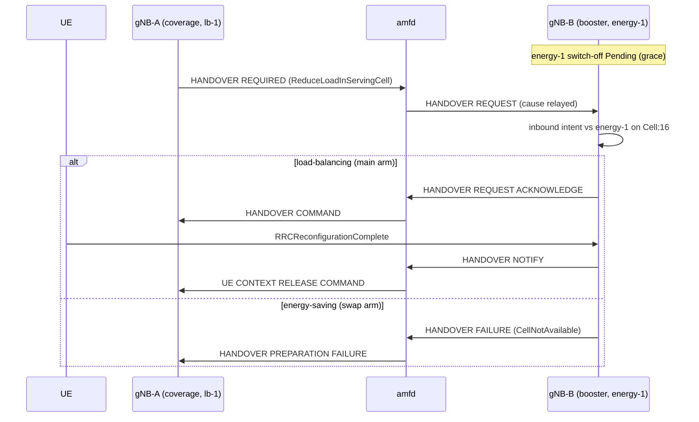

# D446A: load-balancing vs energy-saving agents over a booster cell

Demo key `d446a-agent-conflict` (nextgsim#483, program #458). Modes:
`load-balancing` (the main arm) and `energy-saving` (the swap arm), plus a
runtime-switch arm that changes between them through `nr-cli`.

## Purpose

Two agents have genuinely opposing intents on one booster cell. This demo shows
the booster arbitrating them into **exactly one** standard N2 handover, which
nextgcore's AMF logs and relays.

- **Success signal:** amfd logs `HandoverRequired … source_gnb_id=2
  cause=RadioNetwork(ReduceLoadInServingCell)`, then `UE 1 relocated to target
  gNB`. The booster's audit shows `Resolved (winner lb-1)` → `Deferred (energy-1)`.
- **Not the point:** the agents are not "intelligent" (both are rule-based), and
  this is not an Xn or cell-activation demo.

## How it works

| component | what it does |
|---|---|
| gNB-A `lb-1` (`config/demo-agent-energy/gnb-a.yaml`) | When the cell serves `load_threshold_ues` UEs, submits `TriggerHandover target_cell=16`. The coordinator executes it from its conflict-checked queue only (a superseded intent never runs). RRC/NGAP send HANDOVER REQUIRED with cause "Reduce load in serving cell" (TS 38.413 §9.3.1.2). The outcome is audited as `ActuationSucceeded` or `ActuationFailed`. |
| gNB-B `energy-1` (`gnb-b.yaml`) | Has no connected UE, so it queues `OptimizeResources target=16 status=inactive`, Pending for `grace_s`. The `SwitchOffWithConnectedUes` guardrail holds it while a UE is connected: any UE with an RRC context on the cell, as the RRC task reports it, including a UE that sends nothing on its bearer. The guardrail also holds an energy-saving win while a UE admitted earlier is still connected. A switch-off bars RRC and stops answering RLS heartbeats. |
| gNB-B admission control | TS 38.300 §15.5.1.3: the target performs admission control for load-balancing handovers. The HANDOVER REQUEST becomes an inbound intent on `Cell:16`, contesting energy-1's (`ConflictDetector`). The **mode** picks the winner. An admitted UE is held against an A3 handback to its source PCI 32, read from the UE History Information. |
| amfd (nextgcore#1418) | Logs `source_gnb_id=` and `cause=` on HandoverRequired, and `gnb_id=` on HandoverFailure. Log-only. |

**Toggles.** Two gates, both needed:
- the cargo feature `demo-d446a-agent-conflict` on `nextgsim-gnb`;
- `demo: {enabled: true, d446a-agent-conflict: {enabled: true, mode: …}}`.

An unknown mode fails startup with `DemoConfigError::UnknownMode`. Enabling it
alongside another handover-triggering demo fails with `HandoverDemoConflict`.
At runtime, `nr-cli <gnb-b> demo d446a-agent-conflict set mode=<mode>` applies
to the next contest and is audited as `PolicyChanged`. Read the audit with
`nr-cli <gnb-b> agent-audit --json`.

## How to run it

- Compose: `NEXTGCORE_DIR=../nextgcore scripts/demo/d446a-check.sh
  load-balancing|energy-saving|off|runtime-switch`. The stack is nextgcore's
  `docker-compose.demo-n2ho.yml` with no published port, and the gNB image is
  built with the feature.
- `runtime-switch` starts in load-balancing. After the first contest it runs
  `nr-cli <gnb-b> demo d446a-agent-conflict set mode=energy-saving`. A second UE
  (IMSI 999700000000002) then starts on gNB-A and makes the second contest. The
  audit shows `Resolved (winner lb-1)`, `PolicyChanged`, `Resolved (winner
  energy-1): refused`, then `GuardrailHold` (the first UE is still connected),
  and the AMF shows one relocation followed by one HandoverFailure.
- Revert arms: `scripts/demo/d446a-reverts.sh`.
- Nightly: the `demo-d446a` job (scheduled and dispatch).
- EKS: `k8s/demo-check.sh d446a-agent-conflict <mode>` in nextgcore.

## Results

Filled in from the captured EKS (devtest1) run after the merge; never invented.

## Honesty labels and limitations

- **Non-normative policy.** Refusing an inbound handover while a switch-off is
  only Pending is this demo's choice. TS 38.300 §15.4.2.1 allows a booster to
  prevent incoming handovers only during the switch-off time period.
- **Xn stand-in.** No Xn is modelled. The NGAP cause carries lb-1's intent, and
  the booster names the remote agent from the source gNB ID through its
  `peers:` list.
- **Simple inputs.** The agents are rule-based. lb-1's load is a count of
  served UEs, meaning UEs whose bearer has carried user-plane data on the cell.
  energy-1 counts connected UEs (RRC contexts). RSRP comes from the simulator's
  distance model.
- **Baseline.** The A3 handover still carries "Handover desirable for radio
  reasons".
- **Runtime switch.** The `runtime-switch` arm drives it end to end through
  `nr-cli`. The second contest has to arrive while the first contest's deferred
  switch-off is still Pending (within `grace_s`, 90 s). After a `GuardrailHold`
  nothing is Pending, so a later request is admitted without a contest.
  `PolicyChanged` is recorded at the first contest after the `set`. The `set`
  itself is audited at once by nextgsim-demo.
