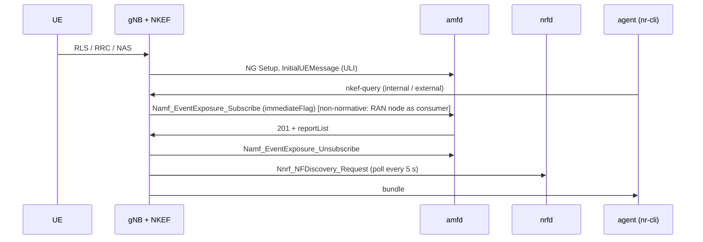

# D447A: live-state knowledge exposure (nkef-live)

Demo key `d447a-nkef-live`, ticket [nextgsim#488](https://github.com/NextgCoreLab/nextgsim/issues/488),
program anchor [#458](https://github.com/NextgCoreLab/nextgsim/issues/458). A supporting
(stage-2) demo: it reads core state and changes no nextgcore behaviour, apart from the
base-core amfd change that records when amfd learnt a UE's location
([nextgcore#1422](https://github.com/NextgCoreLab/nextgcore/pull/1422)).

## Purpose

Show an agent developer that one question to the network returns one token-bounded
bundle of live facts from RAN, N2 and SBA. Each fact is tagged with its domain, its
producer and its age, and a fact expires when its source stops.

**Not the point:** this is not natural-language Q&A and not retrieval-quality research.
Ranking is lexical over about ten entities.

## How it works



- **RAN tee** (RLS task): each measured cell-load window (connected UEs, throughput)
  and each UE's received power and serving cell.
- **N2 tee** (NGAP task): this gNB, the AMF it set up NG with (name, GUAMI) and each
  UE's AMF UE NGAP ID.
- **SBA client** (`nkef/sba.rs`, the #457 h2c client): at every query, a
  Namf_EventExposure subscription to LOCATION_REPORT and CONNECTIVITY_STATE_REPORT
  with `immediateFlag` for the configured SUPI. NKEF reads the `reportList` and
  deletes the subscription at once. The notify URI is a closed loopback port. NKEF
  also polls NRF discovery every `nrf_poll_secs`.
- **Expiry.** The NRF returns only REGISTERED instances. When an NF stops
  heartbeating, the NRF suspends it (`missed heartbeat, marking SUSPENDED`), the next
  poll no longer returns it, and its fact gets `expired_at`. The fact is kept, so a
  consumer sees that the NF went away, and it is live again if the NF comes back. The
  checks kill the NF (SIGKILL): a graceful stop makes it NFDeregister, which also
  expires the fact but is a different path from the suspension shown here. On EKS
  the scenario cuts the BSF with an egress deny-all NetworkPolicy instead, which has
  the same effect: no heartbeat and no NFDeregister.
- **An expired fact still reads `nfStatus=REGISTERED`.** That value is the last status
  NKEF discovered, and NRF discovery never returns a SUSPENDED instance, so NKEF never
  sees the change. `expired_at` is the signal that the NF went away.
- **The join.** The path is `ue>cell>gnb>amf>nf-instance`: the UE's serving cell, this
  gNB, the AMF reached over N2, and the NRF instance whose `amfInfo.guamiList` holds
  that AMF's GUAMI.
- **The header.** `consistent=true` means the AMF's last known NCGI is this gNB's
  cell, with a `ueLocationTimestamp`. `unknown` means there is no timestamped
  location. `stale=true` means the AMF's location predates this run.
- **Consumers.** `internal` sees every fact. `external` gets the TS 23.502 §4.15.7
  shape: `area-N congestion=Low|Medium|High age=…`, with no location and no identity.
  The policy filters before ranking, and the token budget is a hard cap.

### Toggles

| gate | value |
|---|---|
| cargo feature (nextgsim-gnb) | `nkef-sba` (with `6g`, or at least `nextgsim-nkef`) |
| config | `nkef_enabled: true`, an `nkef_live:` block, and `demo: { enabled: true, d447a-nkef-live: { enabled: true, mode: on } }` |
| modes | `on`: the tees and the SBA client feed NKEF. `baseline`: today's NKEF, tees off, nothing live. |
| switching | `nr-cli <gnb> -e "demo d447a-nkef-live set mode=baseline"`, applied from the next query and audited |
| visibility | `WARN DEMO MODE ACTIVE: d447a-nkef-live=<mode>`, `nr-cli <gnb> -e "demo metrics"` → `nextg_demo_enabled{demo="d447a-nkef-live",mode=…} 1`, `[demo:d447a-nkef-live]` log prefix |

An unknown mode fails gNB startup (`DemoConfigError::UnknownMode`), with no fallback.
With `demo.enabled: false`, or no `demo:` block, NKEF answers from an empty store and no
tee sends anything. A default build does not register the demo at all.

CLI: `nkef-query [--as internal|external] <question>` and `nkef-status`.

## How to run it

### Compose

```bash
# 5GC images (nextgcore ./docker/rust/build.sh), and a gNB built with the demo feature:
cargo build --release -p nextgsim-gnb -p nextgsim-cli --features nextgsim-gnb/6g,nextgsim-gnb/nkef-sba
# (copy target/release/nr-gnb to binaries/ and build Dockerfile.gnb-local as nextgsim-gnb:latest)
NEXTGCORE_DIR=../nextgcore NR_CLI=target/release/nr-cli scripts/demo/nkef-check.sh on
NEXTGCORE_DIR=../nextgcore NR_CLI=target/release/nr-cli scripts/demo/nkef-check.sh baseline
```

The stack is nextgcore's standalone `docker-compose.demo-n2ho.yml` with
`config/demo-nkef/compose.override.yml`: one gNB and a stationary UE, with no published
port.

### Revert arms (`scripts/demo/revert-run.sh`)

| patch | expected failure |
|---|---|
| `reverts/447-spawn-order.patch` | the bundle has no live domain (the tees hold a base without the 6G handles) |
| `reverts/447-rls-tee.patch` | no `ran` domain |
| `reverts/447-n2-tee.patch` | no `n2` domain, and the path stops at `cell` |
| `reverts/447-projection.patch` | the external reply leaks |
| amfd without nextgcore#1422 | `consistent=unknown` |

### EKS

The overlay is `deploy/eks/overlays/demo-d447a-nkef-live/` in nextgcore
(nextgcore#1426). It turns on `nkef_enabled` and adds the `nkef_live:` block to
`gnb.yaml` (amfd and the NRF by Service name). The demo profile's post-render then
merges in the demo block with the run's mode. Nothing in it adds a Service, a port or
a listener. For the expiry check, the scenario applies `bsf-no-egress.yaml` mid-run.
It exists only in the run's namespace.

**Images.** The gNB must be the demo build, or it fails startup with
`DemoConfigError::UnknownKey`. These are demo images for the devtest1 ECR only, under
new tags; an existing tag is never overwritten. Check out nextgcore and nextgsim side
by side (`<dir>/nextgcore` and `<dir>/nextgsim`), so that `demo-check.sh` records the
right nextgsim commit.

1. Build the gNB and UE from nextgsim, in the pinned toolchain image (its bookworm
   glibc matches the runtime image):

   ```bash
   docker run --rm -v "$PWD:/src:ro" -v /tmp/tgt:/tgt -w /src -e CARGO_TARGET_DIR=/tgt \
     rust:1.95.0-bookworm@sha256:6258907abe69656e41cd992e0b705cdcfabcbbe3db374f92ed2d47121282d4a1 \
     sh -c 'cargo build --release --locked -p nextgsim-gnb --features 6g,nkef-sba --bin nr-gnb &&
            cargo build --release --locked -p nextgsim-ue --bin nr-ue &&
            cargo build --release --locked -p nextgsim-cli --bin nr-cli'
   mkdir -p binaries && cp /tmp/tgt/release/nr-gnb /tmp/tgt/release/nr-ue binaries/
   TAG=demo-d447a-$(git rev-parse --short=7 HEAD)
   REG=<account>.dkr.ecr.<region>.amazonaws.com
   docker build -f Dockerfile.gnb-local -t d447a-gnb-base:$TAG .
   docker build -f Dockerfile.ue-local -t $REG/nextg/ue:$TAG .
   # one layer on top: nr-cli, which the scenario uses to read the gNB
   mkdir -p /tmp/stage && cp /tmp/tgt/release/nr-cli /tmp/stage/
   printf 'FROM d447a-gnb-base:%s\nCOPY nr-cli /usr/local/bin/nr-cli\n' $TAG \
     | docker build -t $REG/nextg/gnb:$TAG -f - /tmp/stage
   docker push $REG/nextg/gnb:$TAG && docker push $REG/nextg/ue:$TAG
   ```

2. Build the core from nextgcore. First build the ten NF binaries with the 6G
   profile's features (`build-and-push.sh` prints the exact `cargo build` line when
   they are missing), then run:

   ```bash
   PROFILE=demo DEMO_OVERLAY=demo-d447a-nkef-live CORE_BIN_DIR=<bins> \
     IMAGE_TAG=demo-d447a-$(git rev-parse --short=7 HEAD) deploy/eks/build-and-push.sh
   ```

   `IMAGE_TAG` also tags the gnb/ue images that this script pushes. Those have no
   `nr-cli`, so the run below uses the gNB/UE tag from step 1 instead.

**Run.** One arm at a time:

```bash
# from <dir>/nextgcore
YES=true KUBE_CONTEXT=devtest1 CORE_IMAGE_TAG=demo-d447a-<nextgcore sha> \
  SIM_IMAGE_TAG=demo-d447a-<nextgsim sha> k8s/demo-check.sh d447a-nkef-live on
#   ... then the same with: k8s/demo-check.sh d447a-nkef-live baseline
k8s/demo-check.sh off off                     # the demo-off control
```

`demo-check.sh` deploys into its own temporary namespace (`nextg-demo`). It runs the
base e2e and then the overlay's `scenario.sh`, which reads the gNB with `nr-cli`
through `kubectl exec`, because the CLI socket binds 127.0.0.1 in the pod. It captures
the artefacts into `/tmp/eks-val/demos/<key>/<mode>/<UTC>/` and deletes the namespace
afterwards.

## Results

All of the output below is copied from the devtest1 runs of 2026-11-11, built from
the merge commits: nextgsim `2df55fa` (#508) and nextgcore `6371a57f` (#1426). The
core images are `demo-d447a-6371a57`, and the gNB/UE images are `demo-d447a-2df55fa`.
Each run's `verdict.txt` records `core=6371a57faa6a sim=2df55faad37b`, and its
`images.txt` lists those tags on every NF, gNB and UE pod. Run directories:

| Arm | Run directory | Verdict |
|---|---|---|
| `on` | `/tmp/eks-val/demos/d447a-nkef-live/on/20261111T174413Z/` | PASS: e2e PASS, scenario PASS, 1 `DEMO MODE ACTIVE` line, 11 `[demo:` lines, 1 `nextg_demo_enabled` series |
| `baseline` | `/tmp/eks-val/demos/d447a-nkef-live/baseline/20261111T180425Z/` | PASS: e2e PASS, scenario PASS, 1 `DEMO MODE ACTIVE` line, 1 `[demo:` line, 1 `nextg_demo_enabled` series |
| demo-off control | `/tmp/eks-val/demos/off/off/20261111T181606Z/` | PASS: e2e PASS, 0 `DEMO MODE ACTIVE` lines, 0 `[demo:` lines, 0 `nextg_demo_enabled` series |

### on vs baseline

| | `on` | `baseline` |
|---|---|---|
| bundle header (`nkef/internal.txt`) | `domains=ran,n2,sba consistent=true path=ue>cell>gnb>amf>nf-instance cm=CONNECTED stale=false` | `domains=none consistent=unknown path=none cm=unknown stale=unknown` |
| facts in the bundle | 11 | 0 |
| tokens | 93/400 | 9/400 |
| amfd Namf_EventExposure subscriptions (`logs/amf-*_amf.log`) | 6 `Event subscription created`, 6 `removed` | none |
| `nextg_demo_enabled` via `nr-cli demo metrics` | `mode="on"} 1` | `mode="baseline"} 1` |

### One question, one bundle (`on`, `nkef/internal.txt`)

```text
NKEF bundle consumer=internal domains=ran,n2,sba consistent=true path=ue>cell>gnb>amf>nf-instance cm=CONNECTED stale=false amf_nf_instance=6b1d7e3c-0000-4000-8000-000000000af0 tokens=93/400
fact domain=n2 producer=gnb-ngap subject=amf-0 age=94s amf_name=nextgcore-amf0 guami=999-70-020040
fact domain=sba producer=amf subject=imsi-999700000000001 age=0s nrCellId=000000010 tac=0001 ueLocationTimestamp=2026-11-11T17:48:11Z ueLocationTimestampEpoch=1794419291
fact domain=sba producer=amf subject=imsi-999700000000001 age=0s cmState=CONNECTED
fact domain=ran producer=gnb-rls subject=cell-16 age=0s connected_ues=1 throughput_mbps=0.000
fact domain=ran producer=gnb-rls subject=ue-0 age=0s cell=16 rsrp_dbm=-1
fact domain=sba producer=nrf subject=nf-ab641635-f3d4-48b8-b9a1-9c91c008cd2b age=4s nfInstanceId=ab641635-f3d4-48b8-b9a1-9c91c008cd2b nfStatus=REGISTERED nfType=BSF
fact domain=sba producer=nrf subject=nf-7ad07e1d-0692-4a45-99d7-917dd4a44572 age=4s nfInstanceId=7ad07e1d-0692-4a45-99d7-917dd4a44572 nfStatus=REGISTERED nfType=PCF
fact domain=sba producer=nrf subject=nf-eb134be9-120d-4521-9e58-899012caa018 age=4s nfInstanceId=eb134be9-120d-4521-9e58-899012caa018 nfStatus=REGISTERED nfType=SMF
fact domain=sba producer=nrf subject=nf-6b1d7e3c-0000-4000-8000-000000000af0 age=4s guamis=999-70-020040 nfInstanceId=6b1d7e3c-0000-4000-8000-000000000af0 nfStatus=REGISTERED nfType=AMF
fact domain=n2 producer=gnb-ngap subject=ue-0 age=73s amf=amf-0 amf_ue_ngap_id=1
fact domain=n2 producer=gnb-ngap subject=gnb-1 age=94s nci=16 tac=1
```

The bundle's `amf_nf_instance` is the instance the NRF returns for that GUAMI. The AMF's
`ueLocationTimestamp` (17:48:11Z) is later than the moment the NKEF task started
(`nkef/started-loc.txt`: `2026-11-11T17:47:50Z 2026-11-11T17:48:11Z`), so it is this
run's location.

### The baseline bundle (`baseline`, `nkef/internal.txt`)

```text
NKEF bundle consumer=internal domains=none consistent=unknown path=none cm=unknown stale=unknown tokens=9/400
```

### External consumer (`on`, `nkef/external-idle.txt` and `nkef/external-burst.txt`)

```text
# idle
NKEF bundle consumer=external areas=1 tokens=8/400
area-1 congestion=Low age=0s
# during a 1000 x 1200-byte ping burst from the UE (nkef/ping-burst.txt: 1000 received, 0% loss)
NKEF bundle consumer=external areas=1 tokens=8/400
area-1 congestion=Medium age=0s
```

Neither reply carries a location, a SUPI or an NF instance ID.

### Expiry of a silent NF (`on`)

The scenario applied `bsf-no-egress.yaml` (`nkef/policy.txt`). The NRF then suspended
the BSF for a missed heartbeat, with no NF Deregister (`nkef/nrf.log`):

```text
[2026-11-11T17:50:05.196Z WARN  nextgcore_nrfd] NF instance ab641635-f3d4-48b8-b9a1-9c91c008cd2b missed heartbeat, marking SUSPENDED
[2026-11-11T17:50:05.196Z WARN  nextgcore_nrfd::nnrf_handler] [ab641635-f3d4-48b8-b9a1-9c91c008cd2b] NF status: REGISTERED -> SUSPENDED (missed heartbeat)
```

The gNB expired the fact at the next poll (`nkef/gnb-ts.log`). That was 25 s after the
cut, within the 25 s bound (`nkef/expiry.txt`:
`elapsed=25 heartBeatTimer=10 poll=5 bound=25`):

```text
2026-11-11T17:50:10.097564Z  WARN nextgsim_gnb::nkef::task: [demo:d447a-nkef-live] NKEF fact expired subject=nf-ab641635-f3d4-48b8-b9a1-9c91c008cd2b producer=nrf expired_at=2026-11-11T17:50:10Z
```

The fact stays in the bundle with `expired_at` (`nkef/after-stop.txt`). It still reads
`nfStatus=REGISTERED`, the last status discovered, because discovery never returns a
SUSPENDED instance:

```text
fact domain=sba producer=nrf subject=nf-ab641635-f3d4-48b8-b9a1-9c91c008cd2b age=7s nfInstanceId=ab641635-f3d4-48b8-b9a1-9c91c008cd2b nfStatus=REGISTERED nfType=BSF expired_at=2026-11-11T17:50:10Z
```

### Restart without the UE (`on`, `nkef/restart.txt`)

The scenario scaled the UE to zero and restarted the gNB. The AMF's location is now
older than the new NKEF task, so the bundle flags it:

```text
NKEF bundle consumer=internal domains=ran,n2,sba consistent=true path=none cm=IDLE stale=true tokens=70/400
```

### gNB log chain, on (`nkef/gnb.log`)

```text
2026-11-11T17:47:50.090768Z  WARN nextgsim_demo: DEMO MODE ACTIVE: d447a-nkef-live=on
2026-11-11T17:47:50.090917Z  INFO nextgsim_gnb::wiring: NKEF task spawned
2026-11-11T17:47:50.091641Z  INFO nextgsim_gnb::nkef::task: NKEF task started at=2026-11-11T17:47:50Z
2026-11-11T17:49:24.666358Z  INFO nextgsim_gnb::nkef::sba: [demo:d447a-nkef-live] NKEF: amfd subscribe status=201 reports=2
2026-11-11T17:49:24.666677Z  INFO nextgsim_gnb::nkef::sba: [demo:d447a-nkef-live] NKEF: amfd unsubscribe status=204
2026-11-11T17:49:42.060369Z  WARN nextgsim_demo: [demo:d447a-nkef-live] audit: rejected set mode="bogus" from nr-cli: demo config: unknown mode "bogus" for demo "d447a-nkef-live" (known modes ["on", "baseline"]); mode unchanged (on)
```

amfd's side of the same query (`nkef/amf.log`; the notify URI is a closed loopback port):

```text
[2026-11-11T17:49:24.618Z INFO  nextgcore_amfd::namf_server] Event subscription created: id=sub-c7d10330-a2fd-41bd-b3e4-78ea0fbd1b27, events=["LOCATION_REPORT", "CONNECTIVITY_STATE_REPORT"], notifyUri=http://127.0.0.1:9/<redacted>
[2026-11-11T17:49:24.666Z INFO  nextgcore_amfd::namf_server] Event subscription removed: sub-c7d10330-a2fd-41bd-b3e4-78ea0fbd1b27
```

### gNB log chain, baseline (`demo-chain.txt`)

```text
2026-11-11T18:05:37.450261Z  WARN nextgsim_demo: DEMO MODE ACTIVE: d447a-nkef-live=baseline
2026-11-11T18:07:05.330471Z  INFO nextgsim_gnb::nkef::task: [demo:d447a-nkef-live] NKEF bundle consumer=internal domains=none consistent=unknown path=none cm=unknown stale=unknown tokens=9/400
```

### Toggle visibility and an invalid mode (`on`)

```text
$ nr-cli <gnb> -e "demo metrics"                              # metrics/<gnb-pod>-nr-cli.prom
nextg_demo_enabled{demo="d447a-nkef-live",mode="on"} 1
$ nr-cli <gnb> -e "demo d447a-nkef-live set mode=bogus"       # nkef/set-bogus.txt, exit 1
ERROR: demo config: unknown mode "bogus" for demo "d447a-nkef-live" (known modes ["on", "baseline"])
$ nr-cli <gnb> -e "demo d447a-nkef-live show"                 # nkef/demo-show.txt, after the rejected set
demo=d447a-nkef-live active=true mode=on modes=on,baseline requires=-
```

## Honesty labels and limitations

- **Echo caveat.** The AMF's NCGI is the ULI this gNB sent, and the SUPI comes from
  NKEF's config. `consistent=true` proves a round trip through the core, **not** an
  independent location fix.
- The NRF's `nfInstanceId` and its suspension of a silent NF **are** an independent
  observer.
- NKEF in the gNB is a **stand-in** for an operator-side exposure function. A RAN node
  is not a Namf_EventExposure consumer (TS 29.518 lists NEF, SMF, UDM, NWDAF, DCCF,
  LMF, TSCTSF and GMLC).
- The load levels are a project-defined rule on measured cell throughput (below 0.05
  Mbit/s Low, below 5 Mbit/s Medium, else High). Under TS 23.502 §4.15.7 the NEF
  derives the NSR from NWDAF User Data Congestion analytics, so this is a departure.
- Freshness, staleness and expiry are project-defined.
- The baseline is today's NKEF, which returns nothing live.
