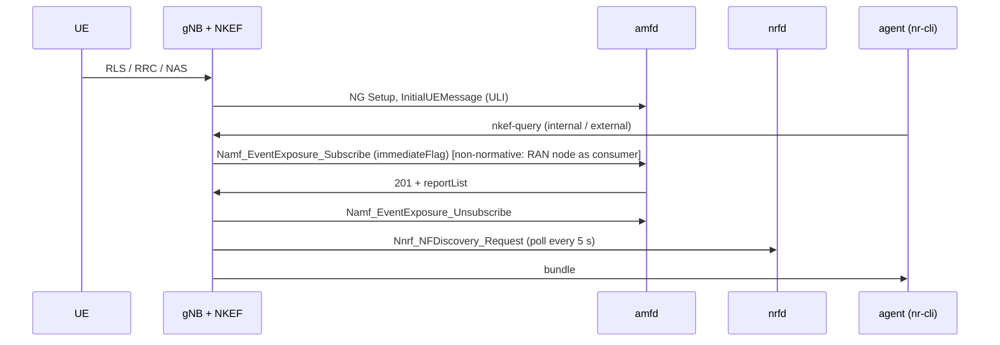

# D447A: live-state knowledge exposure (nkef-live)

Demo key `d447a-nkef-live`, ticket [nextgsim#488](https://github.com/NextgCoreLab/nextgsim/issues/488),
program anchor [#458](https://github.com/NextgCoreLab/nextgsim/issues/458). A supporting
(stage-2) demo: it reads core state and changes no nextgcore behaviour, apart from the
base-core amfd change that records when amfd learnt a UE's location
([nextgcore#1422](https://github.com/NextgCoreLab/nextgcore/pull/1422)).

## Purpose

Show an agent developer that one question to the network returns one token-bounded
bundle of live facts from RAN, N2 and SBA. Each fact is tagged with its domain, its
producer and its age, and a fact expires when its source stops.

**Not the point:** this is not natural-language Q&A and not retrieval-quality research.
Ranking is lexical over about ten entities.

## How it works



- **RAN tee** (RLS task): each measured cell-load window (connected UEs, throughput)
  and each UE's received power and serving cell.
- **N2 tee** (NGAP task): this gNB, the AMF it set up NG with (name, GUAMI) and each
  UE's AMF UE NGAP ID.
- **SBA client** (`nkef/sba.rs`, the #457 h2c client): at every query, a
  Namf_EventExposure subscription to LOCATION_REPORT and CONNECTIVITY_STATE_REPORT
  with `immediateFlag` for the configured SUPI. NKEF reads the `reportList` and
  deletes the subscription at once. The notify URI is a closed loopback port. NKEF
  also polls NRF discovery every `nrf_poll_secs`.
- **Expiry.** The NRF returns only REGISTERED instances. When an NF stops
  heartbeating, the NRF suspends it, the next poll no longer returns it, and its fact
  gets `expired_at`. The fact is kept, so a consumer sees that the NF went away.
- **The join.** The path is `ue>cell>gnb>amf>nf-instance`: the UE's serving cell, this
  gNB, the AMF reached over N2, and the NRF instance whose `amfInfo.guamiList` holds
  that AMF's GUAMI.
- **The header.** `consistent=true` means the AMF's last known NCGI is this gNB's
  cell, with a `ueLocationTimestamp`. `unknown` means there is no timestamped
  location. `stale=true` means the AMF's location predates this run.
- **Consumers.** `internal` sees every fact. `external` gets the TS 23.502 §4.15.7
  shape: `area-N congestion=Low|Medium|High age=…`, with no location and no identity.
  The policy filters before ranking, and the token budget is a hard cap.

### Toggles

| gate | value |
|---|---|
| cargo feature (nextgsim-gnb) | `nkef-sba` (with `6g`, or at least `nextgsim-nkef`) |
| config | `nkef_enabled: true`, an `nkef_live:` block, and `demo: { enabled: true, d447a-nkef-live: { enabled: true, mode: on } }` |
| modes | `on`: the tees and the SBA client feed NKEF. `baseline`: today's NKEF, tees off, nothing live. |
| switching | `nr-cli <gnb> -e "demo d447a-nkef-live set mode=baseline"`, applied from the next query and audited |
| visibility | `WARN DEMO MODE ACTIVE: d447a-nkef-live=<mode>`, `nr-cli <gnb> -e "demo metrics"` → `nextg_demo_enabled{demo="d447a-nkef-live",mode=…} 1`, `[demo:d447a-nkef-live]` log prefix |

An unknown mode fails gNB startup (`DemoConfigError::UnknownMode`), with no fallback.
With `demo.enabled: false`, or no `demo:` block, NKEF answers from an empty store and no
tee sends anything. A default build does not register the demo at all.

CLI: `nkef-query [--as internal|external] <question>` and `nkef-status`.

## How to run it

### Compose

```bash
# 5GC images (nextgcore ./docker/rust/build.sh), and a gNB built with the demo feature:
cargo build --release -p nextgsim-gnb -p nextgsim-cli --features nextgsim-gnb/6g,nextgsim-gnb/nkef-sba
# (copy target/release/nr-gnb to binaries/ and build Dockerfile.gnb-local as nextgsim-gnb:latest)
NEXTGCORE_DIR=../nextgcore NR_CLI=target/release/nr-cli scripts/demo/nkef-check.sh on
NEXTGCORE_DIR=../nextgcore NR_CLI=target/release/nr-cli scripts/demo/nkef-check.sh baseline
```

The stack is nextgcore's standalone `docker-compose.demo-n2ho.yml` with
`config/demo-nkef/compose.override.yml`: one gNB and a stationary UE, with no published
port.

### Revert arms (`scripts/demo/revert-run.sh`)

| patch | expected failure |
|---|---|
| `reverts/447-spawn-order.patch` | the bundle has no live domain (the tees hold a base without the 6G handles) |
| `reverts/447-rls-tee.patch` | no `ran` domain |
| `reverts/447-n2-tee.patch` | no `n2` domain, and the path stops at `cell` |
| `reverts/447-projection.patch` | the external reply leaks |
| amfd without nextgcore#1422 | `consistent=unknown` |

### EKS

`deploy/eks/overlays/demo-d447a-nkef-live` in nextgcore (ClusterIP only), then
`k8s/demo-check.sh d447a-nkef-live <on|baseline|off>`.

## Results

To be filled in from the EKS validation artefacts
(`/tmp/eks-val/demos/d447a-nkef-live/<mode>/`) after the merge. Nothing here is
invented.

## Honesty labels and limitations

- **Echo caveat.** The AMF's NCGI is the ULI this gNB sent, and the SUPI comes from
  NKEF's config. `consistent=true` proves a round trip through the core, **not** an
  independent location fix.
- The NRF's `nfInstanceId` and its suspension of a silent NF **are** an independent
  observer.
- NKEF in the gNB is a **stand-in** for an operator-side exposure function. A RAN node
  is not a Namf_EventExposure consumer (TS 29.518 lists NEF, SMF, UDM, NWDAF, DCCF,
  LMF, TSCTSF and GMLC).
- The load levels are a project-defined rule on measured cell throughput (below 0.05
  Mbit/s Low, below 5 Mbit/s Medium, else High). Under TS 23.502 §4.15.7 the NEF
  derives the NSR from NWDAF User Data Congestion analytics, so this is a departure.
- Freshness, staleness and expiry are project-defined.
- The baseline is today's NKEF, which returns nothing live.
